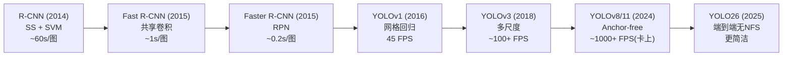
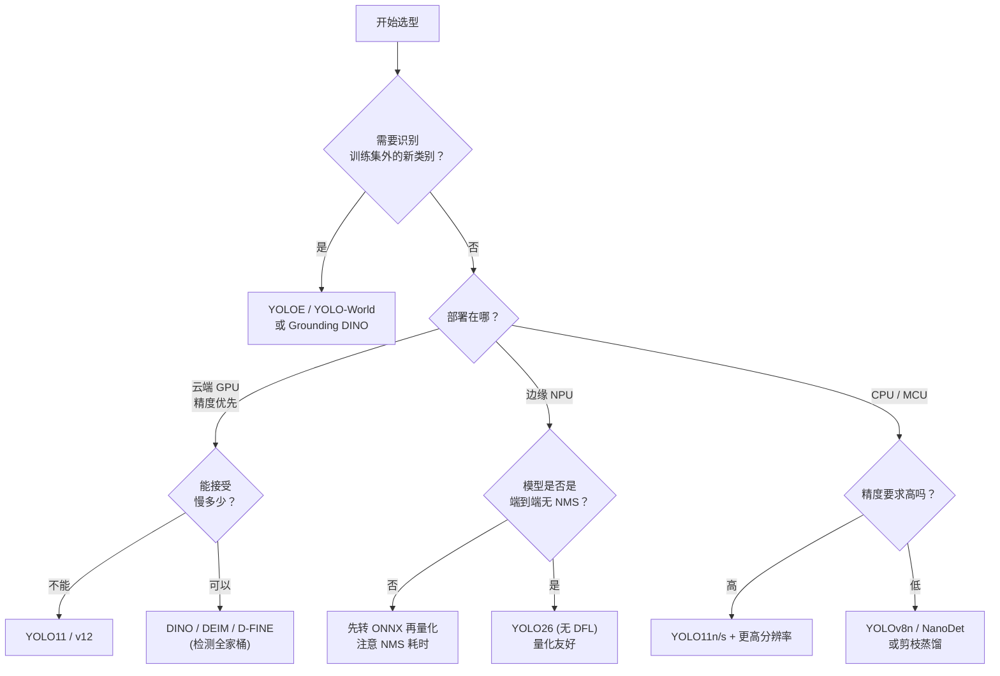

# YOLO 总览与演进史

> **核心问题**：为什么 YOLO 能统治工业界 10 年？为什么它从「学术模型」变成了「事实标准」？

---

## 1. 一句话定义

**YOLO = You Only Look Once**：把目标检测从「先找区域、再分类」的两阶段流程，改造成「一次前向传播同时输出所有目标的位置和类别」的单阶段流程。

这个改写在 2016 年看似只是工程优化，但它改变了检测器的**计算复杂度量级**：

| 范式 | 前向次数 | 与目标数量相关的开销 | 端到端可训练 |
|---|---|---|---|
| 两阶段（R-CNN 系） | 2+ 次（区域提议 → 逐 ROI 分类） | O(N) ROI 分类头 | 端到端（2015 后） |
| 单阶段（YOLO 系） | 1 次 | O(1)（网格大小固定） | 端到端 |
| DETR 系 | 1 次 | O(N²) 注意力（N=查询数） | 端到端（但收敛慢） |

**这就是 YOLO 工业统治力的根源**：在生产环境中，检测器通常要处理视频流，而视频流的上限是摄像头帧率与算力预算。YOLO 的「一次前向」让检测从「重计算」变成「轻计算」，从而**可以叠加在几乎任何后处理链路前面**。

---

## 2. 检测器的三阶段演进（YOLO 视角）



> 上图为逻辑示意，非严格时间轴（YOLOv1 与 Faster R-CNN 几乎同期）。

**关键转折在 2015–2016**：Faster R-CNN 用 RPN 把手工特征换成了学习到的区域提议，精度大幅提升；而 YOLOv1 直接跳过「提议」环节，用回归解决定位。两者的差距在 v3 之后基本抹平（v3 在 COCO 上 33.0 mAP 与 Faster R-CNN 的 41.8 仍有差距，到 v5/v8 时代 YOLO 已经反超）。

---

## 3. 逐代演进：每一代在解决上一代的什么病

### v1（2016）— 建立范式

**做法**：把输入切成 S×S 网格（7×7），每个网格预测 2 个边界框、每个框带 1 个置信度和 20 类概率。

**它解决什么**：两阶段太慢，且区域提议的算力浪费在大量背景区域上。

**它留下什么病**：
- **定位粗糙**：每个格子只出一个中心点，小目标可能完全落在一个格子里而丢失。
- **类别互斥**：一个格子只能负责一个类别。
- **泛化差**：用固定网格尺寸假设物体大小，物体尺寸分布一变就崩。
- **损失不平衡**：定位损失需要 100 倍权重才能压过分类损失。

### v2（2017）— 修正定位与泛化

**关键改动**：
| 改动 | 解决什么 |
|---|---|
| 引入 **Anchor Box**（k-means 聚类得到 5 个先验框） | 网格回归的定位精度天花板被打开 |
| **批归一化 (BN)** | 提升收敛速度与 mAP（+~4%） |
| **多尺度训练** | 解决尺寸泛化，可学习框尺寸 |
| **passthrough 层**（把 26×26×256 与 13×13×512 拼接） | 保留细粒度信息，提升小目标 |
| **WordTree + 联合检测/分类** | 支持 9000 类 |
| 输入 224→416 | 小目标召回改善 |

**结果**：VOC mAP@0.5 从 63.4 → **78.6**，速度 45→21 FPS（换更大输入的代价）。

### v3（2018）— 修小目标

**关键改动**：
| 改动 | 解决什么 |
|---|---|
| **Darknet-53**（残差 + 5 次降采样） | 深层网络可训练 |
| **多尺度预测**（13×13 / 26×26 / 52×52 三张输出图） | v2 只在 13×13 上预测，小目标崩 |
| **每个尺度 3 个 anchor（共 9 个）** | 覆盖小/中/大三档尺寸 |
| 分类改用**独立 Logistic** 而非 Softmax | 多标签场景更合理 |
| **Darknet-19/34 → 53** | 感受野与特征质量提升 |

**遗留问题**：
- **锚框多 = 负样本极多** → 前景/背景极度不平衡。
- 每个位置预测 9 个 anchor，**大量计算浪费在 NMS**。
- 速度虽快但召回仍不及两阶段。

### v4（2020）— 方法论诞生

Bochkovskiy 等人的贡献不在于单个模块，而在于**给「技巧」分了类**：

- **Bag-of-Freebies（BoF）**：只改训练策略、不改推理结构 → 可以零成本迁移到任何模型
  - 数据增强：Mosaic、RandomAffine、MixUp、Cutout、DropBlock
  - 训练技巧：cmBN、权重衰减策略、label smoothing
  - 损失：CIoU、mosaic 目标框构造
- **Bag-of-Specials（BoS）**：只对特定模型有效的结构改动
  - CSPDarknet-53、PANet、Mish 激活、SPP 变体

**这条分类法至今仍是最有用的思维工具**：当你从 YOLOv5 迁移到 YOLOv8 时，你应该带走 BoF，丢掉 BoS。

**结果**：COCO test-dev 43.0% mAP@0.5，1080p GPU 上 77 FPS。

### v5（2020–2022）— 工程化巅峰

Ultralytics 没有发论文（这在学术界是硬伤），但把 YOLO 做成了**工业级代码库**。真正的贡献是**训练配方**：

- **AutoAnchor**：训练前用 k-means 从数据集重算 anchor
- **Mosaic**（4 图拼接）+ **MixUp** + **Copy-Paste**
- **EMA**（指数滑动平均权重）
- **AMP**（混合精度）
- **Cosine LR** + **warmup** + **梯度累积**
- **Focus/CSP/SPPF** 结构
- 完善的 `val / train / hyp 配置分离` 工程体系

### YOLOX（2021）— 学术侧的重要分支

旷视/Meituan 团队路线：
- **解耦头**（Decoupled Head）：分类与回归分支分离 —— 这是 v6 之后被重新证明有效的结构
- **SimOTA** 动态标签分配
- **Anchor-free** + **多尺度标签分配**

YOLOX 证明了：**解耦头 + Anchor-free** 是更好的组合**，这直接影响了 YOLOv6 和 YOLOv8。

### v6（2021–2022）— 工业效率优先

美团自研，主打「部署效率」：
- **EfficientRep** 块：训练时多分支、推理时重参数化为纯卷积（类似 RepVGG）
- **TAL（Task-Aligned Assigner）**：把 YOLOX 的 SimOTA 升级成任务对齐版本
- **解耦头**回归
- **自蒸馏策略**（用自身大模型微调小模型）
- **小模型专门优化**：v6-N 在 CPU 上也能跑实时

### v7（2022）— 训练结构的极致挖掘

**不引入推理时代价的新模块**，只改训练：
- **可训练 Bag-of-Freebies**：辅助头（粗检测头指导细检测头）、重参数化卷积、缩放策略
- **模型缩放方法**：concat 模型的所有层而非宽度，普通卷积与 RepConv 分配通道
- **辅助头 + lead head**：训练时用粗头引导，头部输出更准

### v8（2024）— 收敛与简化

- **C2f**（CSP Bottleneck ×2）
- **解耦头**（延续 YOLOX/v6 路线，v5 时代的耦合头被弃用）
- **Anchor-free 回归**：每位置直接预测到 4 条边的距离（DFL）
- **新标签分配**：TAL TopK
- **mosaic 训练收尾**（最后 10 epoch 关闭 mosaic）
- **可替换模块化架构**（`ultralytics` 包，YOLOv5 不是）

### v9（2024）— 梯度信息流

WongKinYiu（v6/v7 作者）回归，主张「**别堆模块，要修梯度信息流**」：
- **PGI（Programmable Gradient Information）**：多分支特征聚合，提供可控的梯度路径
- **GELAN**：更高效的特征聚合网络
- 结果：在同等算力下超过 v8

### v10（2024）— 干掉 NMS

清华 MIG 团队，**NMS-free 端到端**：
- **一致双分支标签分配**：训练时「一对多」分支提供密集正样本梯度，「一对一」分支匹配推理时的输出结构
- **一对一分配**：每个真值框只匹配一个预测，去重天然完成
- **结果**：YOLOv10-S 比 YOLOv8-S 快 1.8×，且 mAP 更高

### v11（2024）— 新一轮起点

- **C3k2**：把 C2f 中的 bottleneck 换成 C3k（自研的小核并行分支）
- **C2PSA**：在 C2 块后接 PSA（Position Sensitive Attention）块
- 延续 anchor-free + 解耦头 + DFL
- 保持工程易用性（`pip install ultralytics`）

### YOLOE（2025）— 开放词汇

阿里通义团队，解决「闭集 YOLO 无法识别新类别」：
- **分离视觉/文本编码**：文本侧不参与推理时可预计算
- **提示切换（Prompt Switching）**：用**潜在空间**对齐不同任务的文本提示，无需重训即可换任务
- **LSE（Latent Space Alignment）**：统一不同提示下的特征空间
- 支持开放词汇 + 密集文本提示

### v12（2025）— 注意力中心

- 把注意力引入主干与颈部，**在注意力有益处的地方替代卷积**
- **A2C（Attention-to-Convolution）**：用 FlashAttention 实现的高效注意力替代局部卷积
- 移除了部分卷积，推理更省
- **移除 DFL**？（这一点在 v12 与 v26 之间有混淆，见 §5 说明）

### v26（2025）— 端到端 + 去 DFL

- **默认端到端、无 NMS**
- **移除 DFL（Distribution Focal Loss）**：回归头直接输出 4 个边距值，头部大幅简化
- **ProgLoss** + **STAL（Stable Loss Assignment）**：稳定的标签分配
- **MuSGD** 优化器：Nesterov 动量 + 自适应学习率
- 对**小目标与密集场景**显著改善

---

## 4. YOLO 的「统一视角」：所有版本都是同一套骨架

剥掉版本差异，YOLO 的骨架几乎没变：

```
输入图像 (H×W×3)
   ↓
[ Backbone ]        特征提取：Conv / C3k2 / C2f / RepConv / Attention
   ↓               产出 C3, C4, C5 三级特征图（步长 8/16/32）
[ Neck ]            特征融合：PAN / FPN + Concat
   ↓               产出 P3, P4, P5 三个尺度的融合特征
[ Head ] × 3        检测头：解耦（分类分支 / 回归分支）
   ↓               每尺度输出 (4 × reg_max) 边距 + num_classes 类别
[ 后处理 ]          Anchor-free: 直接 decode + NMS / 端到端: 一对一直接出框
```

**变的是**：Backbone 的瓶颈块、Neck 的融合方式、Head 的回归表示、标签分配算法、后处理方式。

**没变的是**：这个骨架。

> **工程结论**：升级 YOLO 版本时，先画出自己模型的骨架图，对比新旧版本，差异一目了然。90% 的「升级没效果」问题，都是骨架没对齐（比如新版本是 anchor-free 而你还在按 anchor 的方式解析输出）。

---

## 5. 常见混淆点澄清

| 混淆 | 澄清 |
|---|---|
| YOLOv5 是 v5 之后的官方版本吗？ | YOLOv5 是 Ultralytics 独立项目，与 v1–v4 无继承关系。YOLOv6/v7 是其他团队的平行作品 |
| YOLOv8 官方发论文了吗？ | 没有。Ultralytics 从 v5 起就没有配套论文 |
| YOLOv10 是 YOLOv8 的升级吗？ | 不是。YOLOv10 是清华 MIG 的独立项目，代码在 `THU-MIG/yolov10` |
| YOLO12 移除了 DFL 吗？ | **YOLO26** 才是移除 DFL 的版本。YOLO12 保留 DFL，改进的是主干/颈部与注意力结构 |
| YOLOE 和 YOLO-World 是一回事吗？ | 不是。YOLO-World 用 CLIP 文本编码器（需在线编码文本），YOLOE 用潜在空间对齐实现**零重训**的任务切换 |
| YOLOv9 和 v8 谁更强？ | 同算力下 v9 略强；但 v8 的工程生态、导出链路成熟度远好于 v9 |

---

## 6. 选型决策树



---

## 7. 工程结论

1. **YOLO 的价值不在单个版本，在于它的「可组合性」**：BoF（训练技巧）可以移植到任意检测器上。看到一个论文的技巧时，先问「这是 BoF 还是 BoS」。
2. **换版本时优先核对三件事**：标签分配算法、回归表示（DFL / 直接边距）、后处理（NMS / 端到端）。这三点决定了你的解析代码和量化精度。
3. **别迷信「最新」。** YOLOv10/v26 的 NMS-free 在训练和部署链路上是范式变化，如果你现有流水线重度依赖 NMS 后处理，迁移成本要算清楚。
4. **YOLO 不擅长**：密集小目标（航拍、细胞）、长尾类别、需要精确形状（用分割模型）、开放词汇。选型前先看任务是否在 YOLO 的能力边界内。

---

## 🔗 下一步

- 想看每个版本的实现细节 → [`02-YOLOv1-v3奠基期.md`](./02-YOLOv1-v3奠基期.md)
- 想理解模块数学 → [`06-YOLO关键模块与算法.md`](./06-YOLO关键模块与算法.md)
- 想直接上手 → [`09-复现手册与避坑.md`](./09-复现手册与避坑.md)
