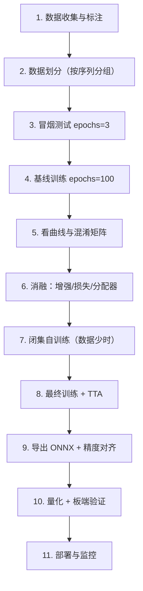

# 复现手册与避坑

> **核心问题**：从零开始跑通一个 YOLO 项目，会遇到哪些具体的坑？

---

## 1. 环境搭建

### 1.1 最小可复现环境

```bash
# Python 3.10~3.12（3.12 对 torch 2.6+ 支持好）
conda create -n yolo python=3.11 -y
conda activate yolo

# PyTorch（按你的 CUDA 版本选）
pip install torch torchvision --index-url https://download.pytorch.org/whl/cu121
pip install ultralytics
```

**验证**：

```python
import torch, ultralytics
print(torch.__version__, torch.cuda.is_available())
print(ultralytics.__version__)
```

### 1.2 依赖清单（Ultralytics）

```
ultralytics>=8.3        # 主包
torch>=1.8, torchvision
numpy>=1.23.0
opencv-python>=4.6.0
pillow>=10.0.1
pyyaml>=6.0
requests>=2.32.2
tqdm>=4.66.3
scipy>=1.4.1
matplotlib>=3.7.0
psutil
py-cpuinfo
pandas>=1.1.4
seaborn>=0.11.0
ultralytics-thop>=2.0.0
```

### 1.3 验证 COCO 官方权重的基线

```bash
# 这一步必做：确认环境和权重链路正常
yolo predict model=yolo11s.pt source='https://ultralytics.com/images/bus.jpg' save=True
```

**预期**：`runs/predict/bus.jpg` 里应画出「4 个乘客 + 1 辆公交车」。

**如果这一步就出问题**，先别往下走。

---

## 2. 数据集准备

### 2.1 目录结构（YOLO 格式）

```
datasets/
└── mydata/
    ├── images/
    │   ├── train/     000001.jpg ...
    │   ├── val/       000001.jpg ...
    │   └── test/      000001.jpg ...
    └── labels/
        ├── train/     000001.txt ...
        ├── val/       000001.txt ...
        └── test/      000001.txt ...
```

**关键规则**：
- 图片和标签**同名同扩展名**（`.jpg` ↔ `.txt`）
- 标签是 **VOC 格式但归一化**：`class x_center y_center width height`，取值 0~1
- 类别 id 从 **0** 开始，连续
- **没有目标的图片**对应一个**空标签文件**（0 字节），不能不放

### 2.2 数据集 YAML

```yaml
# mydata.yaml
path: D:/datasets/mydata        # 数据集根目录
train: images/train              # 相对 path
val: images/val
test: images/test                # 可选

# 类别名（顺序 = 类别 id）
names:
  0: person
  1: car
  2: dog
```

**注意**：
- `path` 用**正斜杠**，Windows 下也写 `D:/datasets/mydata`
- `names` 可以写成 dict（带 id）或 list（顺序即 id），新版推荐 dict

### 2.3 格式转换工具

| 来源格式 | 工具 |
|---|---|
| VOC XML | `labelImg` 标注 → 导出 YOLO；或用脚本转换 |
| COCO JSON | `yolo detect convert --data coco8.yaml --format coco --out yolo_labels/` |
| Pascal VOC | `yolo detect convert --data voc.yaml --format voc` |
| 自己的 DB | 写脚本 |

**COCO JSON → YOLO 的手工转换脚本**：

```python
import json, os, pathlib

def convert_coco_to_yolo(coco_json, img_dir, out_dir):
    with open(coco_json) as f:
        data = json.load(f)
    # id -> filename
    id2name = {img['id']: img['file_name'] for img in data['images']}
    W, H = data['images'][0]['width'], data['images'][0]['height']
    # cat id -> contiguous class id
    cat_ids = sorted(c['id'] for c in data['categories'])
    cat2cls = {c: i for i, c in enumerate(cat_ids)}

    os.makedirs(out_dir, exist_ok=True)
    anns_by_img = {}
    for a in data['annotations']:
        anns_by_img.setdefault(a['image_id'], []).append(a)

    for img_id, anns in anns_by_img.items():
        name = id2name[img_id]
        lines = []
        for a in anns:
            if a.get('iscrowd', 0):     # 跳过 crowd 标注
                continue
            x, y, w, h = a['bbox']
            cx, cy = (x + w/2)/W, (y + h/2)/H
            lines.append(f"{cat2cls[a['category_id']]} {cx:.6f} {cy:.6f} {w/W:.6f} {h/H:.6f}")
        with open(os.path.join(out_dir, os.path.splitext(name)[0] + '.txt'), 'w') as f:
            f.write('\n'.join(lines))
```

---

## 3. 训练

### 3.1 第一次训练（基线）

```bash
# 预训练权重起步
yolo detect train \
    model=yolo11s.pt \
    data=mydata.yaml \
    epochs=100 \
    imgsz=640 \
    batch=16 \
    device=0 \
    workers=8 \
    project=runs/exp1 \
    name=baseline \
    exist_ok=True
```

**参数解释**：

| 参数 | 说明 |
|---|---|
| `epochs` | 100 是通用起点；小数据集可 150~300，大数据集 50~100 |
| `batch` | GPU 显存 / 2 大概是上限（V100 32G 可以到 64+） |
| `workers` | Windows 上建议 4~8，太高会 multiprocessing 报错 |
| `device` | `0` / `0,1` / `cpu` / `0,1,2,3` |
| `cache` | 数据小的时候 `cache=ram` 加速很多 |
| `patience` | 早停 patience，默认 100（几乎等于不早停） |

### 3.2 关键：先跑 3 个 epoch 看曲线

```bash
# 冒烟测试
yolo detect train model=yolo11s.pt data=mydata.yaml epochs=3 imgsz=640 batch=8 name=smoke
```

**检查**：
1. `runs/exp/smoke/results.png` 曲线是否正常（loss 下降）
2. `runs/exp/smoke/train_batch0_labels.jpg` —— **标签叠加图是否正确**
3. 显存是否够

### 3.3 恢复训练

```bash
# 从 last.pt 恢复（含 optimizer 状态）
yolo detect train model=runs/exp1/baseline/weights/last.pt resume=True

# 从 best.pt 继续训练（优化器状态重置）
yolo detect train model=runs/exp1/baseline/weights/best.pt data=mydata.yaml epochs=50
```

### 3.4 多卡训练

```bash
# DDP
yolo detect train model=yolo11s.pt data=mydata.yaml epochs=100 batch=16 device=0,1,2,3
```

**注意**：
- Windows 原生支持 DDP（Ultralytics 会 spawn 进程）
- 多卡时 `batch` 是**总 batch**，每卡 `batch/num_gpus`
- 多卡需要 `if __name__ == '__main__':` 保护（Ultralytics 自动处理）

### 3.5 分布式训练脚本

```python
# train.py
from ultralytics import YOLO

if __name__ == '__main__':
    model = YOLO('yolo11s.pt')
    model.train(data='mydata.yaml', epochs=100, imgsz=640, batch=16, device='0,1')
```

---

## 4. 验证与推理

### 4.1 验证

```bash
yolo detect val model=runs/exp1/baseline/weights/best.pt data=mydata.yaml imgsz=640
```

**关键指标解读**：

| 指标 | 含义 | 注意 |
|---|---|---|
| `mAP50` | IoU=0.5 的平均精度 | 工业界常用 |
| `mAP50-95` | IoU 0.5~0.95 平均 | **衡量定位精度**，模型间比较看这个 |
| `precision` | TP/(TP+FP) | 误检控制 |
| `recall` | TP/(TP+FN) | 漏检控制 |
| `F1` | precision 和 recall 的调和平均 | 阈值依赖 |
| `class_error` | 分类错误率（框对但类别错） | 反映分类头质量 |

### 4.2 推理

```bash
# 图片
yolo detect predict model=best.pt source=test.jpg conf=0.25 save=True

# 视频（带进度条）
yolo detect predict model=best.pt source=video.mp4 conf=0.25 save=True

# 摄像头
yolo detect predict model=best.pt source=0 show=True

# 目录
yolo detect predict model=best.pt source=images/ save=True

# 上传的文件
yolo detect predict model=best.pt source=image.jpg save=True
```

### 4.3 Python API

```python
from ultralytics import YOLO
import cv2

model = YOLO('best.pt')

# 单图
results = model('test.jpg', conf=0.25, iou=0.7, imgsz=640)

# 拿结构化结果
for r in results:
    boxes = r.boxes
    print(f"检测到 {len(boxes)} 个目标")
    for b in boxes:
        cls = int(b.cls.item())
        conf = float(b.conf.item())
        xyxy = b.xyxy[0].tolist()      # 像素坐标
        names = r.names
        print(f"  {names[cls]}: {conf:.2f} @ {xyxy}")

    # 画框
    annotated = r.plot()               # BGR numpy array

# 视频流
cap = cv2.VideoCapture(0)
while cap.isOpened():
    ok, frame = cap.read()
    if not ok: break
    r = model(frame, conf=0.25)[0]
    cv2.imshow('detect', r.plot())
    if cv2.waitKey(1) == 27: break
cap.release()
```

### 4.4 推理参数调优

| 参数 | 默认 | 说明 |
|---|---|---|
| `conf` | 0.25 | 置信度阈值。**漏检多 → 降低；误检多 → 提高** |
| `iou` | 0.7 | NMS 的 IoU 阈值。密集目标场景要降低（0.45~0.55），否则相邻目标被误合并 |
| `max_det` | 300 | 最大检测数。密集场景要提高 |
| `imgsz` | 640 | 推理尺寸 |
| `agnostic` | False | 类别无关 NMS。**多类别同位置目标必须设 True** |
| `half` | False | FP16 |
| `rect` | True | 矩形推理（减少 padding） |
| `classes` | None | 只检测指定类别 `[0, 2, 5]` |
| `retina_masks` | False | 分割时用更高分辨率的 mask |

---

## 5. 60+ 条实战避坑清单

### 5.1 数据与标签

| # | 坑 | 症状 | 解法 |
|---|---|---|---|
| 1 | 标签是像素值不是归一化值 | mAP 接近 0 | 确认 `0~1` |
| 2 | 类别 id 从 1 开始 | 部分类别学不出来 | 从 0 开始 |
| 3 | 图片与标签文件名不一致 | 部分图不被训练 | 严格同名 |
| 4 | 缺标签文件（无目标图） | 报错或图被忽略 | 无目标图放空 txt |
| 5 | `names` 顺序和实际 id 不符 | 类别全错位 | 核对 yaml |
| 6 | 训练集和验证集有重复图 | val mAP 虚高 | 去重（用感知哈希） |
| 7 | 验证集太小（<50 张） | mAP 波动巨大 | 至少 200~500 张 |
| 8 | 类别分布极度不均衡 | 长尾类 recall=0 | 过采样或用 copy_paste |
| 9 | 负样本（背景图）没放 | 误检多 | 加一批纯背景图 |
| 10 | 标注框明显错误（框到背景） | 训练不收敛 | 人工抽查 50 张 |
| 11 | 混淆类别标签 | mAP 上不去 | 合并标签或重新定义 |
| 12 | 同一个物体有多个标注框 | 标签冲突 | 去重 |

### 5.2 训练

| # | 坑 | 症状 | 解法 |
|---|---|---|---|
| 13 | 没用预训练权重 | 收敛慢、mAP 低 | 用 `.pt` 不用 `.yaml` |
| 14 | batch 太小 + lr0 太大 | loss 震荡不下降 | 降 lr0 或加梯度累积 |
| 15 | 增强过强 | mAP 反而低 | 逐个关闭增强测 |
| 16 | 忘了 `close_mosaic` | 少 0.5~1 mAP | 设 `close_mosaic=10` |
| 17 | 小数据集用默认 100 epoch | 过拟合 | 150~300 epoch + 增强 |
| 18 | 大数据集用太多 epoch | 浪费 | 50~100 |
| 19 | 没有 `cache` | 训练慢 | `cache=ram`（数据小） |
| 20 | `workers` 太高（Windows） | multiprocessing 崩溃 | 降到 4~8 |
| 21 | 忘记 `model.train()` 后 `val()` | 指标差 | 用 `model.val()` |
| 22 | 训练完直接用 `last.pt` | 精度略低 | 用 `best.pt`（按 fitness 选） |
| 23 | `best.pt` 是按 mAP50-95 选的 | 不符合业务 IoU 要求 | 手动按 mAP50 挑 |
| 24 | 数据泄漏（同一视频的帧分到 train/val） | val 虚高 | **按视频/序列分组划分** |
| 25 | 未固定随机种子 | 结果不可复现 | `seed=0`（Ultralytics 默认） |
| 26 | CUDA OOM | 训练崩溃 | 降 batch / `imgsz` / 开 AMP |
| 27 | AMP 下 loss 出现 NaN | 训练崩溃 | 检查数据，退回 FP32 |
| 28 | 标签文件有 BOM 头 | 第一类学不出来 | 存为 UTF-8 无 BOM |
| 29 | 标签文件有 CRLF | 部分行解析异常 | 转 LF |
| 30 | 类别名里有中文/特殊字符 | yaml 解析异常 | 用英文或加引号 |

### 5.3 推理与部署

| # | 坑 | 症状 | 解法 |
|---|---|---|---|
| 31 | 训练和推理 `imgsz` 不一致 | 精度掉 | 一致 |
| 32 | 训练用 letterbox，推理用 resize | 精度掉 | 用同样的 letterbox |
| 33 | 通道序 BGR/RGB 搞反 | 输出完全乱 | 确认 `bgr=True/False` |
| 34 | `conf` 太高 | 漏检 | 降到 0.25 |
| 35 | `iou` 太高 | 密集目标被合并 | 降到 0.45 |
| 36 | 密集场景忘了 `agnostic=True` | 跨类 NMS 误杀 | 设 `agnostic=True` |
| 37 | 导出后 mAP 掉很多 | 导出问题 | 逐层对比，opset 降到 12 |
| 38 | 导出时开了 `dynamic=True` | RKNN 不支持 | 关掉 |
| 39 | NMS 在 ONNX 图内 | NPU 不支持该算子 | 端到端模型或分离导出 |
| 40 | 重参数化模块没 `fuse()` | 板端特别慢 | `model.fuse()` |
| 41 | RKNN `target_platform` 填错 | 板端报错/极慢 | 填准确的 SoC 名 |
| 42 | toolkit 和 runtime 版本不一致 | 加载失败 | 严格对齐版本 |
| 43 | 校准集不具代表性 | INT8 精度掉 | 用真实场景数据校准 |
| 44 | 板端预处理与训练不一致 | 输出异常 | 用 PIL + 同一份 JSON 契约 |
| 45 | 板端用 `cv2.resize` | 精度掉 | 用 PIL（BILINEAR） |
| 46 | 板端计时没预热 | 测出虚假的高延迟 | 预热 20 次 |
| 47 | 用 `/proc/stat` 测 CPU 占用 | 假值 | 最小窗口 0.5s + 交叉验证 |
| 48 | 检查 `/dev/rknpu` 判断 NPU | 误报不可用 | 查 `/dev/dri/renderD129` |
| 49 | 视频推理逐帧同步读 | 吞吐上不去 | 用多线程读帧 + 缓冲队列 |
| 50 | 视频推理没丢帧 | 延迟累积 | 队列满时丢旧帧 |

### 5.4 评估与解读

| # | 坑 | 症状 | 解法 |
|---|---|---|---|
| 51 | 只看 mAP50 | 模型定位很差 | 同时看 mAP50-95 |
| 52 | 不同版本口径的 mAP 直接比 | 结论错误 | 统一输入尺寸/后端/数据集 |
| 53 | 拿 YOLOv5 的数字和 YOLOv8 比 | 误判 | 同表对比 |
| 54 | 不做消融 | 不知道哪个改动有效 | 一次只改一个变量 |
| 55 | 在 val 上反复调超参 | 过拟合 val | 留 test 集 |
| 56 | 类别不均衡时看总体 mAP | 掩盖问题 | 看 per-class AP |
| 57 | 只看总体指标 | 不知道哪里不行 | 看混淆矩阵 `confusion_matrix.png` |
| 58 | 没看 PR 曲线 | 不知道阈值怎么定 | 看 `PR_curve.png` |

---

## 6. 诊断速查表

| 症状 | 最可能原因 | 排查顺序 |
|---|---|---|
| mAP = 0 | 标签格式/路径错 | 看 `train_batch0_labels.jpg` |
| mAP 极低（<10） | 类别 id 错位 / 全是背景 | 打印几行标签核对 |
| loss 不下降 | lr 太大 / 数据有问题 | 降 lr、跑 3 epoch 看曲线 |
| 训练 loss 低 val loss 高 | 过拟合 | 加增强、加数据、减 epoch |
| recall 高 precision 低 | 误检多 | 提高 conf、检查负样本 |
| precision 高 recall 低 | 漏检多 | 降 conf、加数据、增强 |
| 框位置整体偏移 | letterbox 参数不一致 | 对比训练/推理预处理 |
| 类别全预测为背景 | 标签和图错位 | 检查文件配对 |
| 换数据集后完全不收敛 | AutoAnchor 没跑（v5）/ TAL 参数不适配 | v8 用 anchor-free；调 TAL topk |
| 导出后掉点严重 | opset 太高 / simplify / 预处理 | 逐层对比 |
| 板端输出乱 | 预处理不一致 / 版本不匹配 | 对比参考输入 npy |

---

## 7. 一个完整的项目落地流程



**每一步的产出物**（建议都存档）：
- 数据集版本号 + 标注规范文档
- 训练配置文件（yaml）
- `results.png` / `confusion_matrix.png` / `PR_curve.png`
- `best.pt` + 其验证指标 JSON
- ONNX + 精度对齐报告
- RKNN + 板端验证报告

---

## 8. 工程结论

1. **前 3 个 epoch 的冒烟测试能省你 2 小时**。绝大多数「训练不work」的问题在第 3 个 epoch 就暴露了。
2. **看 `train_batch0_labels.jpg`**。这是 YOLO 生态最被低估的调试工具，能一眼看出标签格式、类别 id、框位置三大类问题。
3. **一次只改一个变量**。同时改增强和模型，你就永远不知道是哪个起了作用。
4. **数据集划分按序列分组**，不是按帧随机。这是视频类数据集 val 虚高的头号原因。
5. **把预处理写成契约文件**，训练端和部署端读同一份。这是边缘部署最有效的工程实践。
6. **记录每一步的数字**。三个月后你会感谢自己。

---

## 🔗 相关

- 训练参数详解 → [`07-训练调参与数据增强.md`](./07-训练调参与数据增强.md)
- 部署链路 → [`08-导出部署与推理加速.md`](./08-导出部署与推理加速.md)
- 数据集格式 → [`../02-视觉检测模型/12-数据集大全.md`](../02-视觉检测模型/12-数据集大全.md)
