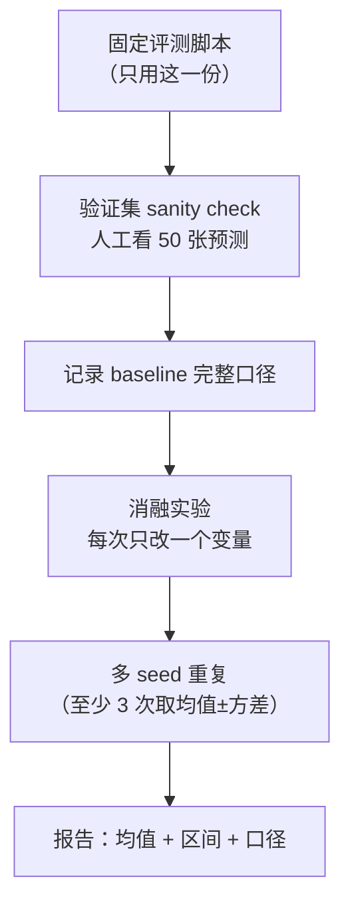

# 任务定义与评测体系

> **核心问题**：mAP 到底在算什么？为什么两个「都是 45 mAP」的模型可能天差地别？

---

## 1. 任务定义

**目标检测（Object Detection）**：在图像中定位并分类**任意数量**的感兴趣目标。

**输出形式**：
$$
\mathcal{D} = \{(b_i, c_i, s_i)\}_{i=1}^{N}, \quad
b_i = (x_1, y_1, x_2, y_2), \ c_i \in \{1..C\}, \ s_i \in [0,1]
$$

**与相关任务的边界**：

| 任务 | 输出 | 与检测的关系 |
|---|---|---|
| 图像分类 | 1 个类别 | 检测的特例（整图一个框） |
| 语义分割 | 像素级 mask | 无实例区分 |
| 实例分割 | 每个实例的像素 mask | 检测 + mask 分支 |
| 全景分割 | 语义 + 实例 | 统一框架 |
| 关键点检测 | 每个实例的关节点 | 检测 + 关键点头 |
| 目标跟踪 | 跨帧的 ID 关联 | 检测 + 关联 |
| 3D 检测 | 3D box | 检测在 3D 空间 |
| 开放词汇检测 | 文本指定的任意类别 | 类别空间开放 |

---

## 2. IoU：一切的起点

$$
\text{IoU}(A, B) = \frac{|A \cap B|}{|A \cup B|}
$$

### 2.1 为什么 IoU 阈值是 0.5

IoU 阈值定义了「两个框算不算同一个物体」的判定。

- **0.5** 是 2014 年 PASCAL VOC 的约定，**沿用了 12 年**
- 直观理解：预测框覆盖了 GT 一半以上，且 GT 覆盖了预测框一半以上
- COCO 保留了 0.5，并**新增**了 0.55~0.95 的细粒度评估

### 2.2 IoU 的问题

**IoU 对尺度不敏感**：
```
预测框 10×10，GT 20×20，重叠 10×10：
  IoU = 100 / (100 + 400 - 100) = 0.25
```
IoU 无法区分「中心偏移」和「尺度错误」，训练梯度不稳定。

**解法链**：IoU → GIoU（加最小包围框）→ DIoU（加中心距）→ CIoU（加宽高比）→ SIoU/EIoU/WIoU（更多细化）

详见 [`11-损失函数与样本分配.md`](./11-损失函数与样本分配.md)。

---

## 3. 精确率-召回率

### 3.1 定义

给定置信度阈值 $t$：

$$
\text{TP}(t) = \#\{i : s_i \ge t, \text{与 GT 匹配}\}
$$
$$
\text{FP}(t) = \#\{i : s_i \ge t, \text{无 GT 匹配}\}, \quad
\text{FN}(t) = \#\{\text{GT 未被匹配}\}
$$

$$
\text{Precision} = \frac{TP}{TP + FP}, \qquad
\text{Recall} = \frac{TP}{TP + FN}
$$

### 3.2 PR 曲线

遍历所有置信度阈值，画出 (Recall, Precision) 轨迹。

**关键理解**：**AP = PR 曲线下的面积**（实际用插值法）。

$$
AP = \sum_k (R_k - R_{k-1}) P_k
$$

其中 $R_k$ 是 recall 变化点，$P_k$ 是该点对应的**插值精度**（右侧最大值）。

---

## 4. AP 的严格定义（COCO 方式）

### 4.1 COCO 的 101 点插值

COCO 使用 **101 个 recall 取值点** $\{0, 0.01, ..., 1\}$：

$$
AP = \frac{1}{101}\sum_{r} \max_{\tilde{r} \ge r} P(\tilde{r})
$$

即在每个 recall 点取「该点右侧的最大 precision」。

**与 VOC 2007 的区别**：
- VOC 2007：直接积分 PR 曲线（连续）
- VOC 2010+ / COCO：全部点插值

### 4.2 按 IoU 阈值分别计算

COCO 在 10 个 IoU 阈值 $\{0.50:0.05:0.95\}$ 上分别计算 AP，然后平均：

$$
\text{mAP} = \frac{1}{10}\sum_{t=0.5,0.55,...,0.95} AP(t)
$$

**这就是 `mAP@0.5:0.95` 的来源。**

### 4.3 AP 的三个分解

COCO 官方提供三个维度的细分：

| 指标 | 定义 | 用途 |
|---|---|---|
| **AP** | 全尺度综合 | 主指标 |
| **AP50** | 只在 IoU=0.5 | 宽松，看「检出率」 |
| **AP75** | 只在 IoU=0.75 | 严格，看「定位质量」 |
| **AP_s** | 面积 < 32² | 小目标 |
| **AP_m** | 32² ≤ 面积 ≤ 96² | 中目标 |
| **AP_l** | 面积 > 96² | 大目标 |

**新版本 COCO API 还提供**：
- `AP_medium`、`AP_large`
- `AR`（Average Recall）：每个图最多 100 个检测框时，召回曲线的面积

### 4.4 AR 的意义

$$
AR = \frac{1}{10}\sum_{t} \max_{n \in \{1, 10, 100\}} \text{Recall}(n, t)
$$

**AR 是「检出能力」的指标**，与误检无关。在「安全关键」场景（漏检代价 >> 误检代价），AR 比 AP 更重要。

---

## 5. LVIS：长尾检测的联邦评测

**论文**：*LVIS: A Dataset for Large Vocabulary Instance Segmentation*, arXiv:1905.02193

### 5.1 问题

COCO 的 80 类在长尾场景下不够用。LVIS 有 **1200+ 类**，但极度长尾：

- 平均每个类别只有 **10 个训练样本**
- 少数类别只有 1~5 个

**这直接导致「mAP 掩盖了严重问题」**：一个模型在 1000 个尾部类上完全失效，但在 200 个头部类上表现很好，总 mAP 看起来仍然不错。

### 5.2 联邦评测（Federated Evaluation）

LVIS 提出的方案：**按类别频率分组，分别计算 AP，再加权平均**。

$$
\text{AP}_{\text{fed}} = \frac{1}{|C|}\sum_{c \in C} \frac{1}{|I_c|}\sum_{i \in I_c} \text{AP}(i, c)
$$

其中 $I_c$ 是包含类别 $c$ 的所有图像集合。

**关键区别**：
- 普通 AP：先对所有 (图像, 类别) 对求平均 → **频繁图像主导结果**
- 联邦 AP：**先按类别分组，组内平均，再对类别平均** → **每个类别权重相同**

### 5.3 LVIS AP 的三个指标

| 指标 | 定义 |
|---|---|
| **AP** | 联邦 AP，主指标 |
| **AP_r / AP_c / AP_f** | rare (1~10 样本) / common (11~100) / frequent (>100) |
| **AP50 / AP75** | 不同 IoU 阈值 |

**读 LVIS 结果表时，务必先看 AP_r**。这是检测器长尾能力的唯一诚实指标。

---

## 6. 常见评测口径陷阱

### 6.1 「同一模型，不同 mAP」的六个原因

| 原因 | 说明 |
|---|---|
| **数据集划分** | train2017 vs train+val2017 vs 全部 |
| **测试集** | `val` vs `test-dev` vs `test` |
| **输入尺寸** | 640 vs 1280 能差 3~5 mAP（小目标尤其） |
| **后处理** | 是否含 NMS、conf 阈值、iou 阈值 |
| **TTA** | 多尺度 + 翻转通常 +1~2 mAP |
| **单卡 vs 多卡** | BN 统计量不同（多卡 SyncBN 精度通常更高） |
| **额外数据** | 用了 Open Images / 预训练数据 |

**结论**：**引用 mAP 必须带全部口径**，否则数字无意义。

### 6.2 `test-dev` vs `val` vs `test`

| 集合 | 说明 |
|---|---|
| `val2017` | 5000 张，公开标注，**论文最常用** |
| `test-dev` | 20288 张，标注不公开（提交到 CodaLab 评测） |
| `test` | 40670 张，**提交次数有限**（每半年 5 次） |

**注意**：COCO 官方 API 对 `test-dev` 和 `test` 的计算方式**与 `val` 略有不同**（加入了 maxDets=100 的处理差异），所以 val 和 test-dev 的数字不完全可比。

### 6.3 `maxDets` 参数

COCO 评测的 `maxDets` 默认 `[1, 10, 100]`。这个参数影响：
- `AP`：用 100
- `AR`：对 1/10/100 分别算

**实践影响**：密集场景（货架、 crowd）如果 `maxDets=100` 截断了，正确框被丢弃 → AP 虚低。可以调大到 300~500。

### 6.4 评估时的预处理必须与训练一致

```
训练用 letterbox（pad 到方形）→ 评估也必须 letterbox
训练用 rect=True（不 pad）→ 评估也要一致
```

**Ultralytics 的 `val()` 默认 `rect=True`**，而 `train()` 时用 letterbox。这个差异是有意为之（推理时不需要 pad，节省算力），但**如果你自己写评估脚本，务必对齐**。

---

## 7. 速度指标

### 7.1 FPS vs 延迟

| 指标 | 定义 | 注意 |
|---|---|---|
| **FPS** | 每秒帧数（= 1000 / 延迟ms） | 流水线场景下 ≠ 端到端延迟 |
| **延迟 (Latency)** | 单帧从输入到输出 | 真正影响交互体验 |
| **吞吐 (Throughput)** | batch=32 时的 fps | 高吞吐 ≠ 低延迟 |

**常见误区**：batch=32 测出 200 FPS，不代表单帧延迟是 5ms（实际可能是 30ms，因为要等 batch 填满）。

### 7.2 延迟的构成

```
端到端延迟 = 预处理 + 前向 + 后处理 + 图像传输/显示

常见占比（YOLOv8n, 640, RTX 3060）：
  预处理 (CPU, letterbox):  0.8 ms
  GPU 前向:                 2.1 ms
  GPU→CPU 拷贝:             0.5 ms   ← 常被忽略
  解码 (xyxy 转换):         0.6 ms
  NMS (CPU):                1.8 ms   ← 常被低估
  画框/编码:                0.8 ms
  ─────────────────────────────
  总计:                     6.6 ms
```

**关键**：
1. **CPU 侧的后处理常常超过 GPU 前向**。做端到端模型（无 NMS）能省掉一大块
2. **GPU→CPU 拷贝**在 Python 端是隐式成本
3. 评估「能不能实时」要看**最坏情况**（P99）而不是平均值

### 7.3 端到端延迟的正确测法

```python
import time, numpy as np

# 1. 预热（重要：触发 CUDA kernel 编译、内存池分配）
for _ in range(50):
    model(img)
torch.cuda.synchronize()

# 2. 多次采样
times = []
for _ in range(200):
    t0 = time.perf_counter()
    model(img)
    torch.cuda.synchronize()      # 必须同步，否则测的是 kernel launch 时间
    times.append((time.perf_counter() - t0) * 1000)

print(f"mean: {np.mean(times):.2f} ms  p50: {np.percentile(times,50):.2f}  "
      f"p95: {np.percentile(times,95):.2f}  p99: {np.percentile(times,99):.2f}")
```

**四个易错点**：
1. 忘记 `torch.cuda.synchronize()` → 测的是异步 launch 时间
2. 不预热 → 首次包含 kernel 编译
3. 只报均值 → 忽略长尾
4. 不包含预处理/后处理 → 高估性能

---

## 8. 其他评测维度

### 8.1 鲁棒性

| 维度 | 测试方法 |
|---|---|
| **遮挡** | 随机遮挡 / Cutout / 加噪 |
| **对抗样本** | FGSM / PGD / 白盒攻击 |
| **域偏移** | 换个数据集测（如 COCO 训 → 街景测） |
| **恶劣天气** | 雾/雨/雪增强 |
| **对抗性变形** | 缩放/旋转/透视扰动 |

### 8.2 效率指标

| 指标 | 意义 |
|---|---|
| **参数量** | 存储和加载 |
| **FLOPs / GFLOPs** | 计算量（注意：**FLOPs 不等于延迟**，取决于内存访问模式） |
| **MACs vs FLOPs** | 乘加各算一次 = 2 FLOPs，论文口径不一 |
| **显存占用** | 推理峰值显存 |
| **能耗** | 边缘部署的关键指标（TOPS/W） |

**重要提醒**：
> **FLOPs 与实际延迟经常不一致。** 原因：内存带宽瓶颈、算子融合效果、并行度不足。
> 例：MobileNetV3-large 的 FLOPs 只有 ResNet-50 的 1/20，但在 CPU 上的延迟可能只快 2~3 倍。
> **永远要实测延迟，不要用 FLOPs 推断。**

### 8.3 公平性（Fairness）

检测器的公平性分析通常看：
- 不同人群（性别、年龄）上的召回率差异
- 不同环境（光照、天气）下的性能差异

**典型发现**：安全帽/安全帽检测器在「有人戴帽子」的样本上误检率高，因为模型把「帽子」当成「安全帽」。

---

## 9. 评测流程最佳实践



**关键实践**：
1. **固定一份评测脚本**，所有实验都用它（否则数字不可比）
2. **训练收敛后再评**（用 best.pt）
3. **至少 3 个随机种子**，报告均值和标准差。检测任务方差可达 ±0.5 mAP
4. **人工抽查 50 张预测图**。很多「精度提升」其实是标注错误被模型「学会」了
5. **记录完整口径**（见 §6.1）

---

## 10. 工程结论

1. **mAP@0.5:0.95 比 mAP@0.5 更能区分模型**。前者反映定位质量，且是 COCO 官方主指标。
2. **长尾场景看 LVIS AP_r 或分频率的 AP**，总 mAP 会骗人。
3. **安全关键场景看 AR 而非 AP**。漏检代价高时，AR 才是对的选择。
4. **引数字必须带口径**。不同划分/分辨率/TTA 差 3~5 mAP 很正常。
5. **延迟必须用 `torch.cuda.synchronize()` + 预热 + p95/p99 测**，FLOPs 不能替代实测。
6. **评测脚本要和训练预处理一致**（letterbox vs rect）。

---

## 🔗 相关

- IoU 损失家族 → [`11-损失函数与样本分配.md`](./11-损失函数与样本分配.md)
- 数据集 → [`12-数据集大全.md`](./12-数据集大全.md)
- 长尾问题 → [`10-开放词汇与基础模型.md`](./10-开放词汇与基础模型.md)
