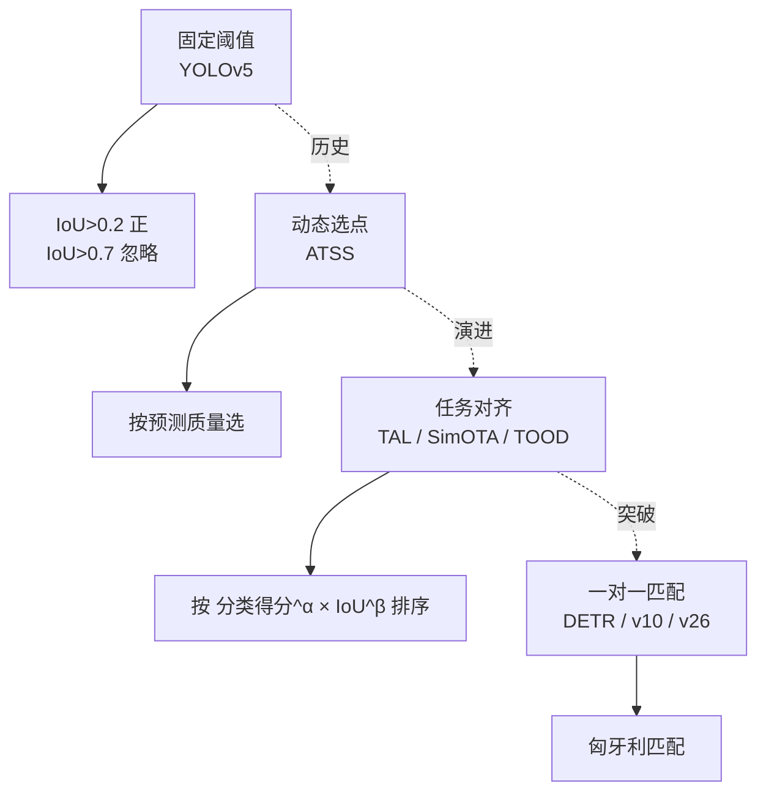
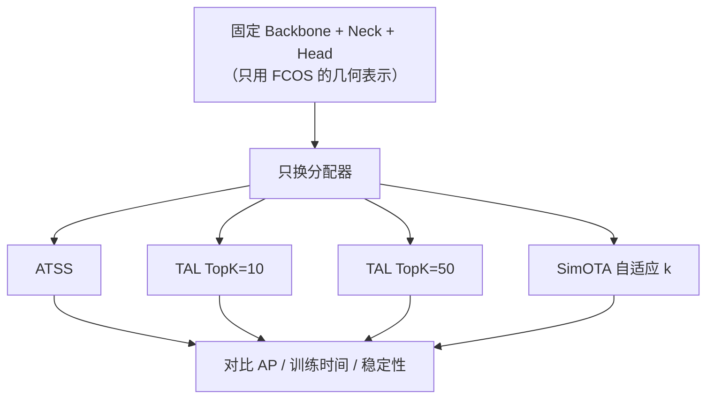

# 无锚框与样本分配

> **核心问题**：正样本到底该给谁？固定阈值、动态选点、任务对齐、一对一匹配——这四种思路的本质区别是什么？

本文是检测领域**最值得深入**的一章。标签分配的质量对 mAP 的影响，通常超过主干网络换代一个档次。

---

## 1. 为什么样本分配是核心问题

**设定**：一张 640×640 的图，YOLOv8n 有 8400 个预测位置（80×80 + 40×40 + 20×20）。假设图中有 3 个目标。

**核心矛盾**：
- 8400 个位置里，只有 3 个「明确正确」
- 其余 8397 个位置全是「不该有输出」的位置
- 但它们在训练中不是完全无用 —— 它们提供了「这里没有目标」的负样本信号

**关键**：**哪个位置当正样本**决定了：
1. 哪些位置提供正梯度（影响召回）
2. 哪些位置提供负梯度（影响误检）
3. 框的监督质量（影响定位精度）

**实验事实**：
> 同一个 ResNet-50-FPN 骨干，把 RetinaNet 的 ATSS 分配器换成 TAL，AP 从 39.6 → 40.3；换成 FreeAnchor 或 S2A，各有 ±0.5~1.0 的波动。**这些改动的收益和换一个更强的主干网络是同一量级。**

---

## 2. 四种范式



| 范式 | 核心思想 | 代表 |
|---|---|---|
| **固定阈值** | IoU 超过阈值就是正样本 | YOLOv5, SSD |
| **动态选点** | 按模型自己的预测质量选正样本 | ATSS, FreeAnchor, S2A |
| **任务对齐** | 分类得分和 IoU 加权排序取 top-k | TAL, SimOTA, TOOD, YOLOv8 |
| **一对一匹配** | 每个 GT 唯一匹配一个预测 | DETR, Sparse R-CNN, YOLOv10 |

---

## 3. 范式一：固定阈值（YOLOv5 / SSD）

### 3.1 规则

```
对每个 GT g 和每个 anchor a:
    IoU = IoU(a, g)

    if IoU > 0.7:   →  忽略（不计损失）
    elif IoU > 0.2: →  正样本
    else:           →  负样本
```

### 3.2 致命缺陷

| 缺陷 | 说明 |
|---|---|
| **小目标全军覆没** | 一个 16×16 的小目标，anchor 尺寸 32×32 时最大 IoU 可能只有 0.25 → 边界情况 |
| **超小目标归零** | 8×8 的目标 vs 32×32 的 anchor，IoU = 64/1024 = 0.0625 → **永远是背景** |
| **与预测质量无关** | 一个预测很准的框和一个预测很差的框，待遇完全一样 |
| **阈值是超参** | 换数据集要重调 |

### 3.3 实际影响

**这就是为什么早期 YOLO 在小目标密集数据集上表现差**。修复方式：
1. v5 加了 **AutoAnchor**（重算 anchor 尺寸，让小目标的 anchor 变小）
2. YOLOv8+ 直接 **Anchor-free**（每个位置都能预测任意尺寸的框）

> **AutoAnchor 的本质**：用数据驱动的 anchor 尺寸，缓解「anchor 与目标尺寸不匹配」的问题。但它**无法解决「一个格子只能出一个框」的根本限制**。

---

## 4. 范式二：动态选点（ATSS）

**论文**：*Bridging the Gap Between Anchor-based and Anchor-free Detection via Adaptive Training Sample Selection*, CVPR 2020
**仓库**：`xingyizhou/ATSS`

### 4.1 完整算法

```
输入：所有 GT 框 G，预测框 P（每个位置 k 个），GT 中心
输出：正样本集合

Step 1：候选生成
    对每个 GT g：
        计算 g 的中心在特征图上的位置 (cx, cy)
        取以 (cx,cy) 为中心、半径 3 的 3×3 邻域内的 K=9 个位置
        这些位置的预测框构成 g 的候选集

Step 2：统计 IoU 并标记
    对每个候选位置 p：
        q_p = max_i IoU(P_p^i, G)          # 该位置与所有 GT 的最大 IoU
        j_p = argmax_i IoU(P_p^i, G)       # 对应的 GT 索引
        k_p = argmax_i IoU(P_p^i, G_j)     # 该 GT 的最佳 anchor 索引

Step 3：筛选候选位置
    对每个 GT g，统计有多少候选位置的 k_p == j_g（被 g 标记为最佳）
    取被标记次数最多的 top-2 个 anchor 索引，形成集合 A_g

    保留候选位置 p，当且仅当：
        (1) k_p ∈ A_g          # p 是 g 的「最佳 anchor 类型」
        (2) IoU(P_p, g) > 0.5  # 且预测够准

Step 4：中心化
    对 g 的保留候选，减去 g 的中心 → 得到相对偏移
    按偏移量大小排序（从近到远）

Step 5：一对一分配
    将排序后的候选位置与 GT 列表按顺序配对
    第 k 个 GT 分配给第 k 个候选位置
    最多分配 min(#GT, #候选) 对
```

### 4.2 三个设计要点

#### 要点 1：只考虑「中心附近」的候选

ATSS 只在 GT 中心 $3\times3$ 邻域内找候选。为什么？

- 框回归只对**位置附近的**目标负责（FCOS 的 assigner 也是这样）
- 限制搜索范围大幅降低计算量
- 隐含假设：**特征图的感受野足够覆盖目标**

#### 要点 2：按 anchor 类型统计（Step 3 的精髓）

**这是 ATSS 最巧妙的一步。**

朴素想法：给每个 GT 选 IoU 最高的 K 个位置。
**问题**：这会导致所有 GT 都在选同一类「最容易被预测准」的位置（通常是目标中心），位置高度重叠，一个位置被多个 GT 争抢。

ATSS 的解法：先统计**每个 anchor 尺寸类型**被多少个候选标记为最佳，取 top-2 类型。然后只保留这些类型的位置。

**效果**：不同 GT 会选到不同类型的位置 → **位置分布更均匀**，减少冲突。

#### 要点 3：中心化 + 排序配对（Step 4-5）

保留的候选按「到 GT 中心的距离」排序，GT 也按同样方式排序，然后一一配对。

**为什么要排序配对？**
为了让**近中心的候选配近中心的 GT**，保证分配的「公平性」和几何一致性。

### 4.3 与 YOLOv5 的对比

| | YOLOv5 | ATSS |
|---|---|---|
| 正样本数 | 每个 GT 可能几十个（取决于 anchor 尺寸） | 每个 GT 最多 9 个 |
| 数量自适应 | ❌ 固定（由 IoU 阈值决定） | ✅ 自动 |
| 依赖预测质量 | ❌ | ✅ |
| 位置冲突 | 常见 | 少 |

### 4.4 性能

RetinaNet + ATSS：COCO AP 37.4 → **39.6**（**只用 1× schedule**）。

### 4.5 ATSS 的局限

1. **仍需 anchor**（虽然只需要 1 个尺度）
2. **Step 3 的 top-2 是硬编码的**
3. **没有考虑分类得分** —— 只用 IoU 决定，但分类和回归质量可能不一致

**ATSS 的局限正是 TAL 要解决的。**

---

## 5. 范式三：任务对齐（TAL / SimOTA / TOOD）

### 5.1 核心思想

**TOOD 的洞察**（TAL 是它的 YOLO 版实现）：

> 分类任务和回归任务对「什么位置是好位置」的判断标准不同。
> **应该用统一的标准来选择正样本。**

**统一标准 = 分类得分 × IoU**（几何与语义的联合度量）。

### 5.2 TAL 完整算法

**论文**：*YOLOv6*, arXiv:2209.02976

```
Step 1：计算对齐分数
    对每个 (位置 i, GT j)：
        s_ij = c_ij^α · q_ij^β
        其中 c_ij = 位置 i 对 GT j 的分类预测得分
              q_ij = 位置 i 的预测框与 GT j 的 IoU
              α = 0.5, β = 6.0

    同时：
        s_ij = 0  若 q_ij < 阈值(0.7)     # IoU 太低直接排除

Step 2：Top-K 候选
    对每个 GT j：
        取 s_·j 中最大的 K 个位置（K = max(10, ...))
        这些是 GT j 的候选正样本

Step 3：冲突仲裁
    若某位置 i 同时被多个 GT 选中：
        只保留 s_ij 最大的那个 GT（其他置 0）

Step 4：正负划分
    正样本：Step 2&3 保留的
    忽略：IoU > 0.7 但未被选中（太容易，模型已经会了）
    负样本：IoU < 0.2 的位置
```

### 5.3 超参 α 和 β 的含义

$$
s_{ij} = c_{ij}^{\alpha} \cdot q_{ij}^{\beta}
$$

**默认 $\alpha = 0.5, \beta = 6.0$**，含义：

- $\beta \gg \alpha$ → **IoU 主导**
- 「首先这个框要准，其次分类要自信」
- IoU 从 0.5 降到 0.4，$q^\beta$ 下降 $(0.4/0.5)^6 = 0.26$ 倍 → **惩罚很重**
- 分类得分从 0.9 降到 0.6，$c^\alpha$ 下降 $(0.6/0.9)^{0.5} = 0.816$ 倍 → **惩罚很轻**

**调参建议**：

| 场景 | α | β | 理由 |
|---|---|---|---|
| 默认 | 0.5 | 6.0 | IoU 主导 |
| 分类难（长尾/相似类） | 1.0 | 4.0 | 提高分类权重 |
| 定位难（小目标/密集） | 0.5 | 8.0 | 更强调框的准确性 |
| 极密集场景 | 0.5 | 6.0 + 增大 topk | 需要更多候选 |

### 5.4 SimOTA 的自适应 top-k

**论文**：*YOLOX*, arXiv:2107.08430

**SimOTA** 与 TAL 的核心区别：**每个 GT 的候选数量自适应**。

```
Step 1：计算所有位置与所有 GT 的 IoU 矩阵
Step 2：统计「动态 k」
    前景候选 = {位置 i : max_j IoU(i,j) > 0.5 且 max_c score(i,c) > 0.1}
    k_gt = max(1, floor(|前景候选| / |GT|))
Step 3：对每个 GT，取分数 top-k_gt 的位置
Step 4：冲突仲裁（同 TAL）
```

**为什么自适应？**
- GT 密集时（如 50 个目标），每个 GT 分 1~2 个候选就够
- GT 稀疏时（如 1 个目标），每个 GT 可以分 10 个候选

**固定 top-k 的问题**：目标稀疏时浪费，密集时不够。

### 5.5 YOLOv8 的实现（简化版 TAL）

Ultralytics v8 的 `TaskAlignedAssigner` 是 TAL 的工程简化：

```python
# ultralytics/utils/tal.py（v8 版）
class TaskAlignedAssigner:
    def __init__(self, topk=10, num_classes=80, alpha=1.0, beta=6.0, eps=1e-9):
        self.topk = topk
        self.alpha = alpha          # v8 默认 1.0
        self.beta = beta            # v8 默认 6.0

    def __call__(self, pd_scores, anc_points, gt_labels, gt_bboxes, mask_gt):
        # 1. 每个位置对每个 GT 的分类得分（取该 GT 类别上的得分）
        cls_scores = pd_scores.permute(1, 0, 2)[gt_labels, :, gt_labels]  # 简化实现
        # 2. IoU
        iou = bbox_iou(gt_bboxes, anc_points)   # (num_gt, num_anchor)
        # 3. 对齐分数
        align_metric = cls_scores.pow(self.alpha) * iou.pow(self.beta)
        # 4. topk
        topk = min(self.topk, ...)
        topk_idxs = torch.topk(align_metric, topk, dim=1).indices
        # 5. 冲突仲裁：每个 anchor 只归给对齐分最高的 GT
        mask_pos = torch.zeros_like(align_metric, dtype=torch.int8)
        for gt_idx in range(topk.shape[0]):
            mask_pos[topk_idxs[gt_idx], gt_idx] = 1
        # 6. 冲突位置：取 align_metric 最大的 GT
        mask_pos_mask = mask_pos.sum(-1)
        if mask_pos_mask.max() > 1:
            multi = mask_pos_mask > 1
            for gt_idx in range(topk.shape[0]):
                mask_pos[:, gt_idx] &= ~(multi & (align_metric[:, gt_idx] < align_metric.max(dim=1)[0]))
        # 7. 归一化
        mask_pos.sum(-1).clamp_(min=1)
        return mask_pos.bool()
```

> **注意**：v8 的 `alpha=1.0`（YOLOv6 用 0.5），`beta=6.0` 一致。

### 5.6 TOOD 的额外机制

**论文**：*TOOD: Task-aligned One-stage Object Detection*, ICCV 2021

除了标签分配，TOOD 还加了：

| 机制 | 说明 |
|---|---|
| **Task-aligned 学习** | 按对齐分数**加权**分类损失（对齐分高的位置，分类损失权重也高） |
| **Task-aligned 预测** | 推理时最终得分 = 分类得分 × 定位质量（IoU），而不是只用分类得分 |

**推理时的得分融合**：
$$
\text{score}_{\text{final}} = s_{\text{cls}} \cdot s_{\text{quality}}
$$

这直接改善了 NMS 的排序质量 → AP 提升。

---

## 6. 范式四：一对一匹配（DETR 系）

### 6.1 匈牙利匹配

**论文**：*DETR*, ECCV 2020

**核心**：把检测当作**集合预测（Set Prediction）**问题。

```
预测集合: Ŷ = {(ŷ_1, ..., ŷ_N)}   N = 100 个 query
真值集合: Y  = {(y_1, ..., y_M)}   M 个 GT

损失 = min over 置换 π of Σ_i ||ŷ_{π(i)} - y_i||*
```

其中 $\|\cdot\|^*$ 是分类损失 + L1 回归损失 + GIoU 损失。

**由匈牙利算法求解最优匹配**（$O(n^3)$，N=100 时开销可接受）。

### 6.2 为什么一对一匹配是「终极解」

| 特性 | 说明 |
|---|---|
| **无重复** | 每个预测最多匹配一个 GT → 输出天然无重复 |
| **无 NMS** | 不需要后处理去重 |
| **端到端可微** | 匹配虽然不可微，但它是离散选择，梯度通过匹配到的对回传 |
| **一对一语义** | 预测「第 i 个 query 负责第 j 个 GT」 |

### 6.3 收敛慢的原因（DETR 的核心缺陷）

**问题**：匈牙利匹配是**全局**的、**离散**的。早期训练时模型预测很差，匹配结果几乎随机 → 梯度信号混乱。

**更本质的问题**：
- 每个 GT 只有 **1 个**正样本 → 监督信号极度稀疏
- 对比 ATSS/TAL 的 9~10 个候选，DETR 的信号量差 10 倍

**解决方案谱系**（见 [`05-Transformer检测器.md`](./05-Transformer检测器.md)）：

| 方法 | 思路 |
|---|---|
| **Deformable DETR** | 稀疏注意力，把复杂度从 $O(N^2)$ 降下来 + 更好的收敛 |
| **DAB-DETR** | 让 query 显式携带「参考框」，逐层更新位置 |
| **DN-DETR** | 加**去噪训练**：用带噪声的 GT 做额外监督 |
| **DINO** | 对比去噪 + 混合 query 选择 + look forward twice |
| **RT-DETR** | 高效混合编码器 + 简化 query 选择 |

### 6.4 YOLOv10 的「一致双分支」

YOLO 侧的一对一实现：

```
         特征
          ↓
    ┌─────┴─────┐
    ↓           ↓
[一对多分支]  [一对一分支]
  密集监督      唯一匹配
  (仅训练)     (训练+推理)
    ↓           ↓
   损失      推理输出（无 NMS）
```

**关键**：
- 一对多分支提供密集梯度（解决收敛慢）
- 一对一分支的输出结构 = 推理时的输出结构（解决训练-推理 gap）
- 两个分支用**对齐损失**保持一致

**YOLO26 的 STAL** 进一步改进：用一对多分支的输出**指导**一对一的分配，而不是简单对齐输出。

---

## 7. 五家对比总表

| | ATSS | TAL | SimOTA | TOOD | 一对一 |
|---|---|---|---|---|---|
| **论文** | CVPR'20 | arXiv'22 | arXiv'21 | ICCV'21 | ECCV'20+ |
| **核心** | 按预测质量选 | 分类×IoU 排序 | 分类×IoU + 自适应 k | 任务对齐 + 得分融合 | 匈牙利匹配 |
| **每 GT 正样本数** | ≤9 | 固定 10 | 自适应 | 任务对齐分配 | **1** |
| **冲突仲裁** | 中心化排序 | 取对齐分最高 | 取对齐分最高 | 取对齐分最高 | 匈牙利（全局最优） |
| **是否需 Anchor** | 是（1 尺度） | 否 | 否 | 否 | 否 |
| **推理端 NMS** | 需要 | 需要 | 需要 | 需要 | **不需要** |
| **收敛速度** | 快 | 快 | 快 | 快 | **慢**（需 DN 训练） |
| **谁在用** | FCOS 系 | **YOLOv6/v8/v9** | **YOLOX** | TOOD | DETR 系 / YOLOv10 |

---

## 8. 融合策略：不是二选一

现代检测器常常**组合**多种思想：

**YOLOv8 的实际配方**：
```
Anchor-free 几何表示（FCOS 系）
+ TAL TopK 分配（TAL 系）
+ DFL 分布回归（GFL 系）
+ 解耦头（YOLOX 系）
= 一个把各流派优点融合的模型
```

**理解现代检测器的正确方式**：不是「它属于哪个流派」，而是「**它组合了哪些流派的技术**」。

---

## 9. 消融实验的设计方法

**想验证「标签分配有用」的标准做法**：



**要记录的不只是 AP**：

| 指标 | 为什么重要 |
|---|---|
| **AP_s（小目标）** | 分配器对小目标的影响最大 |
| **训练 loss 曲线** | 好的分配器收敛更快更稳 |
| **正样本数 / GT** | 理解分配器的行为 |
| **推理速度** | 一对一会消除 NMS |
| **多 seed 方差** | 分配器改动常伴随更高方差 |

---

## 10. 工程结论

1. **标签分配是性价比最高的调优点**。同样的骨干，换分配器动辄 +1~2 AP。
2. **TAL 是当前的默认选择**。它的 α/β/topk 值得针对自己的数据微调。
3. **小目标密集场景优先调 `topk`**。topk 太小 → 漏检；太大 → 训练慢、可能引入噪声正样本。
4. **一对一匹配（端到端）是明确的未来方向**，但需要更长的训练和更多工程投入（YOLOv10/v26 是 YOLO 侧的最优解）。
5. **不要迷信「最新分配器」**。先用 TAL 打好基线，再逐个替换消融。
6. **分配器与推理端要一致**（RTMDet 的原则）。训练用一套分配、推理用另一套，会白白损失精度。

---

## 🔗 相关

- 单阶段基础 → [`03-单阶段检测器.md`](./03-单阶段检测器.md)
- DETR 系 → [`05-Transformer检测器.md`](./05-Transformer检测器.md)
- 端到端 → [`06-端到端与实时检测.md`](./06-端到端与实时检测.md)
- 损失细节 → [`11-损失函数与样本分配.md`](./11-损失函数与样本分配.md)
- YOLO 侧实现 → [`../01-YOLO/06-YOLO关键模块与算法.md`](../01-YOLO/06-YOLO关键模块与算法.md)
