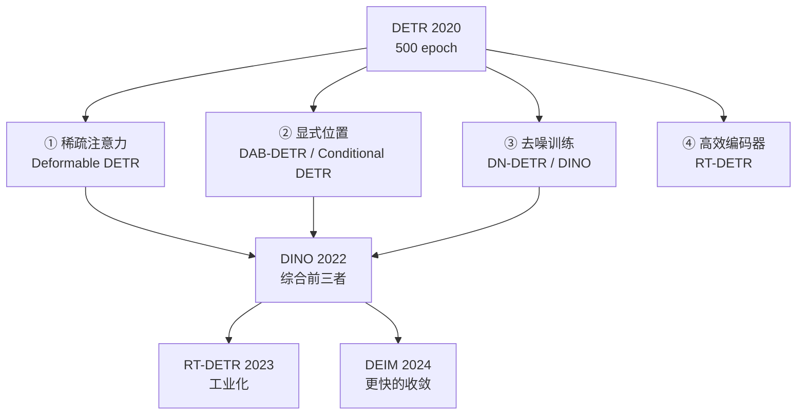

# Transformer 检测器

> **核心问题**：DETR 证明了「可以不要 NMS」，但它慢得离谱。从 2020 到 2024，DETR 系做了什么才变成 RT-DETR？

---

## 1. DETR（2020）— 范式革命

**论文**：*End-to-End Object Detection with Transformers*, ECCV 2020
**作者**：Carion, Massa, Synnaeve et al. (Facebook AI)

### 1.1 核心思想：把检测变成集合预测

**传统检测**：输出一个不定长的集合（需要 NMS 去重）
**DETR**：输出一个**固定长度**的集合（100 个 query），与 GT 做**一对一**匹配

```
图像 → CNN Backbone → 特征图
                        ↓
              位置编码 (positional encoding)
                        ↓
              Transformer Encoder
                        ↓
              Transformer Decoder + N 个可学习 query
                        ↓
              N 个预测 (类别 + 框)
                        ↓
              匈牙利匹配 → 一对一损失
```

### 1.2 三个关键创新

#### 创新 1：匈牙利匹配的一对一监督

$$
\hat{y}^{\sigma(i)} \to y_i, \quad \sigma = \arg\min_{\sigma \in S_N} \sum_i \|\hat{y}^{\sigma(i)} - y_i\|^*_{\text{L1}} + \lambda_{\text{cls}}\|\hat{c}^{\sigma(i)} - c_i\|_{\text{CE}}
$$

**效果**：输出天然无重复 → **完全不需要 NMS**。

#### 创新 2：二分图匹配损失（Set Loss）

$$
\mathcal{L}_{\text{set}}(y, \hat{y}) = \sum_{i=1}^{N}\mathcal{L}_i(y_i, \hat{y}_{\sigma(i)})
$$

其中匹配上的对用 L1 + GIoU，未匹配的（no-object）用分类损失。

**注意**：匈牙利匹配把「类别 + 框」的匹配一起考虑（不是先按 IoU 匹配再算损失）。

#### 创新 3：Object Queries

100 个**可学习的** query embedding（类似 DETR 的 object queries），作为 decoder 的输入。

### 1.3 三大缺陷

| 缺陷 | 原因 |
|---|---|
| **收敛极慢** | 需要 500 epoch 才能训练好（对比 Faster R-CNN 的 12 epoch） |
| **小目标差** | 特征图分辨率低（P5 = stride 32），小目标信息丢失 |
| **分辨率固定** | 训练与推理必须同分辨率 |

### 1.4 性能

COCO val：**42.0 AP**（ResNet-50，500 epoch）—— 精度是好的，问题是太慢。

---

## 2. 加速收敛的四条路线



---

## 3. 路线一：稀疏注意力（Deformable DETR）

**论文**：*Deformable DETR: Deformable Transformers for End-to-End Object Detection*, ICLR 2021
**作者**：Zhu, Su, Lu, Li et al.

### 3.1 问题定位

**作者的分析非常精准**：DETR 收敛慢的**根本原因不是 Transformer 本身，而是注意力的稀疏性需求与全局注意力的矛盾**：

- DETR 需要**全局注意力**才能做集合推理（每个 query 要看全图）
- 但**目标只占图像很小一块**，全注意力浪费 99% 的计算在无关区域
- 而且早期训练时全局注意力很难学（「该看哪里」本身就是要学的）

### 3.2 可变形注意力（Deformable Attention）

**核心**：每个 query 只采样 $k$ 个稀疏点（而不是关注所有 $N$ 个位置）。

```
标准注意力：  Q × K^T  →  softmax → × V        复杂度 O(N²)
可变形注意力：每个 query 从参考点周围采样 k 个位置
              用偏移量和注意力权重加权求和
              复杂度 O(Nk)
```

**数学**：
$$
y(q) = \sum_{i=0}^{k-1} \text{softmax}_i(\Delta m_{qi} + q^T k'_i) \cdot W'_i x(q + \Delta p_{qi})
$$

其中 $\Delta p_{qi}$ 是**可学习的**采样偏移，$\Delta m_{qi}$ 是注意力权重。

**特殊设计**：
- 3×3 卷积感受野内采样 9 个点，分 4 组（用不同的采样偏移）
- **多尺度可变形注意力**：每个 query 在多个 level 的特征图上各采样若干点

### 3.3 收敛加速的关键：混合注意力

**论文的第二个重要贡献**：

```
在可变形注意力的层间，插入一层「标准全局注意力」
```

**Deformable DETR 的 encoder 结构**：
```
Conv Encoder (3 层)  →  Deformable Encoder (6 层)  →  Decoder (6 层)
                              ↑
                    每隔一层插入一次全局注意力
```

**为什么有效**：
- 可变形注意力 → 快速聚焦到目标
- 全局注意力 → 提供全局上下文（对「集合推理」是必要的）

### 3.4 其他贡献

| 贡献 | 说明 |
|---|---|
| **纯位置编码（Pure Positional Embedding）** | 去掉 encoder 的正弦位置编码，只在 decoder 用 → 收敛更快 |
| **混合查询选择（Mix Query Selection）** | 用 encoder 的输出初始化 decoder query（而不是纯可学习） |
| **可变形 RoI 采样** | 替代 MultiScaleDeformableAttention 里的 grid_sample |

### 3.5 性能

COCO val：**52.1 AP**（ResNet-50，50 epoch）—— 相对 DETR 是**质的飞跃**。

---

## 4. 路线二：显式位置建模

### 4.1 DAB-DETR（2022）

**论文**：*DAB-DETR: Dynamic Anchor Boxes are Better Queries for DETR*, ICLR 2022

**核心思想**：让 query 显式携带「参考框」信息。

```
Decoder Layer:
    参考框 (4维) → MLP → (中心点 2维 + 尺度 2维)
                          ↓
                  调制 cross-attention 的 query
                          ↓
    逐层更新参考框 (Δx, Δy, Δw, Δh)
```

**收益**：
- 收敛快（**12 epoch** 就能达到 DETR 500 epoch 的效果）
- 提升小目标性能
- 可视化友好：能直接看到 query 框如何收敛到目标

### 4.2 Conditional DETR（2022）

**论文**：*Conditional DETR for Fast Training Convergence*, CVPR 2022

**核心思想**：DETR 的 decoder 里，**cross-attention 的 query 是由内容特征决定的，但位置信息（空间对齐）不足**。

**解法**：让 query 同时包含「内容特征」和「参考框的 4D 空间位置」：

$$
q = \text{Content}(x) + \text{Spatial}(r_{pos})
$$

**收益**：12 epoch 训练，50.9 AP。

---

## 5. 路线三：去噪训练（DN-DETR / DINO）

### 5.1 DN-DETR（2022）

**论文**：*DN-DETR: Accelerate DETR Training by Introducing Query DeNoising*, CVPR 2022

**核心思想**：**给 decoder 额外的「带噪声 GT」作为输入，让它学会去噪。**

```
训练时，构造两组 query：
  ① 正常 query（可学习 embedding）    → 匹配 GT，产生匈牙利匹配损失
  ② 去噪 query（带噪的 GT 框 + 类别） → 直接回归到对应的带噪 GT
```

**去噪方式**：
- **加性噪声**：$b + \Delta b$，$\Delta b \sim \mathcal{N}(0, \sigma^2)$，$\sigma$ 按框尺寸缩放
- **随机缩放 + 随机裁剪**（box jittering）

**为什么有效**：
1. **每个去噪 query 有明确的回归目标**（不需要匈牙利匹配的离散决策）→ 梯度直接、密集
2. 训练与推理的「去噪能力」对齐：推理时模型也会把粗框「拉」到目标

### 5.2 DINO（2022）— DETR 系的集大成者

**论文**：*DINO: DETR with Improved DeNoising Anchor Boxes for End-to-End Object Detection*, ICLR 2023
**仓库**：`IDEA-Research/DINO`

**四个关键组件**：

#### 组件 1：对比去噪（Contrastive DeNoising）

DN-DETR 的所有去噪 query 属于**同一个 GT** 时，模型可能「偷懒」——把它们都预测成同一个框。

**DINO 的解法**：对同一 GT 构造**多个不同噪声水平**的 query 组，称为「negative query」，让它们互相竞争（互相作为负样本）。

```
GT box
  ├─ 噪声水平 1 → query 组 1  → 预测 GT
  ├─ 噪声水平 2 → query 组 2  → 预测 GT
  └─ 噪声水平 3 → query 组 3  → 预测 GT

组内不同组之间互相抑制（都当作彼此的负样本）
```

**效果**：显著加快收敛（**12 epoch**）。

#### 组件 2：混合查询选择（Mixed Query Selection）

**问题**：DETR 的 query 是纯可学习的 embedding，**不包含图像信息**。

**DINO 的做法**：
```
Encoder 输出 → 在每层特征图上找 Top-K 个位置（按分类/定位质量）
           → 这些位置的**位置编码**作为 decoder 的内容 query
           → 同时保留可学习的 query（作为位置 query）
```

即：**内容 query 来自图像（动态），位置 query 是可学习的（静态）**。

#### 组件 3：Look Forward Twice

利用 decoder 最后一层的输出，**辅助计算下一层的分类损失**：

```
Layer L 的输出 → 通过一个小的分类头 → 得到辅助分类分数
              → 作为 Layer L+1 的分类监督（额外监督）
```

**收益**：+0.5~1 AP，收敛更快。

#### 组件 4：混合查询（可学习 + 内容）

最终 decoder query = 可学习 query（提供位置先验）+ 内容 query（提供图像信息）。

### 5.3 DINO 的性能

COCO val（1× schedule，12 epoch）：

| Backbone | AP | 训练 epoch |
|---|---|---|
| ResNet-50 | **47.6** | 12 |
| ResNet-50 | 49.0 | 36 |
| Swin-T | 57.1 | 36 |
| Swin-B | 58.7 | 36 |

**12 epoch 训出 47.6 AP** —— 这在 DETR 时代是不可思议的（DETR 需要 500 epoch）。

---

## 6. 路线四：高效混合编码器（RT-DETR）

**论文**：*DETRs Beat YOLOs on Real-time Object Detection*, CVPR 2024
**作者**：Liao, Zhang, Song, et al. (百度)
**仓库**：`lyuwenyu/RT-DETR`

### 6.1 问题定位

**RT-DETR 的洞察极其精准**：

> DETR 慢的**主要瓶颈不在 decoder，而在 encoder**。
>
> 原始 DETR 用 6 层标准 Transformer encoder，复杂度 $O(N^2)$，在**高分辨率特征图**上极其昂贵。
> 而 decoder 的作用主要是「集合推理 + 跨 query 交互」，**不需要那么多层**。

**验证方法**：直接把 encoder 层数从 6 减到 1，decoder 保持 6 层 → **精度几乎不变，延迟大降**。

### 6.2 高效混合编码器（Efficient Hybrid Encoder）

**三个模块**：

```
输入多尺度特征 {S3, S4, S5}
    ↓
┌──────────────────────────────────────────────┐
│ ① 尺度内高效融合 (AIFI)                      │
│    只在 S5 (低分辨率) 上做自注意力              │
│    因为 S3 高分辨率做自注意力太贵              │
└──────────────────────────────────────────────┘
    ↓
┌──────────────────────────────────────────────┐
│ ② 尺度内跨卷积融合 (CCFM)                    │
│    用轻量卷积替代跨尺度的注意力融合             │
│    在每层做一次「自底向上 + 自顶向下」          │
└──────────────────────────────────────────────┘
    ↓
  统一的多尺度特征
```

#### AIFI（Intra-scale Scalable Self-Attention）

**只在最高层的 S5 上做自注意力**：
- S5 分辨率最小（20×20），自注意力开销 $O(400^2)$，可接受
- 低层 S3（80×80）用轻量卷积处理

**论文的消融**：
| 编码器设计 | AP | GFLOPs |
|---|---|---|
| 6 层全局自注意力（原始 DETR） | 44.9 | 79 |
| AIFI on S5 + CCFM | **46.6** | 60 |

#### CCFM（Cross-scale Feature Fusion Module）

**用卷积替代跨尺度注意力**：
```
S3 ← FPN(conv) ← S4 ← FPN(conv) ← S5    （自顶向下，带残差）
然后自底向上：S4' ← conv(S4 + Down(S3'))，S5' ← conv(S5 + Down(S4'))
```

**收益**：比 MSDeformAttn 更快且精度更高。

### 6.3 不确定性最小化查询选择（Uncertainty-minimal Query Selection）

**问题**：DETR 系通常从 encoder 输出里**随机选** K 个位置作为 query。

**RT-DETR 的做法**：从 encoder 的输出里，选**分类得分和定位质量都高**的位置。

```
对 encoder 输出的每个位置：
    分类得分 = max over classes of the classification score
    定位质量 = 框的 IoU 估计（从参考框和预测框算）
    两者相乘 → 质量分
取 Top-K
```

**收益**：+1.0 AP，且训练更稳定。

### 6.4 解码层可调

**RT-DETRv2（2024）**：把 decoder 层数做成可调（从 6 减到 3），延迟进一步降低而精度基本不变。

### 6.5 性能

COCO val（640，1× schedule）：

| 模型 | AP | 参数量 | FPS (T4) |
|---|---|---|---|
| RT-DETR-R18 | 46.3 | 20M | 217 |
| RT-DETR-R34 | 47.9 | 31M | 161 |
| RT-DETR-R50 | 48.9 | 42M | 108 |
| RT-DETR-R101 | 50.1 | 60M | 74 |
| RT-DETR-L | 53.1 | 92M | 108* |
| YOLOv8-x (参考) | 53.9 | 68M | — |

\* 不同硬件/延迟定义

**关键**：RT-DETR 在 **640 输入、1× schedule** 下就超过了 YOLOv8-x 的 COCO 精度，且**不需要 NMS**。

---

## 7. DEIM（2024）— 收敛加速的极致

**论文**：*DEIM: DETR with Improved Matching for Fast Convergence*, arXiv:2412.04234

### 7.1 核心：稠密一对一匹配（Dense O2O）

**DINO 的问题**：
- 一对多去噪提供密集监督，但**真正的匈牙利匹配部分（O2O）依然是稀疏的**
- 论文分析：**去噪分支贡献了大部分梯度，导致模型「学偏」—— 倾向于用去噪的密集信号，而不是真实的匹配信号**

**DEIM 的方案**：把去噪的思路**迁移到 O2O 分支**。

```
标准 DINO：
  query 组 = [ 可学习 query (N个) ] + [ 去噪 query (M个) ]
                                    ↓
                          O2O 匹配(稀疏) + 去噪损失(密集)

DEIM：
  在 O2O 分支也加入「分组去噪」：
  把 N 个 query 按类别分组，每组独立做一对一匹配
  → 每组都有密集的分组监督
```

### 7.2 效果

**12 epoch 达到 DINO 36 epoch 的精度**：

| 模型 | AP | Epoch |
|---|---|---|
| DINO | 47.6 | 12 |
| DINO | 49.0 | 36 |
| **DEIM** | **49.6** | **12** |

**训练时间减少 50%+**。

### 7.3 配套的 MAL（Mosaic Augmentation Loss）

用 Mosaic 增强 + 「先训分类再训检测」的分阶段策略，进一步加速收敛。

---

## 8. RF-DETR（2025）— 走向实用

**仓库**：`roboflow/rf-detr`
**文档**：https://rfdetr.roboflow.com

### 8.1 定位

**Roboflow 的目标**：把 DETR 做到「开箱即用 + 高 FPS」。

### 8.2 关键设计

| 设计 | 说明 |
|---|---|
| **混合编码器** | 类似 RT-DETR（CCFM + AIFI） |
| **简化 query 选择** | 从 encoder 特征中用 top-k 选择 |
| **可选预训练骨干** | 支持 DINOv2 等自监督预训练权重 |
| **可选预训练检测头** | 直接加载训好的检测头，收敛极快 |
| **完全 NMS-free** | 端到端 |
| **可调的延迟档位** | 通过调整 decoder 层数 / backbone 深度换速度 |

### 8.3 性能

COCO val：

| 模型 | AP | FPS (T4, TensorRT) |
|---|---|---|
| RF-DETR-Nano | 73.9* | 100+ |
| RF-DETR-Small | 75.0* | 75+ |
| RF-DETR-Base | 77.3* | 55+ |
| RF-DETR-Large | 79.5* | 40+ |

\* 使用了额外预训练数据（需核对具体口径）

**关键**：这是目前**开源免费方案里 COCO 精度最高的实时检测器**，且完全 NMS-free。

---

## 9. DETR 系 vs YOLO 系：全面对比

| 维度 | YOLO 系 | DETR 系 |
|---|---|---|
| **COCO 最高 AP** | ~55（YOLO12x） | ~60+（DINO/DEIM/RF-DETR） |
| **训练速度** | 快（100 epoch 几分钟） | 慢（12 epoch 但每 epoch 慢） |
| **训练成本** | 低 | 高（需要大 batch + 长 schedule） |
| **收敛稳定性** | 稳定 | 对超参敏感（lr、batch） |
| **NMS** | 需要（v10/v26 除外） | **不需要** |
| **后处理复杂度** | 中 | **极简** |
| **小目标** | 中（靠多尺度） | 好（有专门的尺度分配） |
| **密集场景** | 好 | 好 |
| **部署友好度** | 好（纯卷积为主） | **差**（Attention 对 NPU 不友好） |
| **可解释性** | 弱 | 强（query 可视化） |
| **调参难度** | 低 | 高 |
| **多类别/长尾** | 需要平衡采样 | 天然更好（一对一） |
| **扩展性** | 中 | **强**（改 decoder 就能加任务） |

---

## 10. 工程结论

1. **DETR 系的真正价值是「端到端」和「可扩展性」**，不是单纯刷 COCO 分数。
2. **如果你只能用一个模型系列，选 YOLO**。DETR 的训练成本、部署难度、算子兼容性在多数场景下不划算。
3. **但如果你的场景是「密集小目标 / 长尾类别 / 需要极简后处理 / 有大量训练资源」**，DETR 系（DEIM / RF-DETR / DINO）值得认真评估。
4. **理解 DETR 系对理解 YOLO 有价值**：DINO 的去噪思想 → YOLOv10 的一致双分支；DAB 的参考框思想 → YOLO 的 anchor-free 回归；RT-DETR 的混合编码器 → YOLO 的 PAN。
5. **部署到 NPU 是 DETR 系的硬伤**。Multi-head Attention 在很多边缘 NPU 上没有高效实现，甚至不被支持。如果必须部署到边缘，优先考虑 YOLO 的 NMS-free 版本。
6. **RT-DETR 是个折中选择**：既有 YOLO 的速度，又有 DETR 的无 NMS。但训练成本仍高于 YOLO。

---

## 🔗 相关

- 端到端路线 → [`06-端到端与实时检测.md`](./06-端到端与实时检测.md)
- 样本分配 → [`04-无锚框与样本分配.md`](./04-无锚框与样本分配.md)
- 开放词汇 DETR → [`10-开放词汇与基础模型.md`](./10-开放词汇与基础模型.md)
- 部署 → [`13-训练工程与性能优化.md`](./13-训练工程与性能优化.md)
