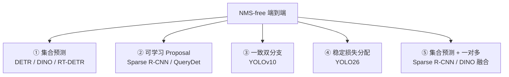

# 端到端与实时检测

> **核心问题**：NMS 到底有多讨厌？为什么所有主流路线最后都走向了「一对一匹配」？

---

## 1. NMS 的四个问题

```
网络输出 8400 个候选框
    ↓ 置信度过滤 (conf > 0.001)  → 剩 ~100~500
    ↓ 按类别分组
    ↓ NMS（类别内按分数降序，贪心抑制 IoU > 0.7）
    ↓ 剩 ~10
```

| # | 问题 | 后果 |
|---|---|---|
| 1 | **延迟** | 串行操作，无法与 GPU 并行；小模型上 NMS 常占 30% 延迟 |
| 2 | **不可微** | 无法端到端训练，无法用可微的方法优化 |
| 3 | **阈值敏感** | `iou_thres` 是超参；密集场景调不好 |
| 4 | **不可移植** | 不同后端的 NMS 实现有细微差异，结果可能不同 |

**NMS-free 的价值**：
- 部署图更简单（对 NPU 极重要）
- 延迟可预测
- 端到端可微 → 蒸馏、量化都更友好

---

## 2. NMS-free 的五条路线



**共同数学本质**：

> **用「训练时的一对一匹配」代替「推理时的 NMS 去重」。**
>
> 如果每个 GT 在训练时只被分配给一个预测位置，那么推理时每个预测位置天然对应不同的 GT → **不需要去重**。

---

## 3. 路线一：集合预测（DETR 系）

见 [`05-Transformer检测器.md`](./05-Transformer检测器.md)。

**要点**：
- 匈牙利匹配保证一对一
- 训练成本高，部署对 NPU 不友好
- 代表：DINO、RT-DETR、DEIM、RF-DETR

---

## 4. 路线二：可学习 Proposal（Sparse R-CNN）

**论文**：*Sparse R-CNN: End-to-End Object Detection with Learnable Proposals*, arXiv:2103.12797

### 4.1 核心：取消 RPN，用可学习的框当 query

```
N 个可学习 proposal（初始：全 0 或网格初始化）
      ↓
Transformer Decoder（迭代 refine）
      ↓
每层输出：框 + 类别
      ↓
最终输出 N 个框（一对一）
```

**关键区别**：
- **不用 RoI Align**：直接用 proposal 的位置在特征图上采样（deformable attention）
- **没有 NMS**：proposal 一对一

### 4.2 Query 的初始化问题

纯可学习的 proposal 初始化，导致：
- 早期 proposal 全在图像中心附近，收敛慢
- 需要 300 epoch

**后续改进**：
- **QueryDet**：用「粗到细」的 query 层级（先在低分辨率找粗框，再在高分辨率 refine）
- **匈牙利匹配**代替一对一固定分配
- **DINO 的混合查询选择**：用 encoder 特征动态生成 query

### 4.3 优势

| 优势 | 说明 |
|---|---|
| 推理快 | 少了 RPN 和 NMS |
| 精度高 | 45.0 AP（v1） |
| 可解释 | query 是显式框，能追踪演化过程 |

---

## 5. 路线三：一致双分支（YOLOv10）

**论文**：*YOLOv10: Real-Time End-to-End Object Detection*, NeurIPS 2024

### 5.1 核心矛盾

**NMS-free 需要一对一匹配，但一对一匹配有两个问题**：
1. **监督稀疏**：每个 GT 只有 1 个正样本 → 收敛慢
2. **训练-推理 gap**：训练时用一对多（密集监督），推理时用一对一 → 输出分布不一致

**YOLOv10 的解法：两个分支并行训练，共享特征**

```
              特征
               ↓
         ┌─────┴─────┐
         ↓           ↓
   [一对多分支]  [一对一分支]
    ├ 训练时提供    ├ 训练时提供一对一监督
    │ 密集正样本    │ （与推理结构一致）
    │ 梯度          │
    └───────────────┴──→ 一致性对齐损失
```

### 5.2 一对多分支

- 每个 GT 可以匹配多个正样本（像 ATSS/TAL）
- **只在训练时使用**，推理时丢弃
- 作用：提供密集梯度，加速收敛

### 5.3 一对一分支

- 每个 GT 匹配唯一位置
- 训练 + 推理都用
- 推理时直接输出，无需 NMS

### 5.4 一致性对齐损失

$$
\mathcal{L} = \mathcal{L}_{\text{OTM}} + \mathcal{L}_{\text{OTO}} + \alpha\mathcal{L}_{\text{cls-align}} + \beta\mathcal{L}_{\text{box-align}}
$$

**问题**（YOLO26 的 STAL 要解决的）：
- 两个分支各自优化，对齐损失是「强行拉近」，训练不稳定
- 一对多分支可能「带偏」一对一分支

### 5.5 性能

| 模型 | mAP@0.5:0.95 | TensorRT FP16 延迟 (T4) |
|---|---|---|
| YOLOv10-N | 38.5 | 1.79 ms |
| YOLOv10-S | 39.6 | 2.29 ms |
| YOLOv10-B | 40.5 | 3.34 ms |
| YOLOv10-L | 41.4 | 4.89 ms |
| YOLOv10-X | 42.4 | 6.66 ms |

**对比 YOLOv8**：
| 对比 | YOLOv8-S | YOLOv10-S |
|---|---|---|
| mAP | 44.9 | **39.6**（v8 更高） |
| 延迟 | 2.8 ms | **2.29 ms** |

> **注意**：v10 论文的对比表里 YOLOv8-S 的延迟和精度口径与 Ultralytics 官方不同。**v10 的核心主张是「同精度下延迟更低，或同延迟下精度更高」**，具体数字请以论文 Table 3/4 为准。

---

## 6. 路线四：稳定损失分配（YOLO26）

### 6.1 STAL 的思路

**不再「强行对齐两个分支的输出」，而是「用一对多分支的输出指导一对一的分配」**。

```
一对多分支输出 → 提供「每个位置有多大概率是某个目标的中心」的概率图
                        ↓
              用这个概率图决定一对一分支的 query 初始化
                        ↓
              一对一分支的匈牙利匹配（在这个先验引导下进行）
```

**好处**：
- 不需要对两个分支的输出做硬对齐 → 训练稳定
- 一对多的密集信息被「软」地注入一对一的分配过程
- 避免了一对多分支「喧宾夺主」

### 6.2 与 v10 的关系

| | YOLOv10 | YOLO26 |
|---|---|---|
| 分配机制 | 硬对齐两个分支的输出 | 用一对多指导一对一的分配 |
| 稳定性 | 一般 | **更好** |
| 附加 | — | 移除 DFL + MuSGD |

---

## 7. 路线五：混合方案（工业界最实用）

**实践中的主流组合**：

```
Backbone（轻量，如 MobileNet/EfficientNet/RepVGG）
    ↓
Neck（PAN/FPN）
    ↓
Head（解耦 + Anchor-free + DFL 或直接边距）
    ↓
一对一分配（训练时）
    ↓
直接解码输出（推理时，NMS-free）
```

**代表实现**：
- **YOLOv10 / YOLO26**（Ultralytics）
- **RT-DETR**（百度）
- **RF-DETR**（Roboflow）
- **DEIM**（2024）

### 7.1 一个实用的「轻量 NMS-free」实现

如果不想换框架，可以在现有 YOLO 上「手动」实现一对一分配：

```python
import torch
from scipy.optimize import linear_sum_assignment

def one_to_one_assign(scores, boxes, gt_boxes, gt_labels):
    """把预测分配给 GT：每个 GT 只保留一个最优预测（不依赖 NMS）"""
    from torchvision.ops import box_iou
    iou = box_iou(boxes, gt_boxes)          # (num_pred, num_gt)

    # 构造代价矩阵：负的 (分类得分 × IoU)
    cls_score = scores[:, gt_labels]        # 每个预测在对应 GT 类别上的得分
    cost = -(cls_score * iou).cpu().numpy()

    row, col = linear_sum_assignment(cost)  # 匈牙利匹配
    keep = torch.zeros(len(boxes), dtype=torch.bool, device=boxes.device)
    keep[torch.as_tensor(row, device=boxes.device)] = True
    return keep
```

**注意**：这个简化版用 IoU 乘得分代替真正的任务对齐分配，效果比 TAL 差一些，但足以验证「NMS-free」的可行性。

---

## 8. NMS-free 的实际收益量化

以 YOLOv8n 640×640 / RTX 3060 为例（**典型量级，非实测**）：

| 环节 | 有 NMS | NMS-free | 变化 |
|---|---|---|---|
| GPU 前向 | 2.1 ms | 2.1 ms | — |
| GPU→CPU 拷贝 | 0.5 ms | 0.5 ms | — |
| 解码 | 0.6 ms | 0.6 ms | — |
| NMS | 1.8 ms | **0** | **-1.8 ms** |
| **总计** | **6.6 ms** | **4.8 ms** | **-27%** |

**对小模型（N/S 规格），NMS 的相对占比更大，收益更明显。**

---

## 9. 端到端的四个「坑」

### 坑 1：训练不收敛

**症状**：一对一分配的模型训 12 epoch 后 mAP 还不如 YOLO 训 5 epoch。

**原因**：正样本太稀疏。**解法**：用去噪训练（DN-DETR / DINO），或用一对多分支持续训练（YOLOv10）。

### 坑 2：导出时 NMS 又回来了

**症状**：模型是 NMS-free 的，但导出后发现图里还有 NMS 节点。

**原因**：训练脚本里的 val 用了 NMS，导出时继承了。

**检查方法**：
```bash
# 导出后检查图里有没有 NMS 算子
python -c "
import onnx
m = onnx.load('model.onnx')
for n in m.graph.node:
    if 'NonMax' in n.op_type or 'TopK' in n.op_type:
        print(n.op_type, n.name)
"
```

### 坑 3：端到端模型的后处理仍需 NMS

**有些「NMS-free」的宣称只是「训练时无 NMS」，推理还是要 NMS**。要看清楚是哪种。

### 坑 4：端到端模型对量化更敏感

一对一匹配的输出「离散化」程度高，少量的置信度扰动可能导致**哪个预测被选中**发生跳变 → mAP 波动大。

**解法**：量化后必须验证 mAP，不能只看框的视觉质量。

---

## 10. 选型建议

| 你的情况 | 建议 |
|---|---|
| 已有 YOLOv5/v8 产线，想去掉 NMS | 上 **YOLOv10 或 YOLO26**（迁移成本最低） |
| 追求 COCO SOTA 且有训练资源 | **DEIM / DINO / RF-DETR** |
| 追求「精度 + 速度」平衡 | **RT-DETR** |
| 需要在边缘 NPU 部署 | **YOLO26**（去 DFL + 无 NMS） |
| 想做研究（端到端方向） | **Sparse R-CNN**（query 可解释，便于改） |

---

## 11. 工程结论

1. **NMS-free 是明确的趋势**，主要驱动力是延迟和部署简洁性，不是精度。
2. **从 YOLO 迁移到 NMS-free 的成本比想象中小**：v10/v26 直接提供了端到端权重和导出链路。
3. **端到端 ≠ 免训练成本**。DETR 系仍需大 batch + 长 schedule；YOLO 侧的一对多分支方案成本更低。
4. **导出后一定要检查 ONNX 图里有没有 NMS 算子**，这是最常见的「假端到端」。
5. **量化后必须重新验证 mAP**，端到端模型对数值扰动更敏感。

---

## 🔗 相关

- DETR 系 → [`05-Transformer检测器.md`](./05-Transformer检测器.md)
- YOLOv10/v26 → [`../01-YOLO/04-YOLOv6-v10分化期.md`](../01-YOLO/04-YOLOv6-v10分化期.md)、[`../01-YOLO/05-YOLO11-26新周期.md`](../01-YOLO/05-YOLO11-26新周期.md)
- 部署 → [`../01-YOLO/08-导出部署与推理加速.md`](../01-YOLO/08-导出部署与推理加速.md)
