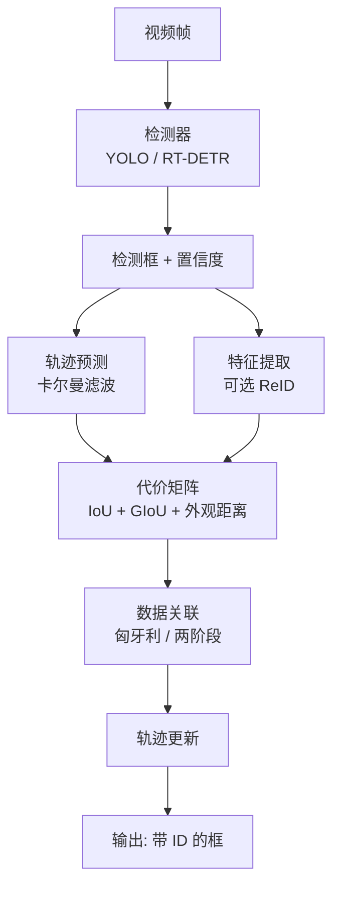

# 关键点、姿态与跟踪

> **核心问题**：多人姿态估计和多目标跟踪的流水线是什么？各自的核心难点在哪？

---

## 1. 关键点检测的三种范式

| 范式 | 做法 | 代表 |
|---|---|---|
| **热力图回归** | 每个关节点一张热力图，argmax 取位置 | OpenPose, HRNet, ViTPose, RTMPose |
| **坐标直接回归** | 每个实例直接回归关节点坐标 | DeepPose, CenterNet |
| **关键点 + 偏移 (Offset)** | 回归热力图 + 亚像素偏移 | CenterNet, RTMPose |

**热力图路线的优势**：每个关点是独立的空间位置投票 → 对遮挡更鲁棒。

---

## 2. 多人姿态估计

### 2.1 OpenPose（2016）

**论文**：*Realtime Multi-Person 2D Pose Estimation using Part Affinity Fields*, CVPR 2016

**两大创新**：

#### 创新 1：热力图（Body Part Detection）

每个关节点一张热力图。用 PAF（Part Affinity Field）把属于同一个人的关节点连起来。

#### 创新 2：PAF（Part Affinity Field）

**关键思想**：不给「关键点属于哪个人」做硬分类，而是用**向量场**表达「这个像素的连线和哪个关节点方向一致」。

```
对每个肢体连接（如 左肩→左肘）：
    每个像素存一个 2D 向量 (dx, dy)，表示"如果这个像素在连接线上，
    它指向哪个方向"
```

**推理时的匹配**：
```
1. 找出所有候选关节点（热力图局部极大值）
2. 对每条肢体连接，计算所有候选对的 PAF 置信度
3. 最大化「总 PAF 得分」的连法 = 最佳多人分配
   （用贪心或二分图匹配）
```

**效果**：第一个实时多人姿态估计框架。

### 2.2 HRNet（2019）

**论文**：*Deep High-Resolution Representation Learning for Human Pose Estimation*, TPAMI 2020
**仓库**：`HRNet/HRNet`

**核心思想**：**在整个网络中保持高分辨率**。

```
传统：并行分支 (低分辨率语义 + 高分辨率细节) → 逐步融合
HRNet：全程并行维护多个分辨率，逐阶段融合
```

**关键结构**：
```
Stage 1: 只用最高分辨率分支
         ↓
Stage 2: 加入低分辨率分支（交换模块）
Stage 3: 再加入更低分辨率分支
Stage 4: 再加一个
```

**交换模块（Exchange Unit）**：把每个分支的分辨率**上采样/下采样**到其他分支的分辨率，然后相加。

**效果**：高分辨率保留了关节点的精确定位能力 → COCO AP 显著提升。

### 2.3 ViTPose（2022）

**论文**：*ViTPose: Simple Vision Transformer Baselines for Human Pose Estimation*, ICCV 2023

**核心**：纯 Transformer + 一个轻量的「姿态 token 」（pose token）。

**设计**：
```
图像 → ViT Backbone → 特征图
    ↓
+ 一个可学习的 pose token（提供全局姿态信息）
    ↓
Transformer Decoder（几层）
    ↓
逐关点回归（每个关点一个独立的 token）
```

**结论**：ViT 特征 + 简单的 pose token 就超过了大部分 CNN 方法，说明**高分辨率特征 + 足够大的模型**是关键。

### 2.4 RTMPose（2023）

**论文**：*RTMPose: Real-Time Multi-Person Pose Estimation Based on MMPose*, arXiv:2307.16426
**仓库**：`open-mmlab/mmpose`

**核心：速度优先的工程优化**

| 技巧 | 说明 |
|---|---|
| **Top-down 的简化** | 用「身体中心点检测」（CenterNet 风格）代替 person bbox 检测 → 简化流程 |
| **SimCC 坐标表示** | 把 2D 坐标回归拆成两个 1D 分类问题（x 方向、y 方向各一张图） |
| **CSPNeXt 骨干** | 兼顾精度和速度 |
| **MIP-NoPE** | 改进的位置编码 |
| **Guided Heatmap Loss** | 用可见性信息引导热力图 |

**SimCC 的巧妙之处**：

传统：回归坐标 $(x, y)$（对 L1 误差敏感）
SimCC：把 $(x,y)$ 编码成两个 1D 分布 $X(x)$ 和 $Y(y)$，分别做分类

```
X 通道: W 个 bin，每个 bin 对应一个 x 坐标
Y 通道: H 个 bin
解码: argmax → 坐标
```

**收益**：
- 分类损失比回归损失稳定
- 亚像素精度通过 bin 的软编码实现
- **推理极快**（不需要额外的 offset 分支）

### 2.5 多人姿态的两条路线

| | Top-down | Bottom-up |
|---|---|---|
| **流程** | 先检测人 → 每人裁剪 → 单人姿态 | 全图一次性预测所有关点 + 归属 |
| **优点** | 精度高（每个人单独处理） | 快，人数多时优势大 |
| **缺点** | 依赖检测器，两步开销 | 归属推断难（需 PAF 等） |
| **代表** | ViTPose, RTMPose, HigherHRNet | OpenPose, CenterPose |

**工程选择**：
- 人数少（<10）→ Top-down
- 人数多 / 密集场景 → Bottom-up
- 追求极致速度 → RTMPose（Bottom-up 的变体，配合中心点检测）

### 2.6 关键点相关任务

| 任务 | 说明 | 代表 |
|---|---|---|
| **动物关键点** | 猫/狗/牛等 | AP-10K |
| **3D 姿态** | 从单图估计 3D 关节 | PIFuHD, 3DMPPE |
| **手部关键点** | 手部精细动作 | InterHand2.6M, MediaPipe Hands |
| **面部关键点** | 68 点人脸 | 3DDFA, MediaPipe Face Mesh |
| **全身关键点** | 人体+手+脸 | OpenPose, RTMPose |

---

## 3. 多目标跟踪（MOT）

### 3.1 任务定义

**输入**：视频序列 $I_1, I_2, ..., I_T$
**输出**：每个目标的轨迹 $\{(b_t^{id}, c^{id})\}$，其中 $id$ 在时间上保持一致

**评测指标**：

| 指标 | 定义 | 范围 |
|---|---|---|
| **MOTA** | $\frac{\sum_t (FN_t + FP_t + IDSW_t)}{T}$ 的补 | 越高越好 |
| **MOTP** | 位置误差的平均（类似 mIoU） | 越高越好 |
| **IDF1** | **身份保持率**（IDF1）：正确关联的 ID 数 / GT ID 数 | 0~1 |
| **HOTA** | **综合指标**（几何+关联的平均） | 0~1，2021 年后主流 |
| **MOTS / MODS** | 分割变体 | |

**HOTA** 的优势：同时衡量「检测质量」和「关联质量」，且各子项可解释。

### 3.2 SORT（2016）

**论文**：*Simple Online and Realtime Tracking*, ICIP 2016

**两个模块**：

#### 卡尔曼滤波预测

**状态向量**（8 维）：
$$
x = (u, v, s, r, \dot{u}, \dot{v}, \dot{s}, \dot{r})
$$
其中 $(u,v)$ 是中心坐标，$s$ 是面积，$r$ 是宽高比。

**假设**：恒速运动。

#### 匈牙利匹配 + IoU 阈值

```
1. 用卡尔曼滤波预测每个 track 的新位置
2. 计算预测框与检测框的 IoU 矩阵
3. 匈牙利匹配
4. IoU < 阈值的匹配 → 判为未匹配
5. 未匹配的检测 → 新建 track
6. 未匹配的 track → 标记为丢失，等 N 帧后删除
```

**SORT 的致命缺陷**：
- **完全依赖检测质量**。检测器的框抖动直接导致 ID 切换
- **没有重识别（ReID）**。目标被遮挡后重新出现 → 新 ID
- 硬件要求高（SORT 要求 1080p / 30 FPS）

**改进方向 → DeepSORT**

### 3.3 DeepSORT（2017）

**论文**：*Deep SORT: Robust Association of Multi-Object Tracking*, arXiv:1703.07402

**三处改进**：

| 改进 | 说明 |
|---|---|
| **ReID 网络** | 用一个 CNN 提取外观特征（128 维），对被遮挡后恢复的目标做身份确认 |
| **级联匹配（cascade matching）** | 按「最近 100 帧内最后出现时间」排序，逐级匹配，先匹配最近的 |
| **匈牙利匹配加入外观代价** | 代价 = λ·运动代价 + (1-λ)·外观代价 |

**级联匹配的必要性**：
- 目标 A 丢失 50 帧，目标 B 丢失 5 帧
- 如果先匹配 B 的轨迹，可能把 A 的检测框错误地分给 B
- 级联匹配保证「最近的先配」→ 更符合直觉

**DeepSORT 的代价**：多一个 ReID 网络（每帧要提取所有目标的特征），延迟增加。

### 3.4 ByteTrack（2021）— 工业界最流行

**论文**：*ByteTrack: Multi-Object Tracking by Associating Every Detection Box*, ECCV 2022
**仓库**：`FoundationVision/ByteTrack`

**核心洞见**：

> **低置信度的检测框不应该被直接丢弃！**
>
> 一个被遮挡的目标，检测器可能只能给出 0.3 的置信度。
> 如果按常规做法（阈值 0.5）丢掉它，轨迹就断了。
> 但只要有**之前的轨迹**（track），这个低置信度框很可能就是那个目标。

**两阶段关联**：

```
Stage 1：高分框关联
    高分框 (conf > 0.6) ↔ 已有轨迹（用卡尔曼预测位置 + IoU）
    → 匹配上的更新轨迹；未匹配的高分框 → 新建轨迹

Stage 2：低分框关联
    低分框 (0.1 < conf < 0.6) ↔ 剩余未匹配的轨迹
    → 匹配上的继续轨迹；未匹配的丢弃
```

**关键收益**：
- 遮挡场景下的 ID 切换大幅减少
- **不需要 ReID 网络** → 速度极快
- MOT 数据集上长期 SOTA

**ByteTrack 的关键工程价值**：它证明了「**不要轻易丢弃低置信度检测**」这个简单观察的巨大价值。

### 3.5 BoT-SORT（2022）

**论文**：*BoT-SORT: Robust Associations Multi-Pedestrian Tracking*, arXiv:2206.14651

**在 ByteTrack 上加了 ReID**：

```
组合：
  ByteTrack 的两阶段关联（运动 + 匹配）
  + ReID 的外观特征（相机内 + 跨相机）
  + GIoU（几何）
  + Kalman 滤波的运动预测
```

**相机内 vs 跨相机**：把 ReID 特征分两组，一组用所有轨迹库（全局），一组只用当前相机（局部）。

### 3.6 OC-SORT（2023）

**论文**：*Observation-Centric SORT: Rethinking SORT for Robust Multi-Object Tracking*, CVPR 2023

**问题**：SORT 的卡尔曼滤波假设「恒速」，但实际运动可能是**突然转向**（机器人、运动员、路口车辆）。

**OC-SORT 的四个机制**：

| 机制 | 说明 |
|---|---|
| **Observation-Centric 运动模型** | 用**观测**而非预测更新状态（更鲁棒） |
| **Observation-Centric 重关联** | 用历史观测做第二阶段匹配 |
| **Observation-Centric Recovery** | 用一组历史观测重新估计丢失目标的运动 |
| **Observation-Centric 虚拟轨迹** | 丢失期间用虚拟观测补齐轨迹，保持轨迹连续 |

### 3.7 MOT 方案对比

| 方案 | ReID | 速度 | 精度 | 适用 |
|---|---|---|---|---|
| **SORT** | ❌ | 极快 | 低 | 固定摄像头、目标不遮挡 |
| **DeepSORT** | ✅ | 慢 | 中 | 遮挡多、离线 |
| **ByteTrack** | ❌ | **很快** | **高** | **通用首选** |
| **BoT-SORT** | ✅ | 快 | 高 | 跨摄像头 |
| **OC-SORT** | ❌ | 快 | 高 | 运动突变场景 |
| **Deep OC-SORT** | ✅ | 中 | 最高 | 精度优先 |
| **StrongSORT** | ✅ | 中 | 最高 | 复杂场景 |
| **BoT-SORT + ReID** | ✅ | 中 | 最高 | 生产级 |

---

## 4. 跟踪的完整流水线



**关键工程点**：
1. **检测器决定上限**。跟踪算法再好，检测器漏检就断轨
2. **置信度阈值**是跟踪质量的第一个调节点（ByteTrack 的两个阈值）
3. **ReID 特征的提取耗时**常被低估（要 crop + forward 每个目标）
4. **视频帧的处理应该用多线程**：读帧、后处理、推理、绘制分离

---

## 5. 实战建议

### 5.1 选型

| 场景 | 推荐 |
|---|---|
| **固定摄像头、无遮挡** | SORT（最简单） |
| **通用视频、多目标** | **ByteTrack**（性价比最高） |
| **遮挡严重/跨摄像头** | BoT-SORT 或 Deep OC-SORT |
| **行人重识别（跨摄像头找人）** | DeepSORT + 专门的 ReID 模型（OSNet） |
| **运动突变（机器人/无人机）** | OC-SORT |
| **3D 场景** | 需要 3D 检测器 + 3D 卡尔曼滤波 |

### 5.2 参数设置

```python
# ByteTrack 示例（supervision 库）
tracker = sv.ByteTrack(
    track_activation_threshold=0.25,   # 低于此不新建轨迹
    lost_track_buffer=30,               # 丢失后保留多少帧
    minimum_matching_threshold=0.8,     # 匹配度阈值
    frame_rate=30,                      # 影响速度自适应
)
```

**调参优先级**：
1. `track_activation_threshold`（建轨迹的置信度门槛）—— 影响最多
2. `lost_track_buffer`（轨迹保留帧数）—— 遮挡场景要加大
3. 检测器的 `conf` 阈值 —— ByteTrack 需要**较低的** conf（因为它靠低分框续轨）

> **关键**：用 ByteTrack 时，检测器的 conf 阈值应该设得**比常规更低**（如 0.1~0.25），而不是 0.5。

---

## 6. 工程结论

1. **ByteTrack 是当前 MOT 的默认选择**：无 ReID、快、精度高，集成成本低。
2. **用 ByteTrack 时降低检测器的 conf 阈值**。这是最常见的错误配置。
3. **跟踪质量的上限由检测器决定**。想提升跟踪，先提升检测。
4. **ReID 是双刃剑**：提升跨遮挡/跨相机的身份保持，但引入延迟和显存。生产环境先不上，确认需要再加。
5. **Top-down 姿态估计精度更高，Bottom-up 更快**。人数少的场景选 Top-down。
6. **RTMPose 是实时姿态的性价比首选**。SimCC 的坐标表示值得学习——分类比回归稳定。

---

## 🔗 相关

- 检测基础 → [`03-单阶段检测器.md`](./03-单阶段检测器.md)
- 分割 → [`07-分割实例与全景.md`](./07-分割实例与全景.md)
- 部署 → [`../01-YOLO/08-导出部署与推理加速.md`](../01-YOLO/08-导出部署与推理加速.md)
