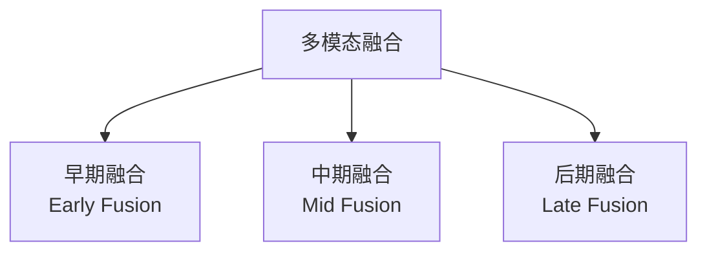

# 3D 检测与多模态融合

> **核心问题**：自动驾驶里的目标检测，为什么必须放到 3D 空间里做？BEV 变换是怎么解决的？

---

## 1. 为什么需要 3D 检测

**2D 检测在自动驾驶中的三个根本缺陷**：

| 缺陷 | 说明 |
|---|---|
| **没有深度** | 知道「车在哪」，不知道「有多远」 |
| **透视歧义** | 2D 框无法判断物体的真实朝向和尺寸（近处小车和远处大车可以有相同的 2D 框） |
| **遮挡严重** | 相邻车辆在图像上重叠，2D 检测器无法区分 |

**3D 检测的输出**：
$$
\{(x, y, z, w, l, h, \theta, \text{class})\}
$$
其中 $(x,y,z)$ 是 3D 中心，$(w,l,h)$ 是尺寸，$\theta$ 是朝向（yaw）。

---

## 2. 数据集

| 数据集 | 年份 | 规模 | 传感器 | 特点 |
|---|---|---|---|---|
| **KITTI** | 2012 | 7481 帧训练 | 相机 + 激光雷达 | 第一个 3D 基准，场景单一（市区） |
| **nuScenes** | 2019 | 1000 场景 / 14939 帧 / 391K 目标 | 6 相机 + 5 雷达 + 6 激光雷达 | **多模态标准**，23 类 |
| **Waymo Open** | 2020 | 1150 场景 / 200K 帧 | 5 相机 + 5 雷达 + 4 激光雷达 | 规模大，质量高 |
| **Argoverse 2** | 2023 | 1000 场景 | 7 相机 + 2 雷达 | 更长序列 |
| **ONCE** | 2023 | 16K 片段 | 相机 + 雷达 | 单帧为主 |
| **nuPlan** | 2023 | 1500 小时 | 全套 | 规划数据集 |

**共同特点**：都有**多相机标定参数**（内参、外参），这是 3D 检测的基础。

---

## 3. 点云数据表示

### 3.1 三种主流表示

| 表示 | 说明 | 代表 |
|---|---|---|
| **Point-based** | 直接处理点云，用 PointNet 提取特征 | PointRCNN, PointPillars, CenterPoint |
| **Voxel-based** | 转体素，用 3D 卷积 | SECOND, VoxelNet |
| **Pillar-based** | 转「柱」（垂直方向压缩） | **PointPillars**（最快） |
| **BEV-based** | 投影到鸟瞰图 | BEVDet, BEVFormer, BEVFusion |
| **Range-view** | 极坐标投影 | RangeDet, RSN |

### 3.2 坐标系约定（nuScenes）

```
全局坐标系 (global):  x 前, y 左, z 上
ego 坐标系 (ego):     x 前, y 左, z 上（自车为原点）
相机坐标系 (cam):     x 右, y 下, z 前（OpenCV 约定）
激光坐标系 (lidar):   x 前, y 左, z 上
```

**传感器标定**：
```python
# nuScenes 的标定信息
calibrated_sensor: {
    'camera_intrinsic': [[fx, 0, cx], [0, fy, cy], [0, 0, 1]],
    'sensor2ego_rotation': 4x4 齐次矩阵,
    'sensor2ego_translation': [x, y, z]
}
```

**相机 → 像素投影**：
$$
\begin{aligned}
P_{cam} &= T_{ego \to cam} \cdot T_{ego \to global} \cdot P_{global} \\
u &= \frac{P_{cam}[0]}{P_{cam}[2]}, \quad
v = \frac{P_{cam}[1]}{P_{cam}[2]} \\
u &= f_x \cdot u + c_x, \quad v = f_y \cdot v + c_y
\end{aligned}
$$

---

## 4. Point-based 与 Voxel-based

### 4.1 PointRCNN（2018）

**论文**：*PointRCNN: 3D Object Proposal Generation and Detection from Point Cloud*, CVPR 2019

**流程**：
```
Stage 1（无监督）：
    点云 → PointNet++ 特征 → 生成 3D proposal（区域投票）
Stage 2（有监督）：
    proposal → RoI Pooling（3D）→ RefineNet → 分类 + 框回归
```

**关键**：Stage 1 的区域投票（Region Voting）不依赖 GT —— 每个点投票给一个种子点，种子点聚合得到候选框。

### 4.2 SECOND（2018）

**论文**：*SECOND: Sparsely Embedded Convolutional Detection*, ECCV 2018

**Voxelization**：
```
点云 → (x, y, z) 量化到体素网格 → 二值占据栅格
     → 每个非空体素存特征（点数、均值等）
```

**稀疏卷积（Sparse Conv）**：
- 3D 稀疏体素中 90%+ 是空的
- 稀疏卷积只在非空位置计算 → 比 dense 3D conv 快 10×

**稀疏卷积的关键操作**：
```
gather → 计算规则卷积 → scatter
（只在非空体素上做 3×3×3 卷积）
```

### 4.3 PointPillars（2019）

**论文**：*PointPillars: Fast Encoders for Object Detection from Point Clouds*, CVPR 2019

**关键创新：Pillar（柱）表示**

```
点云 → 去掉 Z 轴（保留 x, y），按 xy 划分 pillar（网格）
     → 每个 pillar 内：点数、质心、偏移量、均值高度、最大高度
     → Scatter 到 BEV 伪图像 (H × W × C)
     → 2D CNN
```

**为什么有效**：
- 保留了 XY 空间布局（不像纯 voxel 丢 z）
- 计算是在 2D CNN 上做 → 成熟且快
- **推理速度极快**（~30 FPS）

**缺点**：pillar 内的 z 信息被压缩，无法精确表示 3D 结构。

### 4.4 CenterPoint（2021）

**论文**：*CenterPoint: Towards 3D Object Detection via Center-based 3D Object Proposals*, CVPR 2021

**关键：把 3D 检测变成「BEV 上的中心点检测」**

```
点云 → Voxelization + 稀疏 3D CNN
     → BEV 特征图 (H×W×C)
     ↓
  BEV 上的 CenterNet（2D 中心点检测）
     ↓
  3D 框 = (中心 xy, 高度 z, 尺寸 whl, yaw)
```

**中心点表示的优越性**：
- 目标在 BEV 上的中心是**唯一**的 → 天然无重复，不需要 NMS 式的去重（可以用 peak 提取）
- 相当于「BEV 上的 anchor-free」
- 证明了 CenterNet 在 3D 上同样有效

**性能**：nuScenes 上大幅超越此前的点云方法。

---

## 5. 多模态融合

### 5.1 三种融合方式



| 方式 | 做法 | 优点 | 缺点 |
|---|---|---|---|
| **早期融合** | 原始数据层面融合（点云 + 深度图拼成 4 通道） | 简单 | 要求标定精确，对模态缺失不鲁棒 |
| **中期融合** | 特征层面融合（BEV 特征相加/注意力） | **主流** | 需先统一到 BEV |
| **后期融合** | 各模态独立检测，融合结果 | 模态缺失鲁棒 | 特征互补性差 |

### 5.2 LSS（Lift-Splat-Shoot, 2020）

**论文**：*Lift, Splat and Shoot: Encoding Images into Arbitrary 3D Radiance Fields for BEV Representation*, CVPR 2020

**核心：把 2D 特征「提升」到 3D 体素，再「泼溅」到 BEV**

```
1. Lift（提升）：
   图像特征图 (H×W×C) + 像素深度分布 (H×W×D)
   → 外积 → 3D 体素特征 (H×W×D×C)
   （用深度分布而非单一深度，保留不确定性）

2. Splat（泼溅）：
   3D 体素 → 用 3D→2D 投影矩阵 → 散射到 BEV 网格
   （用 voxel pooling，比 bilinear 更快）

3. Shoot（投影视图）：
   BEV 特征 → 用自车运动外推 → 投影到未来时间
```

**LSS 的历史地位**：确立了「**图像 → BEV**」的标准范式，后面所有图像 BEV 方法都建立在它之上。

### 5.3 BEVDet（2022）

**论文**：*BEVDet: High-performance Multi-camera 3D Object Detection in Bird-Eye-View*, arXiv:2212.10088

**对 LSS 的改进**：

| 改进 | 说明 |
|---|---|
| **显式深度监督** | 用激光雷达投影到图像的深度作为监督（而不是纯靠 LSS 的隐式深度） |
| **尺度自适应的深度分配** | 不同图像的深度分布不同（近处相机 vs 远处相机），动态调整 |
| **两阶段 refinement** | 先粗 BEV 检测，再提取 ROI 特征 refine |

**性能**：nuScenes Camera-only NDS 达到 49.9。

### 5.4 BEVFormer（2022）

**论文**：*BEVFormer: Learning Bird's-Eye-View Representation from Multi-Camera Images via Spatiotemporal Transformers*, ECCV 2022

**核心：用 Transformer 生成 BEV**

```
1. 预定义 BEV 网格（BEV queries, 如 200×200）
2. 每个 BEV query 通过「空间交叉注意力」从多相机特征图采样
   - 关键：BEV query 的 3D 位置 → 投影到各相机 → 得到参考点
   - 通过 deformable attention 采样特征
3. 用「时序自注意力」聚合历史帧的 BEV 特征（带 ego motion 补偿）
```

**BEVFormer v2（2023）**：引入**透视分割监督**（perspective supervision）—— 从 BEV 特征图生成一个分割 mask，监督它与「把 BEV 特征投影回图像」的伪标签一致。

### 5.5 PETR（2022）

**论文**：*PETR: Position Embedding Transformation for Multi-View 3D Object Detection*, ECCV 2022

**不同的思路：不解 BEV，直接在 3D 位置嵌入上做 Transformer。**

```
1. 多相机图像特征 → 各自的 3D 位置嵌入（PE）
   （每个特征点有确定的 3D 坐标 → 编码成位置嵌入）
2. 把所有相机的特征（带 3D PE）拼在一起
3. Transformer Encoder（全局 3D 交互）
4. 检测头
```

**优点**：不需要显式的 BEV 网格 → 显存友好、速度快
**缺点**：丢失了显式的 BEV 空间结构

### 5.6 BEVFusion（2022）

**论文**：*BEVFusion: A Simple and Robust LiDAR-Camera Fusion Framework*, NeurIPS 2022

**两阶段融合**：

```
Stage 1（BEV 层面融合）：
    相机 → LSS → BEV 特征
    激光 → PointPillars/CenterPoint → BEV 特征
    BEV 特征相加（或门控融合）

Stage 2（图像层面 refinement）：
    用融合后的 BEV 特征生成「图像视角的引导特征」
    回到图像特征上做 refine（类似 BEVDet 的两阶段）
```

**为什么两阶段？**
- 早期融合时，相机特征有深度不确定性，直接融合会引入噪声
- 先在 BEV 融合（几何对齐好），再用融合结果指导图像特征 refine（补细节）

**性能**：nuScenes NDS 71.7（当时 SOTA）。

### 5.7 占据栅格（Occupancy）

**问题**：3D 检测只能输出「有标注的目标」，但自动驾驶需要理解「所有占据空间」。

**Occupancy Network 范式**：

```
多相机图像 → BEV/体素特征 → 预测每个体素的占据状态 + 语义类别
```

**代表工作**：

| 模型 | 年份 | 数据集 | 指标 |
|---|---|---|---|
| **SurroundOcc** | 2023 | nuScenes | 占据 mIoU |
| **Occ3D** | 2023 | nuScenes | 提供了占据标注 |
| **TPVFormer** | 2023 | nuScenes | 三视图（透视+俯视+侧视） |
| **OccFormer / BEVFormer-Occ** | 2023 | nuScenes | — |
| **FB-BEV** | 2023 | nuScenes | 前融合 + 占据 |
| **COTR / SparseOcc** | 2024 | nuScenes | 稀疏占据（更省算力） |
| **RenderOcc** | 2024 | Occ3D-nuScenes | 用 NeRF 渲染监督 |

**占据的价值**：
- 覆盖了「没有标注但占据空间」的区域（路面、建筑物、植被）
- 为**规划和仿真**提供完整的空间理解
- 可以直接从占据生成 3D 检测框

### 5.8 端到端自动驾驶（UniAD, 2023）

**论文**：*Planning-oriented Autonomous Driving*, CVPR 2023

**首次把感知 + 预测 + 规划统一到一个模型里**：

```
多相机图像 → BEV 特征
    ↓
┌────────┬────────┬────────┬────────┐
↓        ↓        ↓        ↓
检测头   跟踪头   运动预测  占据预测
└────────┴────────┴────────┴────────┘
              ↓
         轨迹规划头 (Planning)
              ↓
         未来的自车轨迹
```

**贡献**：证明「以规划为导向」的任务设计（而不是以感知指标为导向）能提升整个系统的表现。

---

## 6. 融合策略的工程选择

| 你的传感器配置 | 推荐 |
|---|---|
| **只有相机** | BEVDet / BEVFormer / PETR / StreamPETR |
| **只有激光** | CenterPoint（快且准）或 VoxelNet / SECOND |
| **相机 + 激光** | **BEVFusion**（当前主流）或 FUTR3D / CMT |
| **雷达 + 相机** | FUTR3D / CRN |
| **要占据栅格** | OccFormer / SparseOcc（可加在融合模型之上） |
| **单帧 vs 时序** | 单帧：BEVDet；时序：BEVFormer / StreamPETR / Sparse4D |

---

## 7. 工程结论

1. **3D 检测的门槛在数据，不在模型**。没有多相机标定的数据集，一切免谈。
2. **点云-only 首选 CenterPoint**，相机-only 首选 BEVDet/BEVFormer，两者融合首选 BEVFusion。
3. **BEV 是当前的事实标准中间表示**。所有主流多相机 3D 方法都在 BEV 上做融合。
4. **占据栅格比 3D 检测更通用**。如果你的任务需要「完整场景理解」（而不只是找车），直接做占据。
5. **相机-only 与激光融合的性能差距仍然存在**（NDS 上通常 5~10 点），纯视觉方案要达到融合方案还有距离。
6. **时序信息收益很大**。BEVFormer / StreamPETR 用历史帧能显著提升遮挡和远距离目标的检测率。

---

## 🔗 相关

- Transformer 基础 → [`05-Transformer检测器.md`](./05-Transformer检测器.md)
- 开放词汇 → [`10-开放词汇与基础模型.md`](./10-开放词汇与基础模型.md)
- 训练工程 → [`13-训练工程与性能优化.md`](./13-训练工程与性能优化.md)
