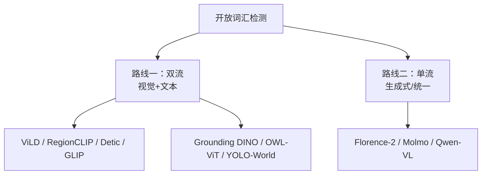

# 开放词汇与基础模型

> **核心问题**：怎么让检测器认识「训练时没见过」的类别？这条线通往 CLIP、Grounding DINO、YOLO-World、Florence-2 和 Qwen-VL。

---

## 1. 问题定义

**闭集检测（Closed-set）**：类别集合 $C = \{c_1, ..., c_K\}$ 固定且已知，模型输出这 K 类之一。

**开放词汇检测（Open-Vocabulary Detection, OVD）**：测试时可能出现**训练时未见过的类别**。

$$
\mathcal{C}_{test} \not\subseteq \mathcal{C}_{train}
$$

**两类任务**：

| 任务 | 输入 | 输出 |
|---|---|---|
| **文本引导（Text-prompted）** | 文本描述（可零样本） | 检测框 + 文本对齐分数 |
| **图像引导（Image-prompted）** | 1~N 张参考图 | 检测框 + 视觉相似度分数 |

**核心挑战**：
1. **视觉-语言对齐**：图像特征要和文本特征在同一空间可比
2. **定位能力**：CLIP 会「认」但不会「指出在哪」
3. **泛化与遗忘的平衡**：加新类别时不能破坏已有能力

---

## 2. 两条技术路线



| 路线 | 结构 | 速度 | 精度 | 代表 |
|---|---|---|---|---|
| **双流** | 图像编码器 + 文本编码器（可预计算文本特征） | 中~快 | 中 | GLIP, Grounding DINO, YOLO-World |
| **单流/生成式** | 一个模型同时处理图像和文本 | 慢 | 高 | Florence-2, Molmo, Qwen2-VL |

---

## 3. 路线一：双流方法

### 3.1 ViLD（2021）

**论文**：*Learning to Detect Every Thing in an Open World*, ECCV 2021

**思想**：把开放词汇检测拆成两个子任务：
1. **类别无关定位**（generalized R-CNN）：找到所有「物体」区域，不管类别
2. **区域分类**：用 CLIP 对区域做分类

```
Mask R-CNN → RPN 找出候选框（类别无关）
          → RoI Align 提取特征
          → CLIP 图像编码器编码
          → 与预计算的文本特征做余弦相似度
```

**问题**：CLIP 是全局编码器，对小区域效果差；且 RPN 是在 COCO 上训练的，倾向于 COCO 类别。

### 3.2 RegionCLIP（2021）

**论文**：*RegionCLIP: Region-based Language-Image Pre-training for Open-world Object Detection*, CVPR 2022

**改进**：不用 RoI Align（破坏 CLIP 特征），而是用**区域提议网络 + 滑窗**在原图上裁剪区域，再送 CLIP。

**Region Proposal Network (RPN)**：
- 在 CLIP 特征图上滑窗（多个尺度）
- 对每个窗口，用一个轻量分类头预测「这里有物体吗」
- 收集高分的窗口作为区域提议

### 3.3 Detic（2022）

**论文**：*Detecting Twenty-thousand Classes using Image-level Supervision*, ECCV 2022

**关键思想：不用框标注，用「图像级标签」训练**

```
训练数据：ImageNet（每张图只有类别标签，没有框）
  ↓
用 Self-Training 生成伪框
  ↓
用框 + CLIP 特征训练检测器
```

**这是开放词汇领域最重要的思路转变**：把「检测标注昂贵」的问题，变成「分类标注廉价」。

**结果**：在 LVIS 上检测 20,000 类。

### 3.4 GLIP（2021/2022）

**论文**：*GLIP: Swapped-Teacher Grounding for Open-Vocabulary Object Detection*, CVPR 2022
**仓库**：`microsoft/GLIP`

**核心：把 grounding（短语-区域对齐）预训练迁移到检测**

**Grounding**：输入图像 + 文本短语，输出每个短语对应的框。

**做法**：
```
图像 → Swin Transformer 骨干
         ↓
      文本 → BERT 编码（每个词一个特征）
         ↓
      Deep Fusion: 图像区域特征 + 文本词特征 拼接后过 MLP
         ↓
      分类头 → 每个 (区域, 词) 对的对齐分数
```

**关键**：**Deep Fusion** 让文本条件参与特征提取，而不是只在最后的分类头拼接。

**训练技巧**：
- **Self-Training**：用 Grounding DINO 生成伪标签提升效果
- **Long-tail 处理**：对高频类别过采样

### 3.5 OWL-ViT（2022）

**论文**：*OWL-ViT: Simple Open-Vocabulary Object Detection with Vision Transformers*, ECCV 2022
**仓库**：`google-research/OWL-ViT`

**核心：把 ViT 的 token 变成「检测 query」**

```
图像 → ViT → patch tokens
                   ↓
        每个 token 预测一个框（class-agnostic）
                   ↓
        每个 token 与所有文本嵌入计算相似度
                   ↓
        取相似度最高的文本作为类别
```

**关键设计**：
- **类无关的框预测**：模型只预测「这里有个框」，不预测类别
- **类别由文本相似度决定** → 天然支持任意类别
- **单个文本嵌入矩阵**：预先计算所有候选类别的文本特征

**效率优化**：只对 top-k 个 token 计算文本相似度。

### 3.6 OWLv2（2023）

**改进**：
1. **更好的预训练**（在 WebLI 数据集上大规模训练）
2. **自训练数据增强**：用自身在伪标注数据上训练
3. **双层匹配**：同时用文本相似度和 IoU 做匹配
4. **改进的 query 初始化**

### 3.7 Grounding DINO（2023）— 事实标准

**论文**：*Grounding DINO: Marrying DINO with Grounded Pre-Training for Open-Set Object Detection*, arXiv:2303.05499
**仓库**：`IDEA-Research/GroundingDINO`

**核心：DINO + Grounding Pre-training**

```
┌─────────────────────────────────────────────┐
│  Text Backbone (BERT / CLIP)                 │
│  "a yellow school bus ."                    │
│      ↓ 词级特征 + 位置编码                   │
│      ↓                                      │
│  Image Backbone (Swin / ConvNeXt)           │
│      ↓ 多尺度特征 + 位置编码                 │
│      ↓                                      │
│  Feature Enhancement: 图像特征与文本特征     │
│  在每个尺度上拼接（Deformable Attention）    │
│      ↓                                      │
│  Language-Guided Query Selection            │
│  用文本相关性给每个 query 分配语言特征       │
│      ↓                                      │
│  Transformer Decoder (6 层)                 │
│      ↓                                      │
│  900 个 query → 框 + 对齐分数                │
└─────────────────────────────────────────────┘
```

**三个关键设计**：

#### 设计 1：跨模态融合（Cross-Modality Grounding）

不是简单的特征拼接，而是用 **Deformable Attention** 让图像特征「去文本特征那里取信息」。

#### 设计 2：Language-Guided Query Selection

DETR 的 query 是纯可学习的（与图像无关）。Grounding DINO 用**文本相关性**给 query 分配语言特征：

```
对每个 query：
    用它的图像特征（[x, y, w, h]）去和文本 embedding 算相似度
    取最相似的 K 个文本 token 的特征，作为该 query 的语言条件
```

**效果**：query 天然与文本对齐 → 收敛更快。

#### 设计 3：900 个 Query

比 DETR 的 100 个多得多，覆盖能力更强。

**性能**：

| 数据集 | 指标 | Grounding DINO (Swin-T) |
|---|---|---|
| COCO | AP | 45.9 |
| LVIS | AP | 33.4 (minival) |
| LVIS rare | AP | 19.6 |
| ODinW-35 | 平均 AP | 47.4 |

**Grounding DINO 是目前开放词汇检测的事实标准**，几乎所有「文本 → 检测」的下游都基于它。

### 3.8 YOLO-World（2024）

**论文**：*YOLO-World: Real-Time Open-Vocabulary Object Detection*, CVPR 2024
**仓库**：`AILab-CVC/YOLO-World`

**核心：把 CLIP 文本编码器嫁接到 YOLO**

```
文本 "dog" → CLIP 文本编码器 → 文本嵌入 (512维)
                              ↓
              线性投影 (Projection) → 检测头的嵌入空间
                              ↓
YOLO 检测头（分类分支与文本嵌入做点积）
```

**三个设计**：

#### 设计 1：Text-Embedding 对齐

```
文本特征 → Linear Projection → 与检测头的分类特征同一空间
```

**推理时**：文本嵌入可以**离线预计算**（类别固定时）→ 推理速度接近闭集 YOLO。

#### 设计 2：预训练检测头（Text-to-Box Head）

```
预训练阶段：
  用大规模图文数据（CC3M/CC12M/GQA/Objects365）训练
  检测头学会「把任意文本嵌入映射到框」
  
微调阶段：
  用闭集数据（如 COCO）微调，保持开放词汇能力
```

#### 设计 3：YOLO-World v2（2025）的改进

- 大规模预训练（引入 MAE 预训练）
- **弱监督图文对**（用 Grounding DINO 生成伪标签）
- **Region-Text 对比损失**

**性能**：COCO 75.4 AP（多模型融合），LVIS 55.4 AP，**推理速度 250+ FPS**。

---

## 4. 路线二：生成式 / 统一模型

### 4.1 Florence-2（2024）

**论文**：*Florence-2: Advancing a Unified Representation for a Variety of Vision Tasks*, CVPR 2024
**仓库**：`microsoft/Florence-2`

**核心：用「统一的任务提示」把多种视觉任务都变成「文本生成」**

```
输入：图像 + 任务提示
  ┌──────────────────────────────────┐
  │ <CAPTION_TO_PHRASE_GROUNDING>     │ → "a yellow school bus"
  │ <OPEN_VOCABULARY_DETECTION>       │ → <loc_84><loc_...>yellow bus</loc_>
  │ <DENSE_REGION_CAPTION>            │ → 每个区域一段描述
  │ <REGION_PROPOSAL>                 │ → 一系列框
  │ <CAPTION>                         │ → 整图描述
  │ <OCR>                             │ → 文字
  │ <OCR_WITH_REGION>                 │ → 带位置的文字
  └──────────────────────────────────┘
```

**输出是序列**（带位置 token 的文本），而不是固定格式的数组。

**架构**：
- **视觉编码器**：DaViT（基于 DaViT 的层次化编码器）
- **文本编码器**：BART（seq2seq）
- **多模态编码器**：用 [CLS] + average pooling 融合（简洁有效）
- 训练数据：FLD-5B（54M 图像，**5.4 亿个文本-框对**）

**优势**：
- 一个模型做 7+ 种任务
- 支持零样本
- 输出灵活（可以要「区域描述」「框」「描述短语」）

### 4.2 Molmo（2024）

**论文**：*Molmo and PixMo: Open Weights and Open Data for State-of-the-Art Multimodal Models*, arXiv:2409.17146
**仓库**：`allenai/Molmo`

**核心：把「指代」做成原生能力**

**"Pointing"（指代）能力**：
```
输入：图像 + "point to the [描述]"
输出：<point>x1 y1</point> —— 一个坐标
```

这是与 Grounding DINO 等价的能力，但用生成式模型实现。

**数据构建**：
- **PixMo-Points**：让人类在图上点击指代物体 → 260 万个点
- **PixMo-Count**：计数数据
- **PixMo-Explain**：解释性描述

**架构**：
- **视觉编码器**：ViT-L/14（OpenAI CLIP 初始化）
- **连接器**：pixel shuffle（把 2×2 相邻 patch 合并）→ 576 token
- **语言模型**：Qwen2-7B

**性能**：在多个 benchmark 上超过 GPT-4o（点指代和计数任务尤其强）。

### 4.3 Qwen2-VL / Qwen2.5-VL（2024/2025）

**论文**：*Qwen2-VL: Enhancing Vision-Language Model's Perception of World at Any Resolution*, arXiv:2409.12191

**核心技术：动态分辨率（Naive Dynamic Resolution）**

```
不 resize 到固定尺寸！
把原图按 28×28 像素的 patch 划分，
保留所有 patch（数量可变），并加二维位置编码
```

**优势**：
- 小目标细节不丢失
- 长文档/高分辨率图能看清
- 支持多图输入

**检测能力**：Qwen2-VL 支持输出 grounding 坐标（`<|box_start|>(x1,y1),(x2,y2)<|box_end|>`）。

**Qwen2.5-VL** 进一步加了：
- 绝对时间定位（视频）
- 文本 grounding（ grounding 文本区域）
- 结构化输出

### 4.4 其他重要工作

| 模型 | 年份 | 关键点 |
|---|---|---|
| **LISA** | 2023 | 用 [SEG] token 触发分割，1B 参数就能做复杂推理 |
| **GLaMM** | 2023 | Pixel Grounding + LLaVA 架构 |
| **Shikra** | 2023 | 无坐标编码的自然语言指代 |
| **Kosmos-2** | 2023 | 统一理解与生成，grounding 作为中间表示 |
| **All-Seeing Project (ASG)** | 2024 | 统一的分割、描述、定位、问答 |
| **Grounded-SAM** | 2023 | Grounding DINO + SAM |
| **DetCLIPv3** | 2024 | 纯对比学习的 OVD |
| **CoDet** | 2024 | 协同训练的 OVD |

---

## 5. 开放词汇检测的评测

### 5.1 基准

| 基准 | 特点 |
|---|---|
| **LVIS val / minival** | **最常用**。1200 类，长尾分频率统计 |
| **COCO** | 闭集类别，但常作为微调后的评测 |
| **ODinW-35** | 35 个跨领域数据集的集合 |
| **OVR-COCO** | 罕见类别的召回率 |
| **Objects365 / VG** | 大规模，用于预训练 |

**关键指标**：LVIS 上必须看 **AP_r / AP_c / AP_f** 和 **rare 类的 AP**。

### 5.2 评测协议的三种变体

| 协议 | 做法 | 影响 |
|---|---|---|
| **Base-to-Novel** | 在 base 类上训练，在 novel 类上测 | 最能反映泛化 |
| **Generalized Zero-Shot** | 在 base 上训练，在 base+novel 上测 | 最接近实际 |
| **Crosstab** | 按类别频次分组交叉评测 | 最严格 |

---

## 6. 选型

| 需求 | 推荐 | 理由 |
|---|---|---|
| **实时 + 开放词汇** | **YOLO-World** | 250+ FPS，文本可预计算 |
| **实时 + 零重训任务切换** | **YOLOE** | 潜在空间对齐，运行时切提示 |
| **精度 + 文本提示** | **Grounding DINO** | 事实标准，社区生态最全 |
| **图像提示（找相似物）** | **OWLv2 / Detic** | 支持 few-shot 图像提示 |
| **多任务统一** | **Florence-2** | 7 种任务一个模型 |
| **点指代 / 计数** | **Molmo** | Pointing 能力最强 |
| **通用多模态理解** | **Qwen2.5-VL** | 中文强，生态好，工具调用好接 |
| **标注辅助（预标注）** | **Grounding DINO + SAM** | 文本 → 框 → 精 mask |

---

## 7. 工程结论

1. **Grounding DINO 是开放词汇检测的「事实基座」**。要接文本提示，先从它开始。
2. **YOLO-World 是「实时 + 开放词汇」的唯一成熟选择**。固定类别 + 需要速度，直接上它。
3. **Qwen2.5-VL 这类多模态大模型正在快速吞并专用检测模型的功能**。如果你的需求是「理解 + 定位 + 对话」，用 VLM 而不是拼检测器。
4. **开放词汇 ≠ 高精度**。开放词汇模型在 base 类上通常比闭源专用模型低 5~10 AP。
5. **「用检测器 + 跟踪 + 规则」还是「用 VLM」**：前者更准更快更可控，后者更灵活更通用。**混合方案往往最好**（VLM 做高层理解，检测器做精确执行）。
6. **预计算文本嵌入是开放词汇落地的前提**。每次推理都跑 CLIP 文本编码器是不可接受的延迟。

---

## 🔗 相关

- DETR 系 → [`05-Transformer检测器.md`](./05-Transformer检测器.md)
- 分割（SAM）→ [`07-分割实例与全景.md`](./07-分割实例与全景.md)
- YOLO 开放词汇 → [`../01-YOLO/05-YOLO11-26新周期.md`](../01-YOLO/05-YOLO11-26新周期.md)
- VLM 与 RAG 的衔接 → [`../03-RAG/14-多模态RAG.md`](../03-RAG/14-多模态RAG.md)
