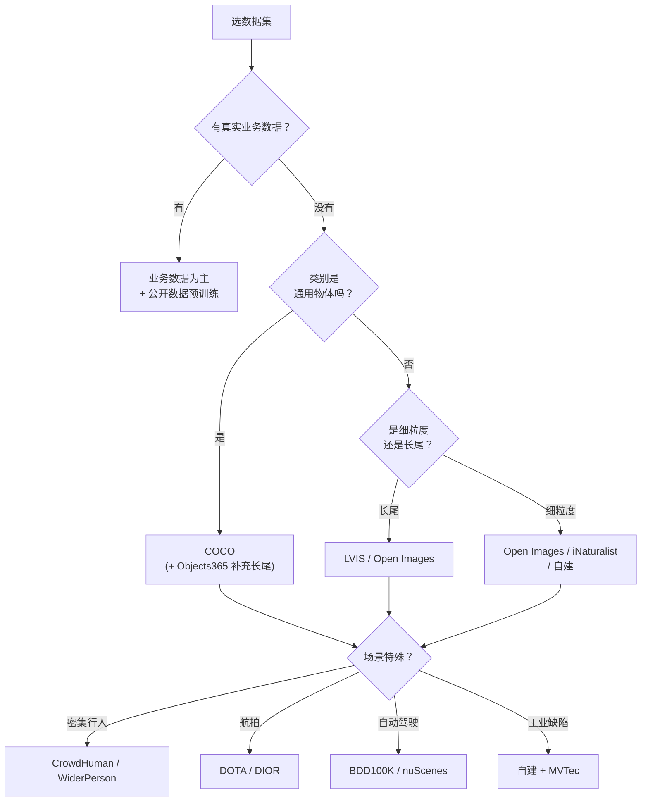

# 数据集大全

> **核心问题**：训练一个检测器，数据集怎么选？标注格式是什么？许可证要注意什么？

---

## 1. 主流检测数据集速查

| 数据集 | 年份 | 图像 | 框 | 类别 | 标注格式 | 许可 |
|---|---|---|---|---|---|---|
| **PASCAL VOC** | 2007–12 | 11.5K | 27K | 20 | XML | 自定义（非商业研究） |
| **COCO** | 2014–17 | 330K | 1.5M | **80** | JSON | CC BY 4.0（标注） |
| **Open Images** | 2013–23 | 9.2M | 16M | **600** | CSV/JSON | CC BY 4.0 |
| **LVIS** | 2019 | 120K | 1.4M | **1200+** | JSON | CC BY 4.0 |
| **Objects365** | 2019 | 1.7M | 10M | **365** | JSON | CC BY-NC 4.0 ⚠️ |
| **Object365 v2** | 2023 | 8.7M | 40M | **365** | JSON | **研究免费** |
| **CrowdHuman** | 2019 | 15K | 470K | 1 | JSON | 非商业 |
| **WiderPerson** | 2019 | 13.8K | 400K | 5 | — | 非商业 |
| **TAO** | 2020 | 28K | 800K | 482 | COCO 格式 | CC BY-NC |
| **Open Images Challenge** | 2019 | 512K | 14M | 500 | CSV | CC BY 4.0 |
| **SA-1B** | 2023 | 11M | 11B | 任意 | COCO 格式 | **CC BY-NC 4.0** ⚠️ |
| **DOTA** | 2019 | 11.7K | 1.8M | 15 | XML | **CC BY-NC-SA 4.0** ⚠️ |
| **Cityscapes** | 2016 | 5K | — | 30 城 | JSON | **非商业** ⚠️ |
| **BDD100K** | 2020 | 100K | 100K | 40 | JSON | **非商业** ⚠️ |
| **KITTI** | 2012–19 | 13K | — | 8 | XML | 非商业 |
| **nuScenes** | 2019 | 1.5K×6 | 1.4M | 23 | JSON | **非商业** ⚠️ |
| **Waymo Open** | 2020 | 200K | 12M | 16 | protobuf | 非商业 |
| **Argoverse 2** | 2023 | 1K | — | 30 | JSON | CC BY-NC-SA |
| **ADE20K** | 2017 | 20K | — | 150 | — | MIT |
| **COCO-Stuff** | 2018 | 164K | — | 171 | PNG | CC BY 4.0 |
| **Mapillary Vistas** | 2019 | 25K | — | 66 | PNG | CC BY-NC-SA ⚠️ |

> **⚠️ 商用警告**：标注为「非商业」的数据集**不能用于商业产品**。COCO、Open Images、LVIS 标注是 CC BY 4.0（可商用），但**图像本身的版权要另行确认**。

---

## 2. 分类数据集（预训练用）

| 数据集 | 图像 | 类别 | 许可 |
|---|---|---|---|
| **ImageNet-1k** | 1.28M | 1000 | 非商业研究 |
| **ImageNet-21k** | 14M | 21K | 非商业 |
| **ImageNet-22k (自监督)** | — | — | — |
| **CLIP pretrain** | 400M | — | 混合 |
| **CC3M / CC12M** | 3M/12M | — | 混合 |
| **LAION-400M / 5B** | 400M/5B | — | 混合 |
| **Objects365 / O365v2** | 1.7M/8.7M | 365 | 研究免费 |

---

## 3. 标注格式详解

### 3.1 YOLO 格式（txt）

```
# 每个目标一行：class_id x_center y_center width height
# 坐标是归一化的 (0~1)，相对于图像宽高
0 0.512500 0.483333 0.225000 0.450000
2 0.753125 0.610417 0.103125 0.216667
```

**规则**：
- 类别 id 从 0 开始
- 归一化坐标
- 空文件表示「无目标」

### 3.2 COCO 格式（JSON）

```json
{
  "images": [
    {"id": 1, "file_name": "000000.jpg", "width": 640, "height": 480}
  ],
  "annotations": [
    {
      "id": 1,
      "image_id": 1,
      "category_id": 1,
      "bbox": [x, y, width, height],       // 像素值，xywh
      "area": 12345,
      "iscrowd": 0
    }
  ],
  "categories": [
    {"id": 1, "name": "person", "supercategory": "person"}
  ]
}
```

**关键字段**：
- `iscrowd=1`：密集区域（不是单个实例），评测时会特殊处理
- `area`：标注面积
- `segmentation`：实例分割的多边形/RLE

### 3.3 Pascal VOC 格式（XML）

```xml
<annotation>
  <folder>images</folder>
  <filename>000001.jpg</filename>
  <size><width>640</width><height>480</height><depth>3</depth></size>
  <object>
    <name>person</name>
    <pose>Unspecified</pose>
    <truncated>0</truncated>
    <difficult>0</difficult>
    <bndbox>
      <xmin>100</xmin><ymin>150</ymin>
      <xmax>250</xmax><ymax>400</ymax>
    </bndbox>
  </object>
</annotation>
```

### 3.4 格式转换

```bash
# Ultralytics 内置
yolo detect convert --data coco8.yaml --format coco --out yolo_labels/
```

**手写转换脚本** → [`../01-YOLO/09-复现手册与避坑.md`](../01-YOLO/09-复现手册与避坑.md) §2.3。

---

## 4. 长尾与特殊场景数据集

### 4.1 LVIS（长尾）

- 1200+ 类，训练集平均每类 **10 个样本**
- 少数类只有 1~5 个
- **必须用联邦评测**（见 [`01-任务定义与评测体系.md`](./01-任务定义与评测体系.md)）

### 4.2 CrowdHuman（密集行人）

- 15K 图像，470K 行人实例
- 平均每张图 **22 个**行人（最大 100+）
- 标注包含「全身可见/部分遮挡/严重遮挡」

**用途**：密集场景检测、行人检测的专用训练集。

### 4.3 WiderPerson（密集行人，更难）

- 13.8K 图像，399.8K 框
- 密度更高，包含小尺寸行人（最小 ~20px）

### 4.4 DOTA（航拍遥感）

- 11.7K 高分辨率图像（800~4000px）
- 1.8M 旋转框
- 15 类（飞机、舰船、车辆等）
- **难点**：密集、小目标、任意方向

**衍生版本**：DOTA-v1.0/1.5/2.0、DIOR（20 类）、HRSC2019（舰船）、FAIR1M（细粒度）。

### 4.5 TAO（视频目标检测）

- 28K 视频片段，800K 实例，482 类
- 视频场景专用

### 4.6 工业质检相关

| 数据集 | 说明 |
|---|---|
| **MVTec AD** | 工业 anomaly 检测（15 类） |
| **MVTec LOCO AD** | 逻辑异常 |
| **BTAD** | 3D anomaly |
| **DAGM / KolektorSDD** | 工业表面缺陷 |
| **NEU-DET** | 钢材表面缺陷（6 类，中文场景） |
| **PCB defect** | PCB 缺陷 |

---

## 5. 自动驾驶数据集

| 数据集 | 相机 | 雷达 | 激光 | 标注 |
|---|---|---|---|---|
| **nuScenes** | 6 | 5 | 1 | 3D 框 + 速度 + 属性 |
| **Waymo** | 5 | 5 | 4 | 3D 框 + 速度 |
| **KITTI** | 2 | — | 1 | 3D 框 |
| **Argoverse 2** | 7 | 2 | — | 3D 框 + 车道 |
| **ONCE** | 6 | 5 | — | 3D 框 |
| **nuPlan** | 8 | 5 | 1 | 轨迹规划 |
| **BDD100K** | 1 | — | — | 2D 框 + 车道 + 轨迹 |
| **Cityscapes** | 1 | — | — | 像素级标注 |
| **Mapillary** | 1 | — | — | 语义 + 实例 |
| **A2D2 / ApolloScape** | 多 | — | — | 3D 框 + 语义 |

---

## 6. 数据集选择决策



---

## 7. 数据集混用策略

### 7.1 预训练 + 微调

```
阶段 1：COCO 预训练（通用视觉特征）
阶段 2：业务数据微调（100~500 张）
阶段 3：业务数据 + COCO 混合训练（防止过拟合）
```

### 7.2 合并数据集的注意事项

| 问题 | 处理 |
|---|---|
| **类别 id 冲突** | 重新映射，保留全局唯一 id |
| **类别名重复** | 用 `supercategory` 区分 |
| **标注格式不同** | 统一转换到一个格式 |
| **长尾类别被淹没** | 采样加权，或用 LVIS 式联邦评测 |
| **测试集污染** | 确保不同数据集的 val/test 不重叠 |

**Ultralytics 支持多数据集 YAML 列表**：
```yaml
# 训练时混合两个数据集
path: D:/datasets/
train:
  - mydata/images/train
  - coco/images/train2017
val: mydata/images/val
names:
  0: person
  ...
```

---

## 8. 数据质量检查清单

```python
# 通用检查脚本要点
def check_dataset(labels_dir, img_dir, names):
    issues = []
    imgs = {os.path.splitext(f)[0] for f in os.listdir(img_dir)}
    labels = {os.path.splitext(f)[0] for f in os.listdir(labels_dir)}

    missing = imgs - labels
    orphan = labels - imgs
    if missing: issues.append(f"{len(missing)} 张图缺标签: {list(missing)[:5]}")
    if orphan:   issues.append(f"{len(orphan)} 个标签无对应图: {list(orphan)[:5]}")

    # 逐个检查标签内容
    for f in os.listdir(labels_dir):
        for i, line in enumerate(open(os.path.join(labels_dir, f))):
            parts = line.split()
            if len(parts) != 5:
                issues.append(f"{f} 第{i+1}行字段数={len(parts)}（应为5）")
                continue
            cid = int(parts[0])
            if cid < 0 or cid >= len(names):
                issues.append(f"{f} 类别id={cid} 越界")
            vals = [float(x) for x in parts[1:]]
            if any(v < 0 or v > 1 for v in vals):
                issues.append(f"{f} 坐标未归一化: {vals}")
            if vals[2] <= 0 or vals[3] <= 0:
                issues.append(f"{f} 宽高<=0")
    return issues
```

**必查项**：
- [ ] 图片/标签一一对应
- [ ] 类别 id 连续且在范围内
- [ ] 坐标归一化到 0~1
- [ ] 宽高 > 0
- [ ] 无重复标注
- [ ] 训练/验证集无重复图（用感知哈希检查）
- [ ] 视频数据集按序列分组划分

---

## 9. 许可与合规要点

| 风险 | 说明 |
|---|---|
| **非商业数据集用于商业产品** | Cityscapes / BDD100K / nuScenes / Objects365 的标注多为 CC BY-NC |
| **图像本身的版权** | COCO 的标注是 CC BY 4.0，但**图像版权各异**（Flickr 等来源），商用前需确认 |
| **Open Images 的图像来源** | 混合来源，部分有额外限制 |
| **LAION 数据集** | 已知包含有害内容，商用有法律风险 |
| **SA-1B** | CC BY-NC 4.0，**不可商用** |
| **人脸数据** | 各国有专门法规（GDPR、中国个人信息保护法）；人脸相关的训练数据基本都有额外限制 |
| **导出与分发** | 即使模型商用，**原始图片不能打包进产品** |

> **工程结论**：训练用的数据集许可和**模型权重的许可**是两件事。即使数据集是 NC 的，模型权重在某些司法辖区被认为不受数据许可约束（但仍有争议）。**商用前请咨询法务。**

---

## 10. 工程结论

1. **COCO 是默认起点**，但它的 80 类对真实业务远远不够。
2. **LVIS 用来测长尾能力**，但它的 1200 类不能直接商用。
3. **业务数据 + 公开数据预训练**是标准流程。1000 张业务数据从 ImageNet/COCO 预训练起步，效果远好于从零训练。
4. **视频数据集必须按序列划分**。按帧随机划分会造成严重的验证集泄漏。
5. **密集场景（行人、货架）要用专用数据集**（CrowdHuman）补充，COCO 上训练不出密集检测能力。
6. **数据质量检查脚本应该标准化**，每次新数据集入库都跑一遍。
7. **许可证要在项目开始就确认**，不要等到上线前才发现数据集是 NC 的。

---

## 🔗 相关

- 评测体系 → [`01-任务定义与评测体系.md`](./01-任务定义与评测体系.md)
- 长尾问题 → [`10-开放词汇与基础模型.md`](./10-开放词汇与基础模型.md)
- 数据增强 → [`../01-YOLO/07-训练调参与数据增强.md`](../01-YOLO/07-训练调参与数据增强.md)
