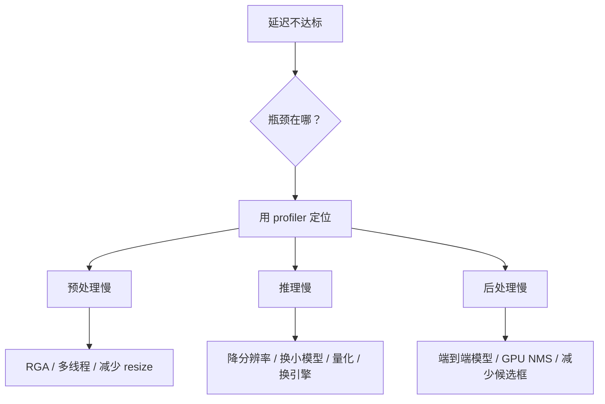

# 训练工程与性能优化

> **核心问题**：同样的模型，有人 30 FPS 有人 120 FPS，差距在哪？精度和速度怎么权衡？

---

## 1. 精度-速度权衡曲线

### 1.1 三个「杠杆」

```
精度 ↑ ←→ 速度 ↓

杠杆 1：模型规模（n/s/m/l/x）
杠杆 2：输入分辨率（416 / 640 / 1280）
杠杆 3：后处理（NMS vs 端到端）
```

**经验数据（YOLOv8，640 输入，RTX 3060）**：

| 模型 | mAP | 延迟 | 相对加速 |
|---|---|---|---|
| v8n | 37.3 | 1.5 ms | 1.0× |
| v8s | 44.9 | 2.4 ms | 0.63× |
| v8m | 50.2 | 5.0 ms | 0.30× |
| v8l | 52.9 | 8.4 ms | 0.18× |
| v8x | 53.9 | 13.0 ms | 0.12× |

**关键观察**：
- 从 n 到 s：精度 **+7.6**，延迟 **+60%** → **性价比最高的一档**
- 从 m 到 x：精度 **+3.7**，延迟 **+160%** → **边际收益递减**
- **v8n → v8s 是绝大多数场景的最优解**

### 1.2 分辨率的杠杆更大

| 输入 | mAP (v8n) | 延迟 | 小目标 AP |
|---|---|---|---|
| 416 | 33.0 | 0.9 ms | 12.0 |
| 640 | 37.3 | 1.5 ms | 17.5 |
| 960 | 41.2 | 3.4 ms | 24.8 |
| 1280 | 43.0 | 6.0 ms | 29.5 |

**注意**：分辨率提升的**计算量是平方关系**（640→1280 是 4 倍像素），但精度提升显著。

**结论**：
- 目标尺寸小（<32px）→ **提分辨率比换模型更有效**
- 目标尺寸大 → 提分辨率没用，换更大的模型更有效

---

## 2. 推理优化技术

### 2.1 算子融合与图优化

| 技术 | 工具 | 收益 |
|---|---|---|
| **算子融合**（Conv+BN、Conv+激活） | TensorRT / OpenVINO / ONNX Simplifier | 10~30% |
| **常量折叠** | 同上 | 小 |
| **精度规约**（FP16） | TensorRT `half=True` | 1.5~2× |
| **图优化** | `torch.compile` / `onnxruntime` 图优化 | 10~20% |

### 2.2 量化

| 方式 | 精度损失 | 加速 | 实施成本 |
|---|---|---|---|
| **FP32** | 基准 | 1× | — |
| **FP16** | <0.5 mAP | 1.5~2× | 低 |
| **INT8 (PTQ)** | 1~3 mAP | 2~4× | 中（需校准） |
| **INT8 (QAT)** | 0.5~1 mAP | 2~4× | 高 |
| **INT4 (AWQ/GPTQ)** | 2~5 mAP | 4~8× | 高（主要用于 LLM） |

**检测器的量化难点**：
1. **DFL 的 softmax**（见 [`../01-YOLO/06-YOLO关键模块与算法.md`](../01-YOLO/06-YOLO关键模块与算法.md)）
2. **NMS 的整数/浮点混合运算**
3. **检测头的输出分布长尾**

**INT8 校准的实操**：
```python
# 校准集要覆盖真实分布
calib_imgs = load_representative_samples(n=200, diverse=True)
# 记录各层激活的直方图
```

### 2.3 稀疏化

| 技术 | 说明 | 收益 |
|---|---|---|
| **结构化剪枝 (2:4)** | 每 4 个权重里剪 2 个 | 2×（需硬件支持） |
| **非结构化剪枝** | 任意剪枝 | 需稀疏算子支持 |
| **通道剪枝** | 剪掉整个卷积核/通道 | 通用，1.5~2× |
| **NAS 剪枝** | TinyNeuralNet、DMAD | 需重训 |

### 2.4 知识蒸馏

**检测蒸馏的主流做法**：

| 方法 | 思路 |
|---|---|
| **Logit Mimicking (FitNet)** | 学生模仿教师的分类 logits |
| **Feature Mimicking** | 匹配中间特征图（需处理尺寸差异） |
| **Relation-based KD (PKD, RKD)** | 匹配特征之间的关系（对通道数不敏感） |
| **ReviewKD** | 多个「评审」层 |
| **FGD (Generalized Focal Distillation)** | 类别无关的蒸馏，师生检测器类别数可以不同 |
| **DistillDet** | 用 teacher's GT 指导学生的 RPN |
| **DE (Detection Distillation)** | **让 teacher 和 student 同时过 NMS**，只蒸馏 NMS 之后的框 → **最有效的 trick** |
| **Scale-equalizing pyramid** | 处理分辨率差异 |
| **RepDistill** | 通道重排 + 蒸馏 |

**Detection Distillation (DE) 的关键 trick**：
```
Teacher: 预测框 → NMS → 保留的框 → 作为 student 的额外 GT
Student: 同时用原始 GT 和 teacher 的框训练
```

**收益**：mAP +1~3，且**不增加推理开销**。

### 2.5 推理引擎对比

| 引擎 | 平台 | 优势 | 局限 |
|---|---|---|---|
| **PyTorch eager** | 全平台 | 灵活 | 最慢 |
| **PyTorch compile** | 全平台 | 免改造加速 1.3~2× | 首次编译慢 |
| **TensorRT** | NVIDIA | 最快（NVIDIA） | 绑定硬件版本 |
| **OpenVINO** | Intel | Intel 平台最优 | 非 Intel 弱 |
| **ONNX Runtime** | 全平台 | 跨平台均衡 | 中等 |
| **RKNN** | Rockchip | 板端最优 | 只能 Rockchip |
| **TFLite / NCNN** | 移动 | 移动端成熟 | 模型需适配 |
| **Triton** | 服务端 | 多模型管理、动态 batching | 部署重 |

### 2.6 服务端的动态批处理

**Triton / Triton Inference Server 的 dynamic batching**：

```
请求队列 → 动态聚合（最多 batch_size=N，最多等 max_delay=5ms）→ 一次推理
```

**收益**：吞吐提升 3~10×（取决于单请求延迟容忍度）。

**延迟 vs 吞吐的权衡**：
| 场景 | 配置 |
|---|---|
| 交互式（要低延迟） | batch=1 或小 batch + 短 max_delay |
| 离线批处理 | 大 batch |
| 视频流 | 按帧组 batch，但要控制延迟 |

---

## 3. 训练加速

### 3.1 混合精度（AMP）

```python
scaler = torch.cuda.amp.GradScaler()
with torch.cuda.amp.autocast():
    loss = model(imgs)
scaler.scale(loss).backward()
scaler.step(optimizer)
scaler.update()
```

**收益**：显存减半、速度 +30~50%（在支持的算子上）。

**注意**：某些算子（尤其是损失函数）在 FP16 下精度差，需要 GradScaler 保护。

### 3.2 梯度累积

```python
accumulate = max(round(nbs / batch_size), 1)
for i, (imgs, targets) in enumerate(dataloader):
    loss = model(imgs, targets) / accumulate
    scaler.scale(loss).backward()
    if (i + 1) % accumulate == 0:
        scaler.step(optimizer); scaler.update(); optimizer.zero_grad()
```

**关键**：**权重衰减要按比例缩放**：
$$
w_d^{\text{scaled}} = w_d \cdot \frac{batch\_size \times accumulate}{nbs}
$$

### 3.3 分布式训练

| 策略 | 适用 | 说明 |
|---|---|---|
| **DDP** | 多机多卡 | 主流，梯度同步 |
| **FSDP / ZeRO** | 模型很大 | 分片参数和梯度 |
| **DeepSpeed ZeRO-2/3** | 超大模型 | 显存优化 |
| **梯度压缩** | 跨机带宽有限 | 减少通信量 |
| **Activation Checkpointing** | 显存不够 | 用时间换显存 |

**DDP 的常见坑**：
- **BN 的同步**：DDP 默认同步 buffer，但如果用 `SyncBN` 会有额外通信开销
- **`find_unused_parameters`**：如果模型有分支未被使用（如某些配置），需要开这个（慢）
- **数据加载要快**：`num_workers` 太小会成为瓶颈

### 3.4 缓存

```bash
yolo detect train ... cache=ram     # 数据集 < 4GB 时用 RAM
yolo detect train ... cache=disk    # 大数据集用磁盘
yolo detect train ... cache=False   # 默认
```

**收益**：数据加载不再成为瓶颈，训练速度提升 20~50%（尤其在多卡时）。

---

## 4. 边缘部署的性能工程

### 4.1 RK3588S 相关（实测经验）

> 来自本机 RK3588S（LubanCat-4）实测

| 项目 | 结论 |
|---|---|
| **NPU 可用性** | 查 `/dev/dri/renderD129`，不是 `/dev/rknpu`（旧驱动路径，板上不存在） |
| **三核全开** | `NPU_CORE_0_1_2`，加速约 2~2.5×（非线性） |
| **预处理** | 用 **PIL**（与训练一致），resize 用 BILINEAR |
| **RGA** | 可做硬件缩放加速，但插值方式要与训练对齐 |
| **计时** | 预热 20 次；`/proc/stat` 需最小窗口 0.5s 并交叉验证 |
| **版本** | rknn-toolkit2 必须与板端 lite2 版本一致（本机为 2.3.2） |
| **INT8 陷阱** | YOLOv8n 的 DFL 在 INT8 下精度塌陷 → 选无 DFL 模型（YOLO26） |

### 4.2 NPU 部署的一般原则

| 原则 | 说明 |
|---|---|
| **优先纯卷积** | NPU 对卷积优化最好，Attention 支持差 |
| **避免动态 shape** | 固定输入尺寸 |
| **避免复杂算子** | 多分支（未 fuse）、自定义算子都会走慢路径 |
| **NMS 要分离** | 很多 NPU 不支持 NMS 算子，放在 CPU 上做 |
| **重参数化先 fuse** | 否则多分支 |
| **端到端优先** | 少一个后处理环节 |

### 4.3 端侧性能预算

以「30 FPS 视频检测」为例：

```
帧预算: 33.3 ms

分配建议:
  图像采集:      3 ms   (硬件)
  预处理:        3 ms   (RGA/CPU)
  NPU 推理:     15 ms   (主战场)
  后处理:        5 ms   (CPU: 解码 + NMS)
  业务逻辑:      5 ms   (你的代码)
  余量:          2 ms
```

**如果推理超标**，按优先级：
1. 减输入分辨率（影响最大）
2. 换更小的模型
3. 优化后处理（用端到端模型）
4. 提高量化精度（FP16→INT8，但注意 DFL）

---

## 5. 性能分析工具

| 工具 | 用途 |
|---|---|
| `torch.profiler` | 逐算子耗时 |
| `nsys` (NVIDIA Nsight Systems) | 全局时间线分析 |
| `ncu` (Nsight Compute) | 单核性能分析 |
| `TensorRT --profilingVerbosity` | TensorRT 逐层耗时 |
| `onnxruntime` profiling | ORT 逐节点耗时 |
| `perfetto` | 通用时间线 |
| `py-spy` | Python 侧热点 |
| `caliper` (RKNN) | Rockchip NPU 性能分析 |

**典型发现**：
- PyTorch eager 下，**数据加载和 Python 后处理占 30~50%**
- TensorRT 下，**NMS 常占 20%+**
- NPU 上，**预处理（CPU）可能比推理还慢**

---

## 6. 优化决策流程



**顺序很重要**：很多团队一上来就换模型，其实瓶颈在预处理或后处理。

---

## 7. 一个可复用的性能测试脚本骨架

```python
import time, numpy as np, torch

@torch.no_grad()
def benchmark(model, imgs, warmup=30, iters=200, device='cuda'):
    """测量端到端延迟（预处理已就绪）"""
    # 预热
    for _ in range(warmup):
        model(imgs)
    if device == 'cuda':
        torch.cuda.synchronize()

    times = []
    for _ in range(iters):
        t0 = time.perf_counter()
        model(imgs)
        if device == 'cuda':
            torch.cuda.synchronize()
        times.append((time.perf_counter() - t0) * 1000)

    times = np.array(times)
    return {
        'mean': times.mean(),
        'p50': np.percentile(times, 50),
        'p95': np.percentile(times, 95),
        'p99': np.percentile(times, 99),
        'fps': 1000 / times.mean(),
    }
```

---

## 8. 工程结论

1. **n → s 是性价比最高的一档**。往上换模型的边际收益递减得很快。
2. **小目标场景优先提分辨率**。640→960 的精度提升往往超过换一个大模型。
3. **先 profile 再优化**。瓶颈通常不在你以为的地方。
4. **知识蒸馏（尤其是 DE 的 NMS trick）是「免费」的精度提升**，不增加推理开销。
5. **INT8 要小心 DFL**。选无 DFL 的模型（YOLO26）或接受 FP16。
6. **边缘部署的预处理一致性比模型精度更影响结果**。用契约文件锁死。
7. **动态批处理是服务端吞吐的关键**，但要控制 max_delay 以免牺牲延迟。

---

## 🔗 相关

- 导出部署 → [`../01-YOLO/08-导出部署与推理加速.md`](../01-YOLO/08-导出部署与推理加速.md)
- 量化细节 → [`../01-YOLO/06-YOLO关键模块与算法.md`](../01-YOLO/06-YOLO关键模块与算法.md)
- 模型选型 → [`../01-YOLO/05-YOLO11-26新周期.md`](../01-YOLO/05-YOLO11-26新周期.md)
