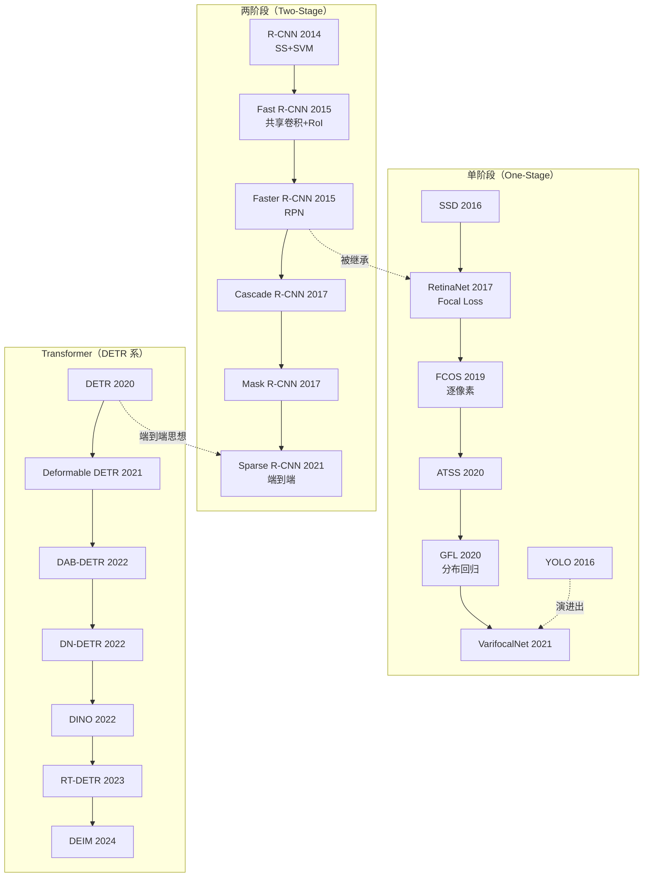

# 视觉检测模型研究笔记

> **五大流派的完整地图：两阶段、单阶段、无锚框、Transformer、端到端。**

---

## 🎯 这部分要解决什么

YOLO 是「怎么做检测」的一个答案，但检测领域有**五种截然不同的范式**，每种都有代表模型、理论依据和适用边界。这份笔记的目标是：

1. **理清每个流派解决的核心矛盾**（而不是罗列模型）
2. **理解它们之间的继承关系**（RetinaNet → FCOS → ATSS → GFL 是一条线，不是四个独立模型）
3. **建立选型判断力**（什么时候该上 DETR，什么时候 YOLO 就够了）

---

## 📚 文档索引

| # | 文档 | 内容 |
|---|---|---|
| 01 | [任务定义与评测体系](./01-任务定义与评测体系.md) | IoU / AP / mAP / AR 的精确定义，LVIS 长尾联邦评测，为什么 mAP 会骗人 |
| 02 | [两阶段检测器](./02-两阶段检测器.md) | R-CNN → Fast → Faster → Cascade → Mask R-CNN → Sparse R-CNN |
| 03 | [单阶段检测器](./03-单阶段检测器.md) | SSD → RetinaNet → FCOS → ATSS → GFL → VarifocalNet → RTMDet |
| 04 | [无锚框与样本分配](./04-无锚框与样本分配.md) | Anchor-free 的必然性、ATSS/TAL/SimOTA/FreeAnchor 四家对比 |
| 05 | [Transformer 检测器](./05-Transformer检测器.md) | DETR → Deformable → DAB/DN → DINO → RT-DETR → DEIM |
| 06 | [端到端与实时检测](./06-端到端与实时检测.md) | NMS-free 的五条路线与其数学共性 |
| 07 | [分割、实例与全景](./07-分割实例与全景.md) | FCN → Mask R-CNN → Mask2Former → SAM / SAM 2 |
| 08 | [关键点、姿态与跟踪](./08-关键点姿态与跟踪.md) | 多人姿态估计 + MOT 全流水线 |
| 09 | [3D 检测与多模态融合](./09-3D检测与多模态.md) | PointPillars → CenterPoint → BEVFormer → 占据栅格 |
| 10 | [开放词汇与基础模型](./10-开放词汇与基础模型.md) | GLIP → Grounding DINO → YOLO-World → Florence-2 → Molmo |
| 11 | [损失函数与样本分配](./11-损失函数与样本分配.md) | 分类/回归/IoU 三大损失族系全景推导 |
| 12 | [数据集大全](./12-数据集大全.md) | 40+ 数据集规模、标注格式、许可、适用场景 |
| 13 | [训练工程与性能优化](./13-训练工程与性能优化.md) | 精度/速度权衡、量化、蒸馏、并行 |
| 14 | [论文全景索引](./14-论文全景索引.md) | 120+ 篇核心文献按流派整理 |

---

## 🗺️ 检测模型全景图

---

## ⚡ 五大流派速查

| 流派 | 核心机制 | 精度 | 速度 | 训练难度 | 代表 |
|---|---|---|---|---|---|
| **两阶段** | 先提 region，再分类 | 高 | 慢 | 中 | Faster R-CNN, Cascade R-CNN |
| **单阶段** | 一次前向出所有框 | 中 | 快 | 中 | RetinaNet, FCOS, GFL |
| **无锚框** | 逐像素/逐点预测 | 高 | 快 | 中 | FCOS, ATSS, GFL, YOLOv8 |
| **Transformer** | Set Prediction + 匈牙利匹配 | 最高 | 中~快 | **难**（收敛慢） | DETR, DINO, RT-DETR |
| **端到端** | 一对一匹配，免 NMS | 高 | **最快** | 中 | Sparse R-CNN, DINO, YOLOv10, YOLO26 |

---

## 🎓 五条主线的问题意识

检测器的所有设计分歧，都可以还原为**五个核心矛盾**：

### 矛盾 1：召回 vs 定位精度
- 想要高召回 → 候选框要多 → NMS 慢、误检多
- 想要高定位精度 → 候选框要精 → 训练难

**解法演进**：RPN（两阶段）→ Focal Loss（处理不平衡）→ 分布回归 GFL（精确定位）→ 一对一匹配（端到端）

### 矛盾 2：正负样本极度不平衡
- 一张图 1~100 个 GT，但候选位置 8400 个
- 99% 是负样本

**解法演进**：hard negative mining → OHEM → Focal Loss → 动态样本分配（ATSS/TAL）→ 一对一匹配

### 矛盾 3：锚框的先验偏见
- Anchor 编码了「目标长宽比大致是 3:1 / 1:1」这种假设
- 换数据集要重算，特殊形状（细长）目标吃亏

**解法演进**：Anchor → Anchor-free（FCOS/ATSS/YOLOv8）→ 混合（TOOD）

### 矛盾 4：NMS 的不可微与延迟
- NMS 是后处理、不可微、需要调阈值
- DETR 证明了可以完全不要 NMS，但收敛极慢

**解法演进**：DETR（匈牙利匹配，慢）→ Deformable DETR（加速收敛）→ DINO（去噪训练）→ RT-DETR（高效 encoder）→ YOLOv10/v26（YOLO 侧实现）

### 矛盾 5：全局上下文 vs 局部细节
- 纯卷积感受野有限，看不到全局
- 全局注意力（DETR）代价高

**解法演进**：FPN（多尺度）→ 可变形注意力（稀疏全局）→ 高效混合编码器（RT-DETR）

---

## 📌 选型决策

| 你的约束 | 推荐 |
|---|---|
| 固定类别 + 要极致速度 | YOLO11n/s，边缘部署用 YOLO26 |
| 固定类别 + 精度优先 | Faster R-CNN / Cascade R-CNN / GFL / RTMDet |
| 需要开放词汇 | Grounding DINO / YOLO-World / YOLOE / OWLv2 |
| 密集小目标 | 高分辨率 + 密集头（FCOS/GFL/DINO） |
| 视频/实时流 | YOLO 系 或 RT-DETR（都是免 NMS 或低 NMS 开销） |
| 跟踪 | 检测器 + ByteTrack/BoT-SORT（见 §08） |
| 要精确形状 | 实例分割模型（见 §07） |
| 3D / 自动驾驶 | BEV 感知模型（见 §09） |
| 科研/发论文 | DETR 系（改进空间大） |

---

## 🔗 关联

- YOLO 专题 → [`../01-YOLO/`](../01-YOLO)
- RAG 专题 → [`../03-RAG/`](../03-RAG)
- 术语表 → [`../appendix/术语表.md`](../appendix/术语表.md)
