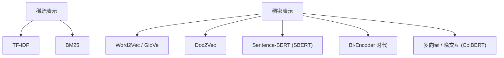
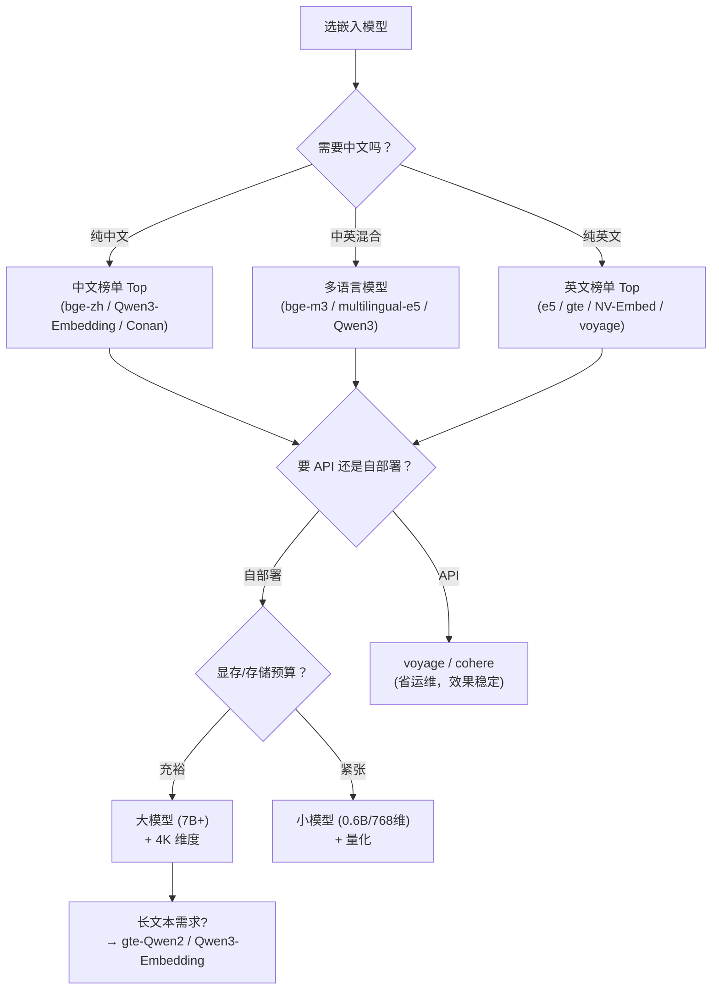

# 嵌入模型选型

> **核心问题**：嵌入模型怎么选？MTEB 榜单怎么读？中文场景该信哪个分数？

---

## 1. 嵌入模型在 RAG 中的角色

```
文档 chunk → 嵌入模型 → 向量（语义表示）
查询      → 嵌入模型 → 向量（同一空间）
                              ↓
                        余弦相似度 → 检索
```

**嵌入模型决定了「语义上相似」的定义**。这比很多人以为的重要：

- 一个擅长「同义句」匹配的模型，适合 FAQ 问答
- 一个擅长「主题聚类」的模型，适合知识库浏览
- 一个训练自「query-document 对」的模型，适合检索
- 一个训练自「对称句子对」的模型，适合语义搜索

---

## 2. 嵌入模型的谱系



### 2.1 稀疏 vs 稠密

| | 稀疏（TF-IDF/BM25） | 稠密（神经网络嵌入） |
|---|---|---|
| **表示** | 高维向量，大部分为 0 | 低维稠密向量 |
| **匹配方式** | 词项精确/词干匹配 | 语义相似度 |
| **优势** | 精确术语、专有名词、编号、罕见词 | 同义表达、跨语言、泛化 |
| **劣势** | 同义词/语义漂移 | 罕见词、专业术语可能丢失 |
| **可解释性** | 高（能看哪个词命中） | 低 |
| **存储** | 稀疏存储 | 稠密（1024 维 × 4 字节 = 4KB/条） |

> **RAG 实践共识：混合检索（BM25 + 稠密）几乎总是优于纯稠密。** 详见 [`06-检索与重排.md`](./06-检索与重排.md)。

### 2.2 Sentence-BERT（2018）

**论文**：*Sentence-BERT: Sentence Embeddings using Siamese BERT-Networks*, EMNLP 2019

**核心**：把「两段文本是否相似」的 cross-encoder，改造成「分别编码再算距离」的 bi-encoder。

| | Cross-Encoder | Bi-Encoder |
|---|---|---|
| **结构** | 两段文本拼接后一起过模型 | 各自独立编码 |
| **相似度** | 模型直接输出 | 向量点积/余弦 |
| **复杂度** | $O(N^2)$ 次前向 | $O(N)$ 次前向（可预计算） |
| **精度** | 高 | 略低 |
| **用途** | **重排（rerank）** | **检索（recall）** |

**这是 RAG 架构的基石**：bi-encoder 做初筛，cross-encoder 做精排。

---

## 3. 现代嵌入模型分类

### 3.1 五大类

| 类别 | 代表 | 特点 |
|---|---|---|
| **通用多语言** | BGE-M3, multilingual-e5, jina-v3, gte-multilingual | 覆盖多语言，一模型通吃 |
| **英文专用（强）** | E5, GTE, NV-Embed, SFR, Instructor, voyage | 英文榜单分数高 |
| **中文专用** | BGE-zh, m3e, Conan-embedding, gte-Qwen2 | 中文优化 |
| **指令跟随** | Instructor, E5-Mistral, SFR-Embedding-Mistral, gte-Qwen2 | 支持「用 query: passage:」前缀 |
| **多向量/晚交互** | ColBERT, ColBERTv2, PLAID | 精度高，存储大 |
| **Matryoshka** | gemma-embedding, jina-v3, nomic | 可变维度 |

### 3.2 关键设计：指令前缀

**指令跟随模型**（E5-Mistral、Instructor、SFR-Embedding-Mistral）要求用不同前缀区分查询和文档：

```python
# E5 风格
query_embedding = model.encode("query: " + query)
doc_embedding    = model.encode("passage: " + document)

# BGE 风格（v1.5+ 推荐）
query_embedding = model.encode(query, prompt="为这个句子生成表示以用于检索相关文章：")
doc_embedding    = model.encode(document)     # 文档不加前缀
```

**忘了加前缀 = 效果打折**。这是最常见的踩坑点之一。

### 3.3 Matryoshka 表示学习

**思想**：训练时让向量的一部分也能独立表示完整信息。

```python
# 训练时用多个维度做损失
loss = sum(w_i * loss_at_dim(d_i) for d_i in [768, 512, 256, 128, 64])

# 推理时可以自由选择维度
emb = model.encode(text, truncate_dim=256)   # 用 256 维，存储省 3 倍
```

**收益**：**一个模型支持多种维度**，部署时按精度/成本权衡自由选。这对大规模索引很有价值。

---

## 4. MTEB 榜单怎么读

### 4.1 MTEB 是什么

**Massive Text Embedding Benchmark** —— 嵌入模型的标准化评测。

**包含的任务**（8 类，56 个数据集）：

| 任务类型 | 数据集数 | 例子 | 测什么 |
|---|---|---|---|
| **Classification** | 14 | TREC, AmazonCounterfactual | 主题分类 |
| **Clustering** | 11 | TwentyNewsgroups, MedrxivClustering | 主题聚类 |
| **Retrieval** | 15 | MSMARCO, NQ, FEVER, HotpotQA, BEIR | **检索（最重要）** |
| **STS** | 10 | STS12-17, SICK-R | 语义相似度 |
| **Summarization** | 1 | SummEval | 摘要 |
| **Bitext** | 1 | Tatoeba | 双语 |
| **Pair Classification** | 3 | SprintDuplicate, TwitterSemEval | 句子对分类 |
| **Instruction following** | 1 | InstructionRetrieval | 指令跟随 |

### 4.2 读榜单的正确方式

**MTEB 的平均分（Mean）会误导你。** 因为 56 个数据集里，14 个是分类、11 个是聚类、10 个 是 STS —— 这些和你的 RAG 场景关系不大。

**应该看**：

| 你要做什么 | 看哪个指标 |
|---|---|
| **RAG 检索** | **Retrieval 分项**（15 个数据集的平均） |
| **中文检索** | C-MTEB 榜单 |
| **长文本** | LongEmbed / MTEB 的长文本分项 |
| **多语言** | MMTEB（多语言版） |
| **指令跟随** | InstructionRetrieval |

**其他注意事项**：

| 坑 | 说明 |
|---|---|
| **检索任务内的细分差异巨大** | BEIR（零样本）分数低是正常的（训练集和测试集领域不同） |
| **训练数据泄漏** | 有些模型用 MSMARCO 等训练，MTEB 分数虚高 |
| **维度不同不能直接比** | 4096 维 vs 384 维，前者天然更强 |
| **是否归一化** | 有的模型需要归一化才能算余弦 |
| **同分数不同行为** | 两个模型 MTEB 分数接近，但一个擅长长文本、一个擅长短文本 |

### 4.3 C-MTEB（中文）

**仓库**：`C-MTEB/C-MTEB`

包含 6 类任务，中文场景必看：

| 任务 | 说明 |
|---|---|
| Classification | 主题分类 |
| Clustering | 聚类 |
| Retrieval | **检索** |
| Reranking | 重排 |
| Pair Classification | 句子对 |
| Summarization | 摘要 |

---

## 5. 主流模型速查（2024–2025 主流选择）

> **注意**：以下为各模型官方/社区常见报告的量级参考，**具体分数随版本变化，引用前请核对官方榜单**。

| 模型 | 维度 | 上下文 | 语言 | 类型 | 特点 |
|---|---|---|---|---|---|
| **BAAI/bge-m3** | 1024 | 8192 | 100+ | 稠密+稀疏+多向量 | **最全能**，支持 dense/sparse/colbert 三种检索 |
| **BAAI/bge-large-zh-v1.5** | 1024 | 512 | 中文 | 稠密 | 中文经典 |
| **intfloat/e5-large-v2** | 1024 | 512 | 英 | 稠密 | 英文强，query/passage 前缀 |
| **intfloat/multilingual-e5-large** | 1024 | 512 | 100+ | 稠密 | 多语言首选之一 |
| **intfloat/e5-mistral-7b-instruct** | 4096 | 8192 | 100+ | 指令 | MTEB 榜单常客，质量高 |
| **Alibaba-NLP/gte-Qwen2-7B-instruct** | 4096 | 32768 | 100+ | 指令 | 长文本 + 指令 |
| **Alibaba-NLP/gte-multilingual-base** | 768 | 8192 | 75+ | 稠密 | 轻量多语言 |
| **nvidia/NV-Embed-v2** | 4096 | 32768 | 英 | 指令 | 榜单顶级，显存需求大 |
| **jinaai/jina-embeddings-v3** | 1024 | 8192 | 100+ | **Matryoshka** | 可变维度，支持 late-interaction |
| **Snowflake/snowflake-arctic-embed-l** | 1024 | 512 | 英 | 稠密 | 英文强性价比 |
| **mixedbread-ai/mxbai-embed-large-v1** | 1024 | 512 | 英 | 稠密 | 英文榜单前排 |
| **Voyage AI voyage-3 / voyage-code-3** | 1024/1536 | 32K | 多 | 商业 | **闭源，API** |
| **Cohere embed-v3.0 / v4** | 1024/1536 | 512 | 100+ | 商业 | 商业 API 首选 |
| **Qwen/Qwen3-Embedding-0.6B/4B/8B** | 1024/2560/4096 | 32K | 100+ | 指令 | **中文强，自部署友好** |
| **conan-embedding** | 1024 | 512 | 中英 | 稠密 | 中文优化 |
| **moka-ai/m3e-base** | 768 | 512 | 中 | 稠密 | 轻量中文 |
| **nomic-embed-text-v1.5** | 768 | 8192 | 英 | Matryoshka | 轻量 |

---

## 6. 选型决策



### 6.1 各场景推荐

| 场景 | 推荐 | 理由 |
|---|---|---|
| **中文企业知识库** | **BGE-M3** 或 **Qwen3-Embedding-4B** | 中文质量高，支持混合检索 |
| **纯中文小规模** | bge-large-zh-v1.5 | 轻量够用 |
| **中英混合** | **BGE-M3** | 一模型搞定，dense+sparse |
| **英文高要求** | voyage-3 / NV-Embed-v2 / e5-mistral | 榜单头部 |
| **长文档（>8K）** | gte-Qwen2 / Qwen3-Embedding / jina-v3 | 长上下文支持 |
| **要省存储** | jina-v3（Matryoshka）/ gte-multilingual-base | 可变维度 |
| **代码检索** | voyage-code-3 / jina-code | 代码专用训练 |
| **预算有限，量大** | bge-small-zh / m3e-base + 量化 | 512/768 维足够 |
| **要混合检索** | **BGE-M3** | 原生支持 sparse 稀疏向量 |

---

## 7. 嵌入模型的评测方法（自己做）

### 7.1 准备评测集

```
queries.jsonl:
  {"query": "如何申请年假？", "positive_ids": ["chunk_123", "chunk_456"], "hard_negatives": ["chunk_789"]}

corpus.jsonl:
  {"id": "chunk_123", "text": "...", "metadata": {...}}
```

**规模建议**：50~200 条查询就够看出明显差异。10 条太少，噪声大。

### 7.2 计算指标

```python
import numpy as np

def evaluate_retrieval(query_embs, doc_embs, qrels, k_values=(1, 3, 5, 10)):
    """
    qrels: {query_idx: {doc_idx: relevance_score}}
    """
    sim = query_embs @ doc_embs.T      # (n_queries, n_docs)
    ranks = np.argsort(-sim, axis=1)

    results = {}
    for k in k_values:
        recalls, precisions, ndcgs = [], [], []
        for qi, rels in qrels.items():
            topk = ranks[qi][:k]
            rel_set = {d for d, r in rels.items() if r > 0}
            hits = [1 if d in rel_set else 0 for d in topk]

            recalls.append(len(set(topk) & rel_set) / max(1, len(rel_set)))
            precisions.append(sum(hits) / k)
            # NDCG
            dcg = sum(h / np.log2(i + 2) for i, h in enumerate(hits))
            ideal = sum(1 / np.log2(i + 2) for i in range(min(k, len(rel_set))))
            ndcgs.append(dcg / ideal if ideal > 0 else 0)

        results[f"recall@{k}"] = np.mean(recalls)
        results[f"precision@{k}"] = np.mean(precisions)
        results[f"ndcg@{k}"] = np.mean(ndcgs)
    return results
```

### 7.3 必须做的消融

| 对比项 | 目的 |
|---|---|
| **不同模型** | 选出最适合你数据的 |
| **不同维度**（Matryoshka 模型） | 精度/成本的权衡点 |
| **是否加前缀** | 指令模型必须加 |
| **是否归一化** | 影响余弦 vs 点积 |
| **chunk_size** | 嵌入效果和切分强相关 |

---

## 8. 性能与成本

### 8.1 嵌入的算力

```
100 万 chunk × 512 维 × 4 字节 = 2 GB 存储（float32）
100 万 chunk × 512 维 × 1 字节 = 0.5 GB（int8 量化）
```

**嵌入时间**（经验值）：
| 模型规模 | 吞吐（GPU, A100） | 100 万 chunk 耗时 |
|---|---|---|
| 0.6B (768维) | ~2000 chunk/s | ~8 分钟 |
| 1.5B (1024维) | ~800 chunk/s | ~21 分钟 |
| 7B (4096维) | ~200 chunk/s | ~83 分钟 |

**结论**：**大模型嵌入的索引构建成本可能很高**（7B 模型建 100 万 chunk 的索引要 1.5 小时 + 大量 GPU 显存）。用 Matryoshka 模型可以先试小维度，再决定是否放大。

### 8.2 维度选择

| 维度 | 存储/条 | 适用 |
|---|---|---|
| 384 | 1.5 KB | 小规模、快速迭代 |
| 768 | 3 KB | 通用起点 |
| 1024 | 4 KB | 主流 |
| 1536 | 6 KB | 高精度 |
| 4096 | 16 KB | 顶级，但存储和检索成本高 |

**经验**：**768~1024 维是性价比区间**。上 4096 维前，先确认瓶颈在嵌入而不是检索策略。

### 8.3 向量量化

| 方式 | 压缩 | 精度损失 |
|---|---|---|
| float32 | 1× | 基准 |
| float16 | 2× | 几乎无 |
| int8 (scalar) | 4× | 很小 |
| int8 (product/PQ) | 8~32× | 小~中 |
| binary (1-bit) | 32× | 中 |

**注意**：量化的误差要在**你的检索评测集**上验证，不能假设。

---

## 9. 常见错误

| # | 错误 | 后果 | 修正 |
|---|---|---|---|
| 1 | **忘了 query/passage 前缀** | 指令模型效果打折 5~15% | 查模型卡 |
| 2 | **文档和查询用了不同模型** | 向量不在同一空间 | 严格一致 |
| 3 | **没有归一化就算余弦** | 排序错乱 | `normalize_embeddings=True` |
| 4 | **换了模型没重建索引** | 全乱 | 版本管理索引 |
| 5 | **用 MTEB 总分选模型** | 选错 | 看 Retrieval 分项 |
| 6 | **中文场景只看英文榜单** | 选错 | 看 C-MTEB |
| 7 | **用检索任务分数判断「语义相似」能力** | 误判 | STS 和 Retrieval 是两回事 |
| 8 | **维度越高越好，堆到 4096** | 成本暴涨，收益递减 | 先 768/1024 |
| 9 | **嵌入时截断了长文本** | 信息丢失 | 检查 max_length |
| 10 | **模型加载用 fp16 但检索用 fp32** | 精度略降 | 保持一致 |

---

## 10. 工程结论

1. **中文场景首选 BGE-M3 或 Qwen3-Embedding**。前者支持混合检索一站式，后者中文理解和长文本更强。
2. **MTEB 只看 Retrieval 分项**，且要核对训练数据泄漏。
3. **指令模型必须加前缀**。这是最高频的踩坑点。
4. **自己做评测集（50~200 条）比看榜单可靠**。榜单是别人的数据。
5. **维度 768~1024 是性价比区间**，上 4096 前先确认瓶颈。
6. **Matryoshka 模型值得优先考虑**（jina-v3 / Qwen3-Embedding）：一个模型支持多种维度，可以先用小维度快速迭代，确认效果后再放大。
7. **换模型 = 重建索引**。要建立索引版本管理。

---

## 🔗 相关

- 检索 → [`06-检索与重排.md`](./06-检索与重排.md)
- 向量库 → [`05-向量数据库与索引.md`](./05-向量数据库与索引.md)
- 切分 → [`03-切分策略.md`](./03-切分策略.md)
- 多模态嵌入 → [`14-多模态RAG.md`](./14-多模态RAG.md)
