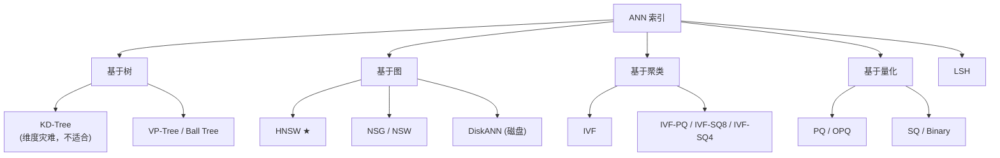
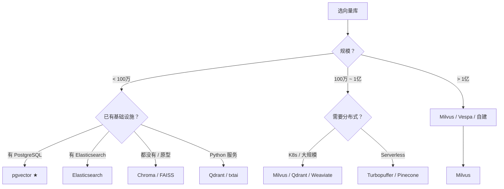

# 向量数据库与索引

> **核心问题**：1000 万条向量，用什么存？HNSW、IVF-PQ、DiskANN 到底怎么选？

---

## 1. 索引技术的核心矛盾

**精确检索（Flat / Brute-force）**：
```
score = query · doc    对所有 doc 算一遍
```
- **100% 准确**，无近似误差
- **O(N) 时间** → 1000 万条要几十毫秒到几百毫秒

**近似最近邻（ANN）**：
- 用索引结构减少要比较的候选数
- **牺牲一点准确率换取巨大的速度提升**
- 核心指标：**Recall@K**（在 K 个结果里找回多少真正相关的）

**所有索引技术都在回答同一个问题**：
> **给定一个查询向量，怎么快速找到最相似的 K 个？**

---

## 2. 索引技术全景



---

## 3. HNSW —— 当前的默认选择

**论文**：*Efficient and robust approximate nearest neighbor search using Hierarchical Navigable Small World graphs*, TPAMI 2020
**作者**：Malkov & Yashunin

### 3.1 核心思想

构建一个**多层图**：

```
Layer 0 (最底层)：包含所有节点，每个节点的邻居很多
   ↓ 稀疏采样
Layer 1：节点变少，邻居变少
   ↓
Layer 2：更少
   ↓
...
Layer L (最顶层)：只有少量节点，作为「入口点」
```

**搜索过程（贪心）**：
```
1. 从顶层入口点开始
2. 在当前层找到离 query 更近的邻居 → 移动过去
3. 重复直到找不到更近的邻居（局部最优）
4. 下降到下一层，把当前位置作为起点
5. 在 Layer 0 用更大的 efSearch 做更彻底的搜索
```

### 3.2 关键参数

| 参数 | 含义 | 效果 | 默认 |
|---|---|---|---|
| **M** | 每个节点的邻居数上限 | ↑ → 召回↑、内存↑、构建慢 | 16~64 |
| **efConstruction** | 构建时的候选队列大小 | ↑ → 图质量↑、构建慢 | 100~200 |
| **efSearch** | 查询时的候选队列大小 | ↑ → 召回↑、延迟↑ | 50~200 |
| **M0** | Layer 0 的邻居数（通常是 2M） | | |

### 3.3 内存估算

```
每个节点的存储：
  - 向量本身：D × 4 字节
  - 邻居列表：M × 4 字节（每层）+ 层数 × 4 字节
  - 元数据指针等

1000 万条 × 1024 维 × 4 字节 = 40 GB（仅向量）
加图结构（~20%）：~48 GB
```

**这是 HNSW 的主要痛点**：**全内存**。内存不够就只能放磁盘（会慢很多）或量化。

### 3.4 HNSW 的优缺点

| 优点 | 缺点 |
|---|---|
| **召回率高**（95%+） | **内存占用大** |
| **查询极快**（亚毫秒） | 构建慢（1000 万条约几小时） |
| **参数直观**（M/ef 调起来简单） | 不支持删除（需要标记 + 定期重建） |
| 生态成熟（几乎所有库都支持） | 量化支持有限（各库实现不同） |

---

## 4. IVF 系列 —— 基于聚类

### 4.1 IVF（Inverted File）

**思想**：用 k-means 把向量空间聚成 $n_{\text{list}}$ 个簇。查询时只搜索其中几个簇。

```
索引构建：
  k-means 聚类 → 得到 centroids
  每个向量分配到最近的 centroid → 建立倒排表

查询：
  找到 query 最近的 nprobe 个 centroids
  → 只在这些簇里做暴力搜索
```

**关键参数**：
- **nlist**：簇的数量。经验值 $\sqrt{N}$（1000 万 → ~3000）
- **nprobe**：查询时搜几个簇。**召回率与延迟的直接旋钮**

### 4.2 IVF-PQ（Product Quantization）

**思想**：把高维向量**切分成 M 段**，每段用一个小码本（K 个质心）编码。

```
原始向量: [d1, d2, ..., d1024]
切成 M=32 段: [32维] × 32 段
每段用 K=256 个质心的码本编码 → 1 字节
总存储: 32 字节/向量（压缩 128×！）

距离计算：查表法
  dist(x, q) ≈ Σ_m table[m][code_q[m]][code_x[m]]
  → M 次查表，无浮点运算
```

**压缩比**：1024 维 float32（4KB）→ 32 字节 = **128× 压缩**。

**代价**：
- **召回率下降**（量化误差）
- 距离计算是近似

### 4.3 IVF-SQ8 / SQ4

- **SQ8**：每维 1 字节（标量量化），压缩 4×，精度损失小
- **SQ4**：每维 4 bit，压缩 8×，损失较大

### 4.4 IVF vs HNSW

| 维度 | IVF | HNSW |
|---|---|---|
| **构建速度** | **快**（k-means + 分配） | **慢**（图的构建是 O(N log N) 且难并行） |
| **内存** | **低**（可量化压缩到 10~32×） | 高（全精度向量） |
| **查询延迟** | 中~高（nprobe 影响大） | **低** |
| **召回率** | 中~高 | **高** |
| **增删** | **容易** | 难 |
| **超参** | nlist, nprobe | M, efConstruction, efSearch |

**选择**：
- **内存紧张 / 数据量大** → IVF-PQ
- **追求最高召回 + 内存够** → HNSW
- **需要频繁增删** → IVF 系

---

## 5. 其他重要索引

### 5.1 DiskANN

**论文**：*DiskANN: Fast Accurate Billion-point Nearest Neighbor Search on a Machine*, NeurIPS 2019 (Microsoft)

**思想**：把「图的一部分」放磁盘，「小热门子图」放内存。

```
内存：PQ 压缩的全量向量 + 热门节点
磁盘：完整的 Vamana 图（邻接表）+ 原始向量

查询：
  内存中的 PQ 向量做粗定位（速度快）
  → 定位到磁盘图的起始节点
  → 在磁盘图上做精细搜索（1~2 次磁盘 IO）
```

**收益**：**100 亿级向量可以在单机上跑**，内存只需几十 GB。
**代价**：延迟比纯内存高（磁盘 IO）。

### 5.2 ScaNN（Google）

**论文**：*Accelerating Large-Scale Inference with Anisotropic Vector Quantization*, ICML 2020

**核心：各向异性量化（anisotropic vector quantization）**

- 标准的 PQ 对所有维度一视同仁
- 但不同维度的**区分度差异很大**（有的维度几乎所有向量都一样）
- ScaNN 学习**每个维度的重要性**，量化时把精度分配给有区分度的维度

**收益**：同样的压缩比下，**召回率显著高于标准 PQ**。

### 5.3 SPTAG

微软的磁盘索引方案，与 DiskANN 类似。

### 5.4 LSH（局部敏感哈希）

**思想**：设计一种哈希，使得**相似的向量有较高概率哈希到同一个桶**。

- LSH 用于**二进制/低维**场景
- 现在更多被 **SPLADE**（学习式稀疏表示）取代

### 5.5 SPARQL / 倒排索引（BM25）

**不是向量索引，但是混合检索的必需组件。**

见 [`06-检索与重排.md`](./06-检索与重排.md)。

---

## 6. 向量数据库横评

### 6.1 主流选择

| 数据库 | 类型 | 索引 | 部署 | 特色 | 适合 |
|---|---|---|---|---|---|
| **Milvus** | 分布式 | HNSW / IVF / DiskANN / GPU | K8s / Docker | **功能最全**，10 亿+ 规模 | 大规模生产 |
| **Qdrant** | 混合 | HNSW / IVF | Docker / K8s | **Rust 编写**，payload 过滤强，过滤+向量联合搜索 | **生产首选（中小规模）** |
| **Weaviate** | 混合 | HNSW / flat | Docker / K8s | GraphQL，模块化，内置向量化 | GraphQL 栈 |
| **pgvector** | 扩展 | HNSW / IVFFlat | PostgreSQL | **和业务数据同库**，SQL 查询 | **中小规模 + 已有 PG** |
| **Chroma** | 嵌入式 | HNSW | Python 进程内 | **零配置**，上手最快 | 原型 / 小规模 |
| **FAISS** | 库 | HNSW / IVF-PQ / GPU | C++/Python | Meta 出品，算法最全 | **自研检索层** |
| **Elasticsearch** | 搜索引擎 | HNSW + 倒排 | 集群 | **BM25 + 向量一体** | 混合检索、已有 ES |
| **OpenSearch** | 搜索引擎 | k-NN + 倒排 | 集群 | ES 的开源分支 | 同上 |
| **Vespa** | 搜索引擎 | HNSW + 倒排 | 集群 | 大规模，复杂排序 | 超大规模 |
| **LanceDB** | 列式 | IVF-PQ | 嵌入式 | **Arrow/Parquet 原生**，多模态友好 | 多模态、Serverless |
| **Turbopuffer** | 托管 | HNSW | 云服务 | Serverless | 不想运维 |
| **Pinecone** | 托管 | HNSW | 云服务 | 最早做托管 | 快速上线 |
| **Redis** | KV+向量 | HNSW | 已有 Redis | 极低延迟 | 已有 Redis 栈 |
| **txtai** | 嵌入式 | FAISS/SQLite | Python | 端到端语义搜索 | 小型应用 |
| **Marqo** | 托管 | Tensor/FAISS | Docker | **端到端：文本→向量→检索** | 快速搭搜索 |
| **Nomic Atlas** | 托管 | 自研 | 云 | 配合 Nomic Embeddings | 配套生态 |

### 6.2 选择决策树



### 6.3 「Payload 过滤 + 向量检索」的关键性

**真实业务几乎总是需要过滤**：
- 「只搜 2024 年的文档」
- 「只搜用户有权限的部门」
- 「只搜产品线 A 的手册」

**三种实现方式**：

| 方式 | 做法 | 优缺点 |
|---|---|---|
| **后过滤（Post-filter）** | 先 ANN 检索，再过滤 | **可能返回空结果**（top-k 全被过滤掉了） |
| **前过滤（Pre-filter）** | 先过滤再检索 | 过滤后候选少 → 走 brute-force，更慢但正确 |
| **过滤感知索引** | 索引本身就是过滤感知的 | **最好**，但实现复杂 |

**Qdrant 的优势**：payload 过滤和向量检索是**原生联合**的，会自动选择策略（用额外的过滤索引做预过滤，或自适应调大 k）。

**pgvector 的注意事项**：PostgreSQL 的 `WHERE` + HNSW 查询，如果过滤条件的选择性低，可能导致大量行被扫描后丢弃，**性能远差于预期**。解法：
- 给过滤列建索引
- 用分区表
- 迭代扫描（`hnsw.iterative_scan`）

---

## 7. 混合索引：向量 + BM25

**现代 RAG 的标准配置是「一套系统，两个索引」**。

| 实现方式 | 说明 |
|---|---|
| **Elasticsearch / OpenSearch** | 原生支持：BM25 倒排 + HNSW 向量，`bool should` 组合 |
| **Vespa** | 原生多阶段检索 + 融合 |
| **Weaviate** | hybrid search（BM25 + vector） |
| **Milvus** | 多向量 + sparse（支持 BM25 稀疏向量） |
| **自建** | FAISS（向量）+ Elasticsearch（BM25）+ RRF 融合 |
| **BGE-M3 稀疏向量** | 模型本身输出稀疏表示，等价于学习式 BM25 |

### 7.1 BGE-M3 的稀疏向量（值得了解）

**论文**：*BGE M3-Embedding: Multi-Lingual, Multi-Functionality, Multi-Granularity Text Embeddings Through Self-Knowledge Distillation*, arXiv:2402.03216

BGE-M3 同时输出三种向量：
1. **稠密向量**（dense）：语义
2. **稀疏向量**（sparse）：词级别的、**学习式**的稀疏表示
3. **多向量**（ColBERT 风格）：token 级

稀疏向量的检索方式和 BM25 类似（按维度累加分数），但权重是**模型学出来的**，比 BM25 的 TF-IDF 权重更准。

**好处**：一个模型 + 一个索引实现混合检索，不用额外维护 BM25 索引。

---

## 8. 运维实操

### 8.1 索引更新

| 方案 | 策略 |
|---|---|
| **全量重建** | 最简单，但索引大时耗时长 |
| **增量 upsert** | 主流库都支持；但 HNSW 的删除是软删除（墓碑），会累积 |
| **墓碑清理** | 定期用 `rebuild` / `compact` 清理 |
| **版本化索引** | **蓝绿部署**：建新索引 → 灌数据 → 切别名 → 删旧索引 |

**推荐「版本化索引」**：
```python
# 蓝绿部署，避免重建期间服务不可用
new_index = client.create_collection("docs_v2")
# ... 灌数据 ...
client.alias(collection="docs_v2", alias_name="docs_active")
```

### 8.2 监控指标

| 指标 | 说明 |
|---|---|
| **QPS / P50 / P99 延迟** | 检索性能 |
| **Recall@K（抽样人工评测）** | 质量回归 |
| **索引大小 / 内存占用** | 容量 |
| **构建/重建耗时** | 运维 |
| **死墓碑比例** | HNSW 健康度 |
| **filter 命中率** | 过滤是否有效 |

### 8.3 备份

- 底层数据（源文档）**才是真正的备份**
- 索引可以随时重建
- 但重建耗时长的场景要备份索引快照

---

## 9. 常见错误

| # | 错误 | 后果 | 修正 |
|---|---|---|---|
| 1 | **用 HNSW 但内存不够** | swap 导致极慢 | 换 IVF-PQ 或加内存 |
| 2 | **efSearch 设太小** | 召回率低 | 调到 100+ 再评估 |
| 3 | **nprobe 没调** | 召回率低 | 至少 10~50 |
| 4 | **过滤后返回空结果** | 用户体验差 | 用支持联合过滤的库 |
| 5 | **用 pgvector 但过滤列没索引** | 性能崩塌 | 建索引 + 分区 |
| 6 | **向量库和嵌入模型版本不一致** | 检索全乱 | 严格同步 |
| 7 | **没做归一化** | 距离计算错误 | 统一归一化 |
| 8 | **忽略索引构建时间** | 上线延期 | 大规模要预留几小时 |
| 9 | **单节点扛千万级** | 迟早 OOM | 上 Milvus 或 IVF-PQ |
| 10 | **没监控 Recall** | 悄悄退化 | 定期抽样评测 |

---

## 10. 工程结论

1. **中小规模（< 100 万）**：**Qdrant** 或 **pgvector**（看你有没有 PG）。Qdrant 的过滤能力更强。
2. **大规模（100 万 ~ 1 亿）**：**Milvus**（功能全）或 **Elasticsearch**（需要 BM25 时）。
3. **超大规模（> 1 亿）**：Milvus / Vespa，或 **DiskANN** 自建。
4. **混合检索优先考虑 Elasticsearch 或 BGE-M3**。前者是成熟的运维方案，后者是更简洁的技术方案。
5. **HNSW 是默认选择**，但内存是硬约束。**内存不够就上 IVF-PQ**。
6. **过滤能力比吞吐更重要**。真实业务一定需要过滤，选库时优先看这个。
7. **一定要建自己的 Recall 评测集**，定期跑。没有它，索引调参全靠猜。

---

## 🔗 相关

- 嵌入模型 → [`04-嵌入模型选型.md`](./04-嵌入模型选型.md)
- 检索与重排 → [`06-检索与重排.md`](./06-检索与重排.md)
- 延迟与缓存 → [`11-工程落地与性能优化.md`](./11-工程落地与性能优化.md)
