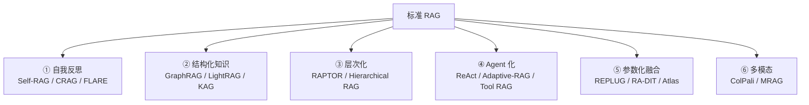
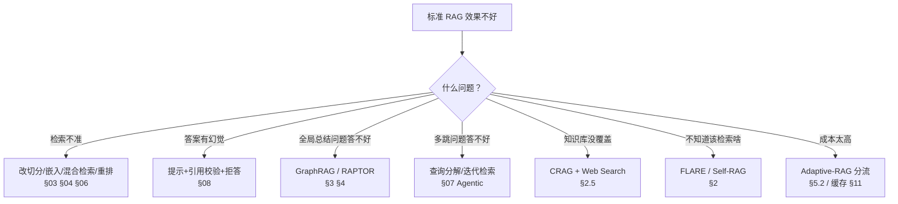

# 高级 RAG 架构

> **核心问题**：当标准 RAG 不够用时，往哪走？

---

## 1. 地图



---

## 2. 自我反思系

### 2.1 Self-RAG（2023）

**论文**：*Self-RAG: Learning to Retrieve, Generate, and Critique through Self-Reflection*, Asai et al., ICLR 2024
**仓库**：`AkariAsai/self-rag`

### 2.2 核心思想：让模型学会「什么时候该检索、检索的东西好不好」

**训练一个「反思 token」生成器**，同时输出：

| Token | 含义 |
|---|---|
| `[Retrieval]` | 需要检索吗？（Yes/No） |
| `[Relevance]` | 检索到的内容相关吗？（0~3 分） |
| `[IsSup]` | 生成的段落是否被上下文支持？（Yes/No） |
| `[IsUse]` | 这个段落对答案有用吗？（Yes/No） |

**推理时**：
```
1. 模型生成一个段落
2. 同时输出反思 token
3. 如果 [Retrieval]=Yes → 检索，把文档拼回上下文，重新生成
4. 如果 [IsSup]=No → 重新生成这个段落
5. 逐段累积，直到输出 [EOS]
```

**关键**：
- **反思 token 是和生成交替输出的**，所以可以在生成中途决定要不要检索
- **不需要人工标注「哪个 chunk 好」**，模型自己学

**训练数据**：用 GPT-4 标注「检索 / 生成 / 反思」三元组。

### 2.3 效果

HotpotQA / TriviaQA / PubHealth 上超过固定检索的 RAG，尤其在**多跳推理**和**长生成**上提升明显。

### 2.4 落地难度

| 难点 | 说明 |
|---|---|
| **需要训练反思模型** | 要构造训练数据（GPT-4 标注） |
| **推理循环** | 延迟增加，且不保证收敛 |
| **模型特定** | 反思 token 是自定义词表，要改模型 |

**实用折中**：不做完整训练，用**提示词模拟**：

```markdown
在生成答案时，请在每段前输出一个标记：
[需要检索] 表示这一段需要更多上下文
[有依据] 表示这一段有文档支撑
[无依据] 表示这一段是推测
```

然后在解析时检查这些标记，对 `[需要检索]` 触发一次检索。

### 2.5 CRAG（Corrective RAG, 2024）

**论文**：*Corrective Retrieval Augmented Generation*, Yan et al., arXiv:2401.15884

**核心：检索之后先「评估」，再决定怎么办。**

```
用户查询
   ↓
[Confidence Judge] 评估检索结果质量
   ↓
  ├── 高置信度 → 直接生成
  ├── 低置信度 → [Web Search] 补充信息 → 生成
  └── 极高置信度但内容可疑 → [Decompose & Recompose] 拆分重组 → 生成
```

**Confidence Judge** 的四种信号（论文用几个分类器/LLM 判断）：
- **Is the query correct?**（问题本身是否合理）
- **Is the retrieved document relevant?**
- **Is the retrieved document consistent?**（多个文档之间是否一致）
- **Is the answer useful?**

**关键创新**：
- **Web Search 兜底** —— 知识库没有时，用搜索引擎
- **Decompose & Recompose** —— 把大查询拆成子查询分别检索

### 2.6 FLARE（2023）

**论文**：*Active Retrieval Augmented Generation*, Jiang et al., EMNLP 2023

**核心：基于「正在生成的内容」来判断要不要检索。**

```
1. 模型开始生成答案
2. 每生成一句，就用这句话作为「伪查询」去检索
3. 检索到的信息用于指导后续生成
```

**为什么有效**：
- 检索的查询**来自模型已经知道的内容**，比原始查询更具体
- 避免了「一开始不知道该检索什么」的问题

**实现**：需要「生成一段 → 检索 → 继续生成」的流式循环。

### 2.7 三者对比

| | Self-RAG | CRAG | FLARE |
|---|---|---|---|
| **核心** | 训练反思 token | 评估检索质量 | 用生成内容做查询 |
| **训练需求** | 高（要造标注数据） | 中（要训 judge 或用 LLM 判） | 无 |
| **延迟** | 中~高（循环） | 中 | 高（每句都检索） |
| **离线知识库外** | ❌ | ✅（可 Web Search） | ❌ |
| **落地难度** | 高 | 中 | 中 |

---

## 3. 图结构化知识系

### 3.1 GraphRAG（微软，2024）

**论文**：*From Local to Global: A Graph RAG Approach to Query-Focused Summarization*, Edge et al., arXiv:2404.16130
**仓库**：`microsoft/graphrag`
**官方文档**：https://microsoft.github.io/graphrag/

### 3.2 它解决什么问题

**标准 RAG 适合**：**局部查询**（"报销流程是什么？"）

**标准 RAG 不适合**：**全局查询**（"这份报告的主要结论有哪些？" / "文档里提到的所有风险因素是什么？"）

**原因**：
- 全局问题需要**综合整份文档**，而不是找几个片段
- 把整个文档塞进 context 会超 token limit
- 找片段再拼接，丢失了「整体结构」

**GraphRAG 的解法**：**构建知识图谱 + 社区摘要**。

### 3.3 工作流程

```
       原始文档
          ↓
    ① 实体抽取 (Entity Extraction)
       用 LLM 抽取实体、关系、关键点
          ↓
    ② 知识图谱构建
       节点 = 实体/概念，边 = 关系/断言
          ↓
    ③ 社区检测 (Leiden 算法)
       把相关节点聚成社区（层次化）
          ↓
    ④ 社区摘要 (Community Summarization)
       对每个社区，用 LLM 生成摘要
       （社区是层次化的：高层社区 = 更全局的摘要）
          ↓
    ⑤ 索引
       社区摘要 → 向量库（作为「全局检索」入口）
          ↓
    ⑥ 查询（map-reduce）
       局部检索 + 社区摘要检索 → 合并 → 生成
```

### 3.4 查询模式

**Local Search**（局部）：
```
向量检索找到相关的社区摘要 → 提取相关的实体/关系/文本块 → LLM 生成
```
**适合**：具体事实查询

**Global Search**（全局）：
```
map:  用每个社区摘要作为「地图」并行提问，提取相关要点
reduce: 把所有要点合并 → LLM 综合成全局答案
```
**适合**：全局总结问题

**DRIFT Search**（2025 新增）：
```
Local + Global 的混合：先做局部搜索找到种子实体，
再用社区图做深度探索，最后综合
```

### 3.5 成本

**GraphRAG 的索引构建非常贵**：
- 每篇文档要调用 LLM 多次（实体抽取、关系抽取、社区摘要）
- 社区摘要是层次化的，摘要数量随文档量增长

**实测量级**（示意）：
```
1000 页文档 → 索引构建需要数十分钟到数小时的 LLM 调用
成本可能是朴素 RAG 的 10~100 倍
```

**优化**：
- `max_text_length` 限制每次抽取的文本量
- 只对「重要」的社区生成摘要（`max_community_level`）
- 用便宜的模型做抽取，贵的模型做摘要
- 缓存中间结果（GraphRAG 有 checkpoint 机制）

### 3.6 LightRAG（2024）

**论文**：*LightRAG: Simple and Fast Retrieval-Augmented Generation*, Gao et al., arXiv:2410.05779
**仓库**：`HKUDS/LightRAG`

**改进 GraphRAG**：
- **双层检索**：低层（实体级）+ 高层（关系级）
- **增量更新友好**：不需要每次重建整个图
- **更轻量**：不需要层次化的社区摘要

```
实体级检索：查"X 是什么"     → 精确
关系级检索：查"X 和 Y 什么关系" → 语义
```

### 3.7 KAG（2024）

**论文**：*KAG: Boosting LLMs with Knowledge Graph-Augmented Retrieval*, arXiv:2409.13731
**仓库**：`OpenSPG/KAG`

**思路：把「图检索」和「向量检索」深度融合**
- 用**开放域 KG**（如 OpenSPG 的 schema）代替自由构图
- 支持**逻辑推理查询**（不只是相似度检索）
- 引入「**推理路径**」的概念

### 3.8 其他图 RAG

| 项目 | 特点 |
|---|---|
| **HippoRAG** (2024) | 用**个性化 PageRank** 在知识图谱上做多跳检索，模仿海马体索引机制 |
| **HippoRAG 2** (2025) | 改进的图结构 + 事实召回 |
| **PathRAG** (2025) | 考虑「路径」而非「节点」的检索 |
| **G-Retriever** (2024) | 用 GNN 在文本图上检索 |
| **RAPTOR** (2024) | 见下（层次化，不是图） |

### 3.9 什么时候用图 RAG

| 场景 | 建议 |
|---|---|
| **需要跨文档的实体关系推理** | ✅ GraphRAG / LightRAG |
| **全局总结类问题** | ✅ GraphRAG（Global Search） |
| **单文档局部问答** | ❌ 朴素 RAG 更好（更便宜） |
| **知识库是关系密集型**（人物、组织、事件） | ✅ 收益大 |
| **知识库是扁平的文档集合** | ⚠️ 图的构建成本可能不划算 |
| **文档少（<100 篇）** | ❌ 直接全量塞进 context |

---

## 4. 层次化系

### 4.1 RAPTOR（2024）

**论文**：*RAPTOR: Recursive Abstractive Processing for Tree-Organized Retrieval*, Sarthi et al., ICLR 2024

### 4.2 核心思想

**问题**：一个 chunk 要么太细（缺上下文）要么太粗（不精确）。RAPTOR **同时索引两种粒度**。

```
原始文档
   ↓ 切分
叶子节点（细粒度 chunk）
   ↓ 聚类 + 摘要
中间节点（簇的摘要）
   ↓ 聚类 + 摘要
根节点（全局摘要）
```

**检索时**：把**所有层级**的节点都放进向量库。
- 细粒度节点回答**具体事实**问题
- 粗粒度节点回答**主题/全局**问题

**效果**：在「需要全局理解」的任务上（QA、摘要）显著提升，同时保持细节检索能力。

### 4.3 实现

```python
from sklearn.cluster import AgglomerativeClustering

def build_tree(chunks, llm, embedder, level=0):
    """递归地聚类 + 摘要"""
    # 1. 聚类
    embeddings = embedder.encode([c.text for c in chunks])
    n_clusters = max(2, len(chunks) // 4)
    clusterer = AgglomerativeClustering(n_clusters=n_clusters)
    labels = clusterer.fit_predict(embeddings)

    # 2. 对每个簇生成摘要
    summaries = []
    for label in range(n_clusters):
        cluster_texts = [c.text for c, l in zip(chunks, labels) if l == label]
        summary = llm.invoke(
            f"请总结以下文本段落的要点：\n" + "\n".join(cluster_texts))
        summaries.append({
            "text": summary.content,
            "level": level,
            "metadata": {"children": [c.id for c, l in zip(chunks, labels) if l == label]}
        })

    # 3. 递归（直到只剩一个簇）
    if len(summaries) > 1 and level < max_levels:
        return summaries + build_tree(summaries, llm, embedder, level + 1)

    return summaries
```

### 4.4 权衡

| 优点 | 缺点 |
|---|---|
| 兼顾细节和全局 | **索引成本高**（每层都要 LLM 摘要） |
| 层次化天然支持「概览 → 深入」 | 存储量增加 |
| 对长文档效果好 | 聚类质量影响很大 |

---

## 5. Agent 化系

### 5.1 ReAct（2022）

**论文**：*ReAct: Synergizing Reasoning and Acting in Language Models*, Yao et al., ICLR 2023

**核心**：推理（Reason）和行动（Act）交替。

```
Thought: 我需要知道 X 公司的 CEO 是谁
Action: Search[{"query": "X 公司 CEO"}]
Observation: 张三
Thought: 现在我需要查张三设计的产品
Action: Search[{"query": "张三 设计的产品"}]
Observation: ...
Final Answer: ...
```

**这是所有 Agentic RAG 的基础范式**。

### 5.2 Adaptive-RAG（2024）

**论文**：*Adaptive-RAG: Learning to Adapt Retrieval-Augmented Large Language Models through Question Complexity*, Jeong et al., NAACL 2024

**核心：先分类问题复杂度，再选策略。**

```
复杂度分类器 → {
  "Simple"    → 不检索，直接生成
  "Moderate"  → 单次检索
  "Complex"   → 迭代检索 + 分解
}
```

**收益**：简单问题不付检索的钱 → **平均成本大降**。

### 5.3 多智能体 RAG

**架构**：
```
[协调器 Agent]
   ↓ 分派
[检索 Agent] [分析 Agent] [验证 Agent] [写作 Agent]
```

**收益**：分工明确
**代价**：多轮 LLM 调用，延迟和成本都很高，调试困难

### 5.4 Tool RAG / 函数调用

**把检索包装成一个「工具」**，让 LLM 自己决定什么时候调用：

```python
tools = [{
    "type": "function",
    "function": {
        "name": "search_knowledge_base",
        "description": "在企业知识库中检索与问题相关的信息",
        "parameters": {
            "type": "object",
            "properties": {
                "query": {"type": "string", "description": "检索查询"},
                "top_k": {"type": "integer", "default": 5}
            },
            "required": ["query"]
        }
    }
}]

# 模型自动决定调用
response = client.chat.completions.create(
    model="gpt-4o", messages=messages, tools=tools)
```

**这是最实用的「Agentic RAG」形态** —— 不需要复杂的框架，用模型原生的 function calling。

### 5.5 什么时候用 Agentic RAG

| 场景 | 建议 |
|---|---|
| **简单的知识库问答** | ❌ 标准 RAG 就够，Agentic 是浪费 |
| **需要多跳推理** | ✅ |
| **需要实时数据**（工具调用） | ✅ |
| **延迟不敏感（离线分析）** | ✅ |
| **延迟敏感（<2s）** | ❌ |
| **成本敏感（大规模调用）** | ❌ 或用 Adaptive-RAG 分流 |

---

## 6. 参数化融合系

### 6.1 REPLUG（2023）

**论文**：*REPLUG: Retrieval-Augmented Black-Box Language Models*, Shi et al., arXiv:2301.12652

**思想**：把检索结果「注入」到黑盒 LLM 的**输入嵌入**里，而不是拼进 prompt 文本。

```
检索文档 → 各自的嵌入 → 通过一个轻量 LM（把文档编码成「提示向量」）→ 拼接到输入 token 嵌入
```

**收益**：
- **不占用 context window**（文档以向量形式注入）
- 检索的内容和指令分离，减少「指令注入」风险
- 对 LoRA 微调的 LLM 效果显著

### 6.2 RA-DIT（2024）

**论文**：*RA-DIT: Retrieval-Augmented Dual Instruction Tuning*, Shi et al., arXiv:2410.01315

**思想：同时微调「指令跟随」和「检索增强」两种能力。**

```
训练数据： (指令, 检索文档) → 目标输出
两个损失：
  L_ISFT: 指令跟随损失
  L_RAG:   检索增强损失
```

**收益**：在检索增强任务上显著优于只做 SFT 的方案。

### 6.3 Atlas（2022）

**论文**：*Atlas: Few-shot Learning with Retrieval Augmented Language Models*, Izacard & Grave, JMLR 2023

**思想**：把「检索器」和「语言模型」联合训练，用「文档作为前缀」的方式。

**代表了「参数化融合」的极致**：不改 LLM 的架构，但改它的输入表示。

---

## 7. 多模态系

见 [`14-多模态RAG.md`](./14-多模态RAG.md)。

| 方法 | 思路 |
|---|---|
| **ColPali** (2024) | 用视觉 tokenizer（不是文本 OCR）做文档检索，**端到端晚交互** |
| **ColQwen2** | ColPali 的 Qwen2 版本 |
| **VisRAG** (2024) | 用 VLM 生成「页面描述」再嵌入 |
| **MRAG / 多模态 RAG** | 文本+图像混合索引 |

---

## 8. 选型决策



**优先级建议**：
1. **先优化标准 RAG 的每个环节**（解析→切分→嵌入→检索→重排→组装→生成）
2. 标准 RAG 优化到瓶颈后，再考虑加 GraphRAG / Agentic
3. **加高级架构前，先确认瓶颈在哪**（用评测集定位）

---

## 9. 工程结论

1. **不要一上来就上 GraphRAG 或 Agentic**。80% 的 RAG 问题靠优化标准流程能解决。
2. **Self-RAG 的思想（模型自我判断检索质量）可以用提示词近似实现**，不必真的训练。
3. **CRAG 的「检索质量评估 + Web Search 兜底」是性价比很高的增强**，特别适合知识库覆盖不全的场景。
4. **GraphRAG 解决的是「全局问题」，不是通用增强**。只有当你的查询真的是全局型时才值得。
5. **Adaptive-RAG 的「分流」思路应该贯彻到所有架构**：简单查询走便宜路径。
6. **Agentic RAG 用 function calling 实现最实用**，不需要复杂的 Agent 框架。
7. **每加一层就重新评测**。高级架构常常让简单问题变差。

---

## 🔗 相关

- 标准架构 → [`01-RAG总览与架构.md`](./01-RAG总览与架构.md)
- 评测 → [`10-评测与度量.md`](./10-评测与度量.md)
- 性能 → [`11-工程落地与性能优化.md`](./11-工程落地与性能优化.md)
- 多模态 → [`14-多模态RAG.md`](./14-多模态RAG.md)
