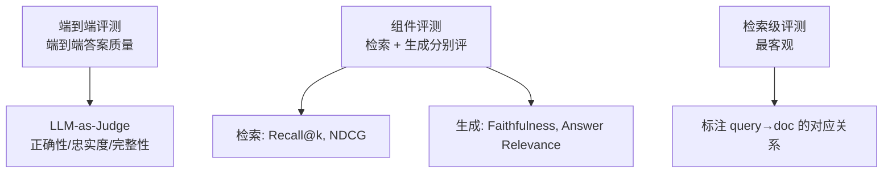

# 评测与度量

> **核心问题**：你怎么知道 RAG 系统变好了，而不是变「感觉更流畅」？

---

## 1. 为什么评测是 RAG 最大的短板

**现状**：
- 检索有相对标准的指标（Recall@k、NDCG）
- 生成有 BLEU/ROUGE（但对 RAG 不合适）
- **端到端 RAG 的评测没有公认标准**，大部分团队靠「人工看看」

**根本困难**：RAG 的输出是**开放式文本**。「答案好不好」没有唯一正解。

**必须先建立的认知**：
> **没有评测集，就没有 RAG 工程。** 所有「我们优化了检索策略」的声明，如果不能给出评测集上的数字，就是没有证据。

---

## 2. 评测的三层结构



**推荐做法**：
1. **主要依赖组件评测**（客观、可自动化）
2. **辅以端到端 LLM-as-Judge**（贴近真实体验）
3. **定期做人工抽检**（校准 Judge 的可信度）

---

## 3. 检索评测指标

### 3.1 需要标注什么

```
eval_set.jsonl:
  {
    "query_id": "q1",
    "query": "年假可以申请几天？",
    "relevant_chunk_ids": ["c_123", "c_456"],       # 相关的 chunk（可以多个）
    "relevant_doc_ids": ["doc_a"],                   # 可选：相关的文档
    "answer": "入职满 1 年可申请 5 天……"            # 可选：参考答案
  }
```

### 3.2 核心指标

| 指标 | 公式 | 含义 |
|---|---|---|
| **Recall@k** | $\frac{\text{检索到的相关数}}{\text{全部相关数}}$ | 漏没漏 |
| **Precision@k** | $\frac{\text{Top-k 中的相关数}}{k}$ | 准不准 |
| **MRR** | $\frac{1}{|Q|}\sum \frac{1}{\text{rank of first relevant}}$ | 第一个相关的排多前 |
| **NDCG@k** | $\frac{DCG@k}{IDCG@k}$ | 排序质量（考虑位置折扣） |
| **MAP** | $\frac{1}{|Q|}\sum \text{AP}(q)$ | 综合（每个相关结果都贡献） |
| **Context Recall** | 检索到的内容覆盖了参考答案多少比例 | RAGAS 指标 |
| **Context Precision** | 检索到的内容里有多少是相关的 | RAGAS 指标 |

**NDCG 的计算**：
$$
DCG@k = \sum_{i=1}^{k} \frac{rel_i}{\log_2(i+1)}, \quad
IDCG@k = \sum_{i=1}^{k} \frac{1}{\log_2(i+1)}
$$

### 3.3 评测代码

```python
import numpy as np

def evaluate_retrieval(results, qrels, k_values=(1, 3, 5, 10, 20)):
    """
    results: {query_id: [chunk_id, ...]}  按相关度降序
    qrels:   {query_id: {chunk_id: rel_score}}
    """
    metrics = {f"{m}@{k}": [] for k in k_values for m in ("recall", "precision", "ndcg")}

    for qid, rels in qrels.items():
        retrieved = results.get(qid, [])[:max(k_values)]
        rel_set = {d for d, r in rels.items() if r > 0}
        hits = [1 if d in rel_set else 0 for d in retrieved]

        for k in k_values:
            h = hits[:k]
            # Recall@k
            metrics[f"recall@{k}"].append(
                len(set(retrieved[:k]) & rel_set) / max(1, len(rel_set)))
            # Precision@k
            metrics[f"precision@{k}"].append(sum(h) / k)
            # NDCG@k
            dcg = sum(rel / np.log2(i + 2) for i, rel in enumerate(h))
            ideal_hits = min(k, len(rel_set))
            idcg = sum(1 / np.log2(i + 2) for i in range(ideal_hits))
            metrics[f"ndcg@{k}"].append(dcg / idcg if idcg > 0 else 0)

    return {m: np.mean(v) for m, v in metrics.items()}
```

### 3.4 标注工作量估算

| 评测集规模 | 标注方式 | 能检出多大差异 |
|---|---|---|
| 20~50 条 | 人工标注（每个 query 标 5~10 个相关 chunk） | 能检出 >10% 的差异 |
| 100~200 条 | 人工 + LLM 辅助 | 能检出 >5% 的差异 |
| 500+ 条 | LLM 批量生成 + 人工抽检 | 能检出 >2% 的差异 |

**推荐起步**：**50 条查询 × 每条标 5 个相关 chunk**。半天工作量，能支撑整个迭代周期。

**标注技巧**：
- 标注「宽松相关」：只要 chunk 包含回答所需信息就算相关
- 允许一条 query 对应多个相关 chunk（不同文档说法不同）
- 标注「困难负例」：容易被误召回的 chunk

---

## 4. 生成评测指标

### 4.1 RAGAS 的四个核心指标

**论文**：*RAGAS: Automated Evaluation of Retrieval Augmented Generation*, Es et al., EACL 2024
**仓库**：`explodinggradients/ragas`

| 指标 | 问题 | 测量方式 | 依赖 |
|---|---|---|---|
| **Faithfulness**（忠实度） | 答案是否**只**基于上下文？ | 把答案拆成陈述句，逐句问「上下文支持这句吗？」取比例 | **需要 LLM** |
| **Answer Relevance**（答案相关性） | 答案是否切题？ | 用答案生成问题，看和原查询的相似度 | **需要 LLM** |
| **Context Relevance**（上下文相关性） | 检索到的内容对回答有用吗？ | 让 LLM 评估内容的直接相关性 | **需要 LLM** |
| **Context Precision**（上下文精确率） | 有用的内容排前面吗？ | 对每个 chunk 问「对回答有用吗」，按排名加权平均 | **需要 LLM** |

**Context Recall**（RAGAS 0.2+）：
- 检索到的内容覆盖了「参考答案」多少
- **需要参考答案**

### 4.2 Faithfulness 的实现

```python
def evaluate_faithfulness(llm, question, answer, contexts):
    """
    1. 把答案拆成原子陈述
    2. 对每条陈述，问 LLM「上下文是否支持」
    3. 计算支持比例
    """
    # Step 1: 拆陈述
    claims_prompt = f"""请把下面的答案拆成独立的原子事实陈述，每行一条。

答案：{answer}

陈述："""
    claims = llm.invoke(claims_prompt).content.strip().split("\n")

    # Step 2: 逐条验证
    ctx_text = "\n".join(contexts)
    supported = 0
    for claim in claims:
        v_prompt = f"""判断「资料」是否支持「陈述」。只回答"支持"或"不支持"。

陈述：{claim}
资料：{ctx_text}

判断："""
        verdict = llm.invoke(v_prompt).content.strip()
        if "支持" in verdict:
            supported += 1

    return supported / len(claims) if claims else 0.0
```

### 4.3 RAGAS 快速上手

```python
from ragas import evaluate
from ragas.metrics import faithfulness, answer_relevancy, context_precision, context_recall

dataset = [
    {
        "question": "年假可以申请几天？",
        "answer": "入职满 1 年可申请 5 天年假。",
        "contexts": ["入职满一年可申请5天年假，满三年可申请10天……"],
        "ground_truth": "入职满1年可申请5天年假",
    }
]

result = evaluate(
    dataset=dataset,
    metrics=[faithfulness, answer_relevancy, context_precision, context_recall],
)
print(result)
```

### 4.4 RAGAS 的问题

| 问题 | 说明 |
|---|---|
| **依赖 LLM 判断** | 评测结果受 Judge 模型影响，不同 Judge 分数不同 |
| **成本** | 每个指标要多次 LLM 调用 |
| **不可复现** | LLM 有随机性，Judge 温度要设 0 |
| **分数难解释** | 「faithfulness 0.85」是好还是坏？需要基线 |

**缓解**：
- 用**强模型**做 Judge（GPT-4o / Claude）
- Judge 的 temperature = 0
- **建立自己的基线分数**，只看相对变化

### 4.5 其他评测框架

| 框架 | 特点 |
|---|---|
| **RAGAS** | 最流行，指标体系清晰 |
| **ARES** (2024) | **用少量人工标注校准**，不用参考答案也能预测 RAG 指标 |
| **RAGChecker** (2024) | 更细的诊断（噪声、冗余、矛盾） |
| **TruLens** | 集成在 LangChain/LlamaIndex，追踪导向 |
| **DeepEval** | pytest 风格，易于 CI 集成 |
| **promptfoo** | 声明式 YAML，擅长 A/B 对比 |
| **LangSmith** | LangChain 生态，trace 导向 |

**ARES 的亮点**：
> 它用**少量人工标注**（比如每个问题 1 个「相关的上下文」标注）来训练一个轻量模型，预测 faithfulness / relevance / context quality 这三个 RAGAS 指标。**不需要参考答案**，成本远低于 RAGAS。

---

## 5. 端到端评测

### 5.1 LLM-as-Judge

**主流做法**：

```python
JUDGE_PROMPT = """你是严格的评测员。根据给定的「参考答案」和「资料」评估「答案」。

评分维度（每项 1-5 分）：
1. 正确性：与参考答案一致吗？
2. 忠实度：所有陈述都有资料支撑吗？
3. 完整性：参考答案的关键信息都覆盖了吗？
4. 相关性：是否切题、无冗余？

参考答案：{ground_truth}
资料：{contexts}
答案：{answer}

评分（JSON）："""

def llm_judge(llm, question, answer, contexts, ground_truth=None):
    prompt = JUDGE_PROMPT.format(
        ground_truth=ground_truth or "（无，请仅依据资料判断正确性）",
        contexts="\n".join(contexts), answer=answer)
    resp = llm.invoke(prompt).content
    return json.loads(resp)     # {"correctness": 4, "faithfulness": 5, ...}
```

### 5.2 Judge 的可靠性问题

**必须校准 LLM-as-Judge**：

```python
# 用人工标注的 30~50 条做校准
human_scores = [...]       # 人工打的分
judge_scores = [...]       # Judge 打的分

# 计算相关系数
from scipy.stats import spearmanr, pearsonr
print("Spearman:", spearmanr(human_scores, judge_scores))
print("Pearson:", pearsonr(human_scores, judge_scores))
```

**相关系数 < 0.6 → Judge 不可信**，要换模型或改 prompt。

**降低 Judge 偏差的技巧**：
1. **成对比较**（A vs B哪个更好）比绝对打分更可靠
2. **让 Judge 先说出理由再打分**（CoT）
3. **打乱选项顺序**，检测位置偏差
4. **多次采样取中位数**
5. **先描述答案，再基于描述打分**（避免长度偏好）

### 5.3 二元判断往往比打分更稳

```python
def is_correct(llm, question, answer, ground_truth):
    """二选一比 1-5 打分更稳定"""
    prompt = f"""判断「答案」是否与「参考答案」在实质上等价。只回答"是"或"否"。

问题：{question}
参考答案：{ground_truth}
待评答案：{answer}

回答："""
    return "是" in llm.invoke(prompt).content
```

---

## 6. 常用基准数据集

| 基准 | 类型 | 说明 |
|---|---|---|
| **RGB** (2023) | 综合 | 检索、生成、鲁棒性、拒答、负拒答五大能力 |
| **CRAG** (2024) | 综合 | **最贴近真实**（含时效性、歧义问题） |
| **FRAMES** (2024) | 多跳推理 | 需组合多个来源的事实型问题 |
| **LooGLE** | 长上下文 | 长文档理解 |
| **HotpotQA / 2WikiMUltiHopQA / MuSiQue** | 多跳 QA | 标准多跳基准 |
| **Natural Questions / TriviaQA** | 开放 QA | 经典 |
| **MS MARCO / BEIR** | 检索 | 检索基准 |
| **MTEB / C-MTEB** | 嵌入 | 嵌入模型基准 |
| **RAGTruth** (2024) | 幻觉 | **RAG 幻觉的标注语料** |
| **TREC-DL19/20** | 检索 | 深度检索 |
| **MultiHop-RAG** (2024) | 多跳 RAG | 专为 RAG 设计的多跳数据集 |
| **ARES benchmark** | 综合 | ARES 的评测集 |

**CRAG 基准特别值得注意**：它引入了「**时效性问题**」（答案会随时间变化）和「**歧义问题**」，这两类在真实企业场景非常常见，而很多基准不包含。

---

## 7. 建立自己的评测体系

### 7.1 最小可行评测集（半天搭建）

```python
# 1. 收集 50 条真实查询（从日志里挑，或让业务同事写）
queries = [...]

# 2. 用当前系统跑一遍，保存检索结果
results = system.retrieve_batch(queries)   # 保存 chunk + 排序

# 3. 人工标注每个 query 的相关 chunk（或用 LLM 辅助生成初标再人工修正）
qrels = {...}

# 4. 固化评测脚本
def eval_retrieval(results, qrels):
    return evaluate_retrieval(results, qrels)
```

### 7.2 评测集要分层

| 层 | 数量 | 来源 | 用途 |
|---|---|---|---|
| **黄金集** | 50~100 | 人工精标 | 每次改动都跑 |
| **扩展集** | 200~500 | LLM 生成 + 抽检 | 定期跑 |
| **线上抽样** | 持续 | 生产日志 | 每周抽 50 条人工评 |
| **对抗集** | 20~50 | 人工构造 | 专门测边界 |

**对抗集要覆盖**：
- 知识库里**没有**答案的问题（测拒答）
- **需要组合多个文档**的问题（测多跳）
- **有歧义**的问题
- **超出知识库时间范围**的问题

### 7.3 持续集成

```yaml
# .github/workflows/rag-eval.yml
name: RAG Eval
on: [pull_request]
jobs:
  eval:
    runs-on: ubuntu-latest
    steps:
      - uses: actions/checkout@v4
      - run: pip install -r requirements.txt
      - run: python eval/run_eval.py --config eval/config.yaml --threshold-check
```

**门禁示例**：
```yaml
thresholds:
  retrieval_recall@5: 0.75      # 下降超过 5% 就 fail
  retrieval_ndcg@10: 0.70
  generation_faithfulness: 0.90
  generation_answer_relevancy: 0.80
  latency_p95_ms: 3000
```

### 7.4 版本化的评测报告

每次改动存一份：
```
eval_runs/
├── 2026-10-30_abc123_hyde.md
├── 2026-10-31_def456_reranker.md
└── comparison.md
```

**这样能看出「哪个改动带来了多少提升」**，这对长期迭代至关重要。

---

## 8. 端到端业务指标

**技术指标之外，业务指标才是最终判据**：

| 指标 | 说明 |
|---|---|
| **自助解决率** | 用户不用转人工就解决了 |
| **转人工率** | 越低越好 |
| **首次响应解决率** | FCR |
| **平均处理时长** | 效率 |
| **点赞/点踩率** | 用户反馈 |
| **幻觉投诉率** | 质量红线 |
| **单次会话成本** | 经济性 |
| **知识库覆盖率** | 检索能覆盖的问题比例 |

**建议同时跟踪**：
```
技术指标（快速反馈，每天看）
   ↓
业务指标（滞后反馈，每周/月看）
```

**注意**：**业务指标和技术指标可能冲突**。比如提高忠实度会让拒答率上升，短期内自助解决率可能下降。这是正常的取舍，但要明确知道自己在优化什么。

---

## 9. 常见错误

| # | 错误 | 后果 | 修正 |
|---|---|---|---|
| 1 | **没有评测集就调参** | 改了什么不知道 | 先建评测集 |
| 2 | **只看最终答案** | 定位不到问题在哪 | 分层评测 |
| 3 | **用 BLEU/ROUGE 评 RAG** | 与实际质量脱节 | 用 Faithfulness / 相关性 |
| 4 | **Judge 不校准** | 分数不可信 | 用人工标注校准相关系数 |
| 5 | **评测集泄漏**（用检索结果当标注） | 循环论证 | 标注要独立于当前系统 |
| 6 | **评测集太小** | 噪声大 | ≥50 条 |
| 7 | **只看平均值** | 掩盖长尾问题 | 分层看（简单/复杂/对抗） |
| 8 | **改了提示词不复测检索** | 不知道收益来自哪 | 分层消融 |
| 9 | **没有基线** | 分数无参照 | 先固定基线 |
| 10 | **线上不采样** | 线上退化发现不了 | 定期抽检 |

---

## 10. 工程结论

1. **先建 50 条的黄金评测集**。这是 RAG 工程化的第一件事。
2. **检索评测是客观的，优先做**。生成评测靠 LLM Judge，要校准。
3. **RAGAS 适合快速迭代，ARES 适合降低标注成本**。
4. **Judge 的 temperature = 0，并用人工标注校准相关系数**。
5. **业务指标才是最终判据**。技术指标是过程指标。
6. **把评测接进 CI**。每次改提示词、切分、模型都要跑。
7. **对抗集（无答案、多跳、歧义）比随机样本更能暴露问题**。

---

## 🔗 相关

- 架构 → [`01-RAG总览与架构.md`](./01-RAG总览与架构.md)
- 检索 → [`06-检索与重排.md`](./06-检索与重排.md)
- 生成 → [`08-生成与提示工程.md`](./08-生成与提示工程.md)
- 失败模式 → [`12-失败模式与安全.md`](./12-失败模式与安全.md)
