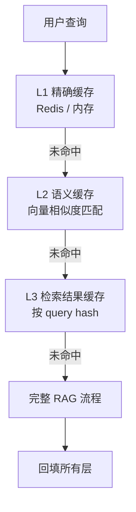

# 工程落地与性能优化

> **核心问题**：RAG 系统怎么在生产环境跑稳？延迟、成本、并发怎么控？

---

## 1. 延迟预算

### 1.1 端到端延迟分解

```
用户输入
   ↓
[网络 + 网关]           20~100 ms
   ↓
[查询处理]              0~800 ms   （LLM 改写/多查询/分解）
   ↓
[嵌入]                   5~50 ms
   ↓
[向量检索]               1~100 ms
   ↓
[BM25 检索]              5~50 ms
   ↓
[融合 + 重排]            20~500 ms  （Cross-Encoder 是大头）
   ↓
[LLM 生成]              500~5000 ms  （首 token 200~800ms）
   ↓
[后处理]                 5~50 ms
   ↓
[网络返回]               20~100 ms
```

### 1.2 不同场景的预算

| 场景 | 总预算 | 建议 |
|---|---|---|
| **客服对话** | < 3s | 关掉查询分解；重排用 base 模型；LLM 用流式 |
| **搜索建议** | < 500ms | 只做向量检索，不重排，不生成（或用小模型） |
| **内部知识库** | < 5s | 可以用 Agentic |
| **离线报告生成** | 分钟级 | 全套 GraphRAG / Agentic |

### 1.3 优化优先级

```
1. 流式输出（TTFT 从 3s → 800ms，用户感知提升巨大）
2. 减少查询处理的 LLM 调用（缓存、路由）
3. 重排用更小的模型（base 而非 large）
4. 降低 top_k（上下文少 → 生成快）
5. 换更快的 LLM（或者分级：简单问题用小模型）
6. 减少检索的 top_k 和索引规模
```

**关键认知**：
> **流式输出是延迟优化里性价比最高的一项。** 总延迟不变，但「用户看到第一个字」的时间可以降低 70%。

---

## 2. 缓存体系

### 2.1 四层缓存



| 层级 | 键 | 命中条件 | 节省 |
|---|---|---|---|
| **L1 精确缓存** | query 字符串 hash | 完全相同 | 100%（不调用任何模型） |
| **L2 语义缓存** | query 嵌入 + 相似度 | 语义相同（相似度 > 阈值） | ~100% |
| **L3 检索缓存** | query hash | 相同 query 的检索结果 | 省掉检索 + 重排 |
| **L4 嵌入缓存** | 文本 hash | 相同文本的嵌入 | 省掉嵌入 |

### 2.2 语义缓存（Semantic Cache）—— 最值得做的一个

**原理**：
```
1. 用户查询 → 嵌入
2. 在缓存的「历史查询嵌入」里做 ANN 检索
3. 找到相似度 > 阈值的历史查询 → 直接返回它的答案
```

```python
import numpy as np
from redis import Redis

class SemanticCache:
    def __init__(self, embedder, redis_client, vector_db,
                 similarity_threshold=0.95, ttl=86400):
        self.embedder = embedder
        self.redis = redis_client
        self.vdb = vector_db
        self.threshold = similarity_threshold
        self.ttl = ttl

    def get(self, query):
        q_emb = self.embedder.encode([query], normalize_embeddings=True)
        hits = self.vdb.search(q_emb[0], top_k=1,
                               filter={"type": "cached_query"})
        if not hits:
            return None
        hit = hits[0]
        if hit.score >= self.threshold:
            cached = self.redis.get(f"rag:ans:{hit.metadata['cache_key']}")
            if cached:
                return {"answer": json.loads(cached),
                        "cached": True,
                        "similarity": hit.score}
        return None

    def set(self, query, answer):
        key = hashlib.md5(query.encode()).hexdigest()
        self.redis.setex(f"rag:ans:{key}", self.ttl, json.dumps(answer))
        q_emb = self.embedder.encode([query], normalize_embeddings=True)
        self.vdb.add(
            ids=[f"cache_{key}"], vectors=[q_emb],
            metadata=[{"type": "cached_query", "cache_key": key}])
```

### 2.3 语义缓存的风险 ⚠️

**这是必须认真对待的问题**：

| 风险 | 场景 | 对策 |
|---|---|---|
| **上下文依赖** | 「它多少钱？」在一个会话里问，缓存会返回另一个问题的答案 | **不要对多轮对话做语义缓存**，或把对话历史一起作为缓存键 |
| **时效性** | 政策变了，但旧问题的缓存还在 | **设置短 TTL**（如 1 小时~1 天）+ 版本号 |
| **权限泄漏** | A 用户的问题缓存被 B 用户命中 | **缓存键必须包含用户身份/权限范围** |
| **阈值过松** | 「年假几天」命中「病假几天」的答案 | 阈值要严（0.95+），或加关键词校验 |

**安全实现**：
```python
cache_key = f"{tenant_id}:{user_permission_scope}:{query_hash}"
# 或者把权限哈希作为嵌入检索的 filter
hits = self.vdb.search(q_emb, top_k=1,
                       filter={"tenant_id": tenant_id,
                               "scope": user_scope})
```

**通用原则**：**语义缓存必须把「会影响答案的所有上下文」纳入键或过滤条件**。

### 2.4 缓存命中率的经验

| 场景 | 命中率 |
|---|---|
| **内部知识库**（问题重复度高） | 30~60% |
| **客服 FAQ** | 50~80% |
| **搜索式提问**（每次都不一样） | < 10% |

**收益**：命中率 40% 意味着 **40% 的请求零 LLM 成本**。这是巨大的成本优化。

---

## 3. 并发与稳定性

### 3.1 限流与降级

```python
class RAGService:
    def __init__(self):
        self.semaphore = asyncio.Semaphore(50)      # 并发上限
        self.circuit_breaker = CircuitBreaker(threshold=5, timeout=30)

    async def query(self, user_query, user_ctx):
        # 1. 限流
        if not await self.semaphore.acquire():
            raise OverloadedError()

        try:
            # 2. 熔断：LLM 挂了就快速失败
            async with self.circuit_breaker:
                return await self._full_pipeline(user_query, user_ctx)
        finally:
            self.semaphore.release()
```

### 3.2 降级策略链

```
完整流程（GraphRAG + Agentic + 重排）
   ↓ 超时/失败
标准流程（混合检索 + 重排）
   ↓ 超时/失败
简化流程（只有向量检索 top-3）
   ↓ 超时/失败
纯 LLM（明确标注「以下不来自知识库」）
   ↓ 失败
固定话术（「系统繁忙，请稍后重试」或转人工）
```

**关键**：降级要**明确告知用户**。悄悄降级会让用户对答案的信任度下降。

### 3.3 超时设计

| 环节 | 超时 | 超时后 |
|---|---|---|
| 查询处理 | 2s | 跳过，用原查询 |
| 嵌入 | 1s | 用原查询的简单编码 |
| 向量检索 | 500ms | 跳过，返回空 |
| 重排 | 1s | 跳过，用召回顺序 |
| LLM 生成 | 30s | 截断已生成内容返回 |

---

## 4. 流式输出

### 4.1 为什么重要

```
非流式：
  [等待 3s] ................ [一次性输出全部答案]
  用户感知延迟: 3s

流式：
  [等待 0.8s] [开始逐字输出............]
  用户感知延迟: 0.8s  ← 提升 73%
```

### 4.2 实现

```python
async def stream_answer(query, retriever, llm, **kwargs):
    """流式返回，检索完成后边生成边推"""
    contexts = await retriever.retrieve(query, **kwargs)

    prompt = build_prompt(query, contexts)
    async for chunk in llm.astream(prompt):
        yield chunk
```

### 4.3 流式下的引用校验问题

**问题**：流式输出时，答案还没生成完，无法做完整的引用校验。

**解法 1：两段式**
```
1. 先流式输出「引用列表」（从检索结果直接生成，不需要 LLM）
2. 再流式输出答案
```

**解法 2：后置校验**
```
流式输出完毕后，在后台做校验，标注可疑引用
```

**解法 3：结构化流**
```
用 JSON 流式输出 {"citations": [...], "answer": "..."}，先解析 citations 字段
```

---

## 5. 增量索引与更新

### 5.1 索引更新策略

| 策略 | 适用 | 实现 |
|---|---|---|
| **全量重建** | 文档少（< 1 万） | 简单可靠 |
| **增量 upsert** | 文档多、变化少 | 按 doc_id upsert |
| **蓝绿索引** | 大规模、要求零停机 | 建新索引 → 灌数据 → 切别名 → 删旧 |
| **分层索引** | 冷热分离 | 热数据在内存，冷数据在磁盘 |

### 5.2 增量更新的正确性

```python
def upsert_document(doc_id, chunks, embedder, vdb):
    # 1. 删除旧 chunks
    vdb.delete(where={"doc_id": doc_id})

    # 2. 生成新 chunks
    new_chunks = chunk_document(doc)

    # 3. 嵌入并写入
    embeddings = embedder.encode([c.text for c in new_chunks],
                                 normalize_embeddings=True)
    vdb.upsert(
        ids=[f"{doc_id}::{c.id}" for c in new_chunks],
        vectors=embeddings,
        metadata=[{"doc_id": doc_id, "chunk_index": i,
                   "text": c.text, **c.metadata}
                  for i, c in enumerate(new_chunks)])
```

**关键**：**先删后插**，避免新旧版本同时存在造成重复召回。

### 5.3 变更检测

```python
# 用内容 hash 判断是否需要更新
doc_hash = hashlib.sha256(content.encode()).hexdigest()
if doc_hash != metadata_store.get(doc_id):
    update_document(doc_id, content)
    metadata_store.set(doc_id, doc_hash)
```

**增量嵌入缓存**：
```python
def embed_with_cache(texts, embedder, cache):
    """相同文本不重复嵌入"""
    to_embed, results = [], []
    for i, t in enumerate(texts):
        h = hashlib.md5(t.encode()).hexdigest()
        if h in cache:
            results.append(cache[h])
        else:
            to_embed.append((i, t))
    if to_embed:
        embs = embedder.encode([t for _, t in to_embed],
                               normalize_embeddings=True)
        for (i, t), e in zip(to_embed, embs):
            cache[hashlib.md5(t.encode()).hexdigest()] = e
            results.append(e)
    return np.array(results)
```

---

## 6. 成本优化

### 6.1 成本构成

```
总成本 = 嵌入成本 + 查询处理成本 + LLM 生成成本 + 重排成本 + 存储成本
```

**典型分布（中等规模生产系统）**：

| 项 | 占比 | 优化手段 |
|---|---|---|
| **LLM 生成** | 60~80% | 缓存、换模型、减少上下文 |
| **查询处理 LLM** | 5~20% | 路由（简单问题跳过）、小模型 |
| **重排** | 3~10% | 用 base 模型、只重排 top-20 |
| **嵌入** | 1~5% | 缓存、批量 |
| **存储** | <5% | 量化 |

**结论**：**主要靠「减少 LLM 调用次数」和「减少 LLM 处理的 token」来省钱。**

### 6.2 模型分级

```
简单查询 → 小模型（分类、改写）+ 小重排模型
复杂查询 → 大模型 + 大重排模型
```

```python
def route_to_model(query, complexity):
    if complexity == "simple":
        return "small-model", "small-reranker"
    return "large-model", "large-reranker"
```

### 6.3 上下文 token 优化

| 手段 | 节省 |
|---|---|
| 减少 chunk 数量（10 → 5） | ~50% |
| 句子级压缩 | 30~70% |
| 去掉重复内容 | 10~20% |
| 用摘要替代长文档（GraphRAG） | 视情况 |

### 6.4 批处理

- **嵌入**：批量提交（batch_size=32~128）
- **离线评测**：批量跑
- **在线**：一般不用批（延迟敏感）

---

## 7. 可观测性

### 7.1 必须记录的 trace

```python
trace = {
    "trace_id": "...",
    "user_query": "...",
    "query_rewrite": {...},           # 改写前后的查询
    "retrieval": {
        "dense_hits": [{"id":..., "score":...}, ...],
        "sparse_hits": [...],
        "fused_hits": [...],
        "reranked_hits": [...],
        "latency_ms": {...},
    },
    "context": {"chunks": [...], "token_count": 1234},
    "generation": {
        "answer": "...",
        "citations": [...],
        "latency_ms": 2100,
        "tokens_in": 1500, "tokens_out": 200,
    },
    "feedback": {"score": 4, "comment": "..."},
}
```

### 7.2 监控面板

| 面板 | 指标 |
|---|---|
| **延迟** | P50/P90/P99（端到端 + 各环节） |
| **质量** | 引用率、拒答率、用户点赞率 |
| **成本** | 每次查询的 token 数和费用 |
| **检索** | 缓存命中率、top1 分数分布、召回文档数 |
| **错误** | 各环节异常率、降级触发率 |

### 7.3 工具

| 工具 | 特点 |
|---|---|
| **Langfuse** | 开源，RAG 追踪友好，自托管 |
| **LangSmith** | LangChain 生态 |
| **Phoenix (Arize)** | 开源，OpenTelemetry 集成好 |
| **Helicone** | 代理式，零侵入 |
| **Helios** | 开源 |
| **OpenTelemetry + Jaeger** | 通用 |

### 7.4 线上反馈闭环


**这个闭环是 RAG 系统持续变好的唯一机制。**

---

## 8. 生产部署清单

### 8.1 上线前

- [ ] 评测集已建立，基线分数已记录
- [ ] 各环节超时已设置，降级链路已实现
- [ ] 缓存已实现（含权限隔离）
- [ ] 引用校验已实现
- [ ] 限流已配置
- [ ] 监控面板已就绪
- [ ] 日志脱敏（不要把敏感数据打到日志）
- [ ] 权限过滤已测试（用不同角色测试）
- [ ] 提示注入防护已测试
- [ ] 成本估算已做（QPS × 单次成本）

### 8.2 运行中

- [ ] 每日查看 P99 延迟
- [ ] 每周抽样 50 条人工评测
- [ ] 每周查看拒答率和引用率趋势
- [ ] 索引更新监控（新文档是否被正确索引）
- [ ] 成本趋势监控

---

## 9. 常见错误

| # | 错误 | 后果 | 修正 |
|---|---|---|---|
| 1 | **没有缓存** | 成本高 | 加 L1/L2 缓存 |
| 2 | **语义缓存不区分用户** | **权限泄漏** | 缓存键含权限范围 |
| 3 | **语义缓存用在多轮对话** | 答非所问 | 多轮不做语义缓存 |
| 4 | **没有超时和降级** | 雪崩 | 全面加超时 |
| 5 | **不做流式** | 用户感知延迟高 | 用流式 |
| 6 | **不记录 trace** | 线上问题无法定位 | 全链路追踪 |
| 7 | **索引更新有竞态** | 重复/缺失 | 蓝绿索引 |
| 8 | **忽略成本监控** | 账单爆炸 | 按次追踪成本 |
| 9 | **所有查询都走复杂流程** | 成本爆炸 | 路由分流 |
| 10 | **上线后不复测** | 悄悄退化 | 定期跑评测集 |

---

## 10. 工程结论

1. **流式输出是延迟优化性价比最高的一项**。
2. **语义缓存能省 40%+ 的 LLM 调用**，但**必须做权限隔离**，否则是安全事故。
3. **成本优化的重点是「减少 LLM 调用的次数和 token」**，不是抠检索的开销。
4. **超时要逐环节设置，降级链路要预先设计**，不要等线上挂。
5. **全链路 trace 是排查问题的前提**。RAG 出问题时不 trace 基本靠猜。
6. **建立「线上反馈 → 评测集 → 修复 → 回归」的闭环**，这是长期质量的唯一保障。
7. **按查询复杂度路由**，简单问题走便宜路径。

---

## 🔗 相关

- 架构 → [`01-RAG总览与架构.md`](./01-RAG总览与架构.md)
- 查询路由 → [`07-查询改写与多路召回.md`](./07-查询改写与多路召回.md)
- 评测 → [`10-评测与度量.md`](./10-评测与度量.md)
- 安全 → [`12-失败模式与安全.md`](./12-失败模式与安全.md)
