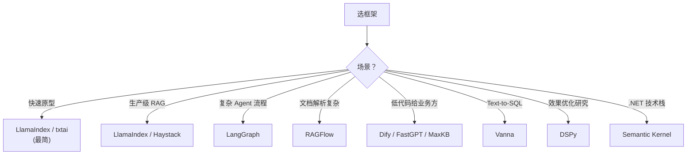

# 论文与框架清单

> **核心问题**：RAG 领域有哪些必读的论文？15 个主流框架怎么选？

---

## 1. 必读论文（按角色）

### 1.1 奠基与综述（必读 3 篇）

| 论文 | 年份 | 会议 | arXiv | 为什么读 |
|---|---|---|---|---|
| **Retrieval-Augmented Generation for Knowledge-Intensive NLP Tasks** (RAG) | 2020 | NeurIPS | 2005.11401 | **一切的起点**。RAG-Sequence / RAG-Token 两种架构 |
| **Retrieval-Augmented Generation or Long-Context LLMs?** | 2024 | — | 2407.16833 | **选型依据**。RAG vs 长上下文的系统对比 |
| **A Survey of Advanced Techniques for Retrieval-Augmented Generation** | 2024 | — | 2407.01297 | 综述，体系化梳理 |

### 1.2 模块化 RAG（必读 2 篇）

| 论文 | 年份 | arXiv | 核心 |
|---|---|---|---|
| **The Power of Modular RAG Architecture** | 2024 | 2406.14949 | 模块化范式 |
| **RAG and RAISE: A New Framework for RAG Against Prompt Injection** | 2024 | 2407.11005 | 注入防御的架构方案 |

### 1.3 切分与索引

| 论文 | 年份 | arXiv | 核心 |
|---|---|---|---|
| **Late Chunking: Contextual Chunk Embeddings Using Long-Context Embedding Models** | 2024 | 2407.05704 | **延迟切分** |
| **Dense Xyr / Propositions** | 2023 | 2310.11511 | 命题切分 |
| **ColBERT** | 2020 | SIGIR | 晚交互检索 |
| **ScaNN: Accelerating Large-Scale Inference with Anisotropic Vector Quantization** | 2020 | ICML | 各向异性量化 |
| **DiskANN** | 2019 | NeurIPS | 十亿级向量检索 |
| **BGE M3-Embedding** | 2024 | 2402.03216 | 稠密+稀疏+多向量统一 |

### 1.4 嵌入模型

| 论文 | 年份 | arXiv | 模型 |
|---|---|---|---|
| **Sentence-BERT** | 2019 | 1908.10084 | SBERT |
| **Contriever** | 2022 | 2112.00826 | 无监督对比学习 |
| **E5: Text Embeddings by Weakly-Supervised Contrastive Pre-training** | 2022 | 2212.03533 | E5 |
| **E5-Mistral** | 2024 | 2401.00332 | 指令式嵌入 |
| **NV-Embed** | 2024 | 2312.16071 | NV-Embed-v2 |
| **Jina Embeddings v3** | 2024 | 2409.07101 | Matryoshka + 多任务 |
| **SFR-Embedding** | 2024 | 2401.00332 | 蒸馏 + 合成数据 |
| **GTE-Qwen2** | 2024 | 2407.19669 | 长文本指令式 |
| **Qwen3-Embedding** | 2025 | 2506.05176 | 新一代多语言指令式 |

### 1.5 检索与重排

| 论文 | 年份 | arXiv | 核心 |
|---|---|---|---|
| **Reciprocal Rank Fusion** | 2009 | SIGIR | **RRF 融合**（至今最常用） |
| **BM25** | 1994 | — | 稀疏检索基础 |
| **Dense Passage Retrieval** (DPR) | 2020 | EMNLP | 稠密检索开创 |
| **ColBERTv2** | 2022 | NAACL | 晚交互 + PLAID |
| **RankGPT** | 2023 | — | LLM Listwise 重排 |
| **BGE Reranker** | 2023 | 2309.07532 | 交叉编码器重排 |
| **SPLADE** | 2021 | SIGIR | 学习式稀疏表示 |
| **HyDE** | 2023 | ACL | 假设性文档嵌入 |
| **RAG-Fusion** | 2023 | — | 多查询 + RRF |
| **Rewrite-Retrieve-Read** | 2023 | — | 查询改写 |
| **REPLUG** | 2023 | 2301.12652 | 检索结果注入输入嵌入 |
| **RankRAG** | 2024 | 2404.16143 | 训练检索模块 |

### 1.6 高级架构

| 论文 | 年份 | 会议 | arXiv | 核心 |
|---|---|---|---|---|
| **Self-RAG** | 2023 | ICLR'24 | 2310.11511 | 反思 token |
| **CRAG: Corrective Retrieval Augmented Generation** | 2024 | arXiv | 2401.15884 | 检索质量评估 + Web Search |
| **FLARE: Active Retrieval Augmented Generation** | 2023 | EMNLP | 2305.06983 | 生成驱动的检索 |
| **Adaptive-RAG** | 2024 | NAACL | 2403.14403 | 复杂度分类路由 |
| **ReAct** | 2022 | ICLR'23 | 2210.03629 | 推理+行动 |
| **Least-to-Most Prompting** | 2022 | ICLR'23 | 2205.10625 | 查询分解 |
| **Self-Ask** | 2022 | NeurIPS'23 | 2210.02433 | 自我提问 |
| **GraphRAG** | 2024 | arXiv | 2404.16130 | 图 + 社区摘要 |
| **LightRAG** | 2024 | arXiv | 2410.05779 | 轻量图 RAG |
| **KAG** | 2024 | arXiv | 2409.13731 | KG 增强检索 |
| **HippoRAG** | 2024 | NeurIPS | 2405.14831 | 个性化 PageRank 检索 |
| **HippoRAG 2** | 2025 | ICML | 2502.14802 | 图检索改进 |
| **RAPTOR** | 2024 | ICLR | 2401.18059 | 层次化摘要树 |
| **RA-DIT** | 2024 | arXiv | 2410.01315 | 双指令微调 |
| **Atlas** | 2022 | JMLR | 2208.03139 | 检索器+LM 联合训练 |
| **ColPali** | 2024 | arXiv | 2407.01449 | 多模态文档检索 |

### 1.7 评测

| 论文 | 年份 | arXiv | 核心 |
|---|---|---|---|
| **RAGAS** | 2023 | EACL'24 | 自动化评测框架 |
| **ARES** | 2024 | 2311.09476 | 少量标注校准评测 |
| **RAGChecker** | 2024 | 2408.08067 | 细粒度诊断 |
| **Seven Failure Points** | 2023 | 2401.05856 | **七类失败点** |
| **Lost in the Middle** | 2023 | TACL'24 | **上下文位置效应** |
| **RGB** | 2023 | 2309.01431 | 综合基准 |
| **CRAG Benchmark** | 2024 | 2406.04744 | 含时效性和歧义 |
| **RAGTruth** | 2024 | 2401.00396 | 幻觉标注语料 |
| **The Power of Noise** | 2024 | — | **检索噪声的影响远大于检索质量** |
| **Benchmarking and Defending Against Indirect Prompt Injection** | 2023 | — | 注入攻击基准 |
| **MTEB** | 2022 | EACL'23 | 嵌入基准 |
| **C-MTEB** | 2023 | — | 中文嵌入基准 |

> **特别推荐**：**The Power of Noise: Redefining Retrieval for RAG Systems**（2024）。核心结论：
> > **「检索到无关内容」的负面影响，远大于「检索到相关但不完全覆盖的内容」。**
> > 这解释了为什么**减少噪音（少而精的上下文）比提高召回更重要**。

### 1.8 提示注入与安全

| 论文 | 年份 | arXiv | 核心 |
|---|---|---|---|
| **Not what you've signed up for** (Indirect Prompt Injection) | 2023 | — | 间接注入攻击的首次系统化 |
| **Securing LLM-based Retrieval Augmented Generation** | 2024 | — | 防御方案综述 |
| **RAG and RAISE** | 2024 | 2407.11005 | 架构级防御 |

---

## 2. 主流框架对比

### 2.1 总览

| 框架 | 语言 | 定位 | 学习曲线 | 适合 |
|---|---|---|---|---|
| **LlamaIndex** | Python | **数据 + 索引抽象**最完整 | 中 | **RAG 首选**（文档索引场景） |
| **LangChain** | Python/JS | 组件最多，生态最大 | 中~高 | 快速组合、需要各种集成 |
| **LangGraph** | Python | **有状态/多步 Agent 编排** | 中 | Agentic RAG、复杂流程 |
| **Haystack** | Python | **生产级 pipeline** | 中 | 需要 pipeline 抽象和企业特性 |
| **DSPy** | Python | **程序化优化 prompt/模块** | 高 | 研究、追求极致效果 |
| **txtai** | Python | 轻量一体化 | 低 | 小型应用、嵌入向量 + LLM 一体 |
| **Vanna** | Python | **Text-to-SQL RAG** | 低 | 数据库问答 |
| **RAGFlow** | Python | **文档解析最强** | 低 | 复杂 PDF/表格 |
| **Dify** | TypeScript/Python | **低代码平台** | 低 | 快速搭建、内部工具 |
| **FastGPT** | TypeScript | 低代码 + 知识库 | 低 | 中文场景、快速搭建 |
| **MaxKB** | Python | 开源知识库 | 低 | 中文、快速部署 |
| **BISHENG** | Python | 可视化工作流 | 低 | 需要可视化编排 |
| **Atomic Agents** | Python | 轻量模块化 | 低 | 想自己搭 |
| **Semantic Kernel** | C#/Python | 企业 SDK | 中 | .NET 生态 |
| **Verba** | Python | 端到端示例 | 低 | 学习用 |

### 2.2 选型



### 2.3 LlamaIndex 深入

**核心概念**：
```
Document → Node（切分单元）→ Index（向量/BM25/知识图谱）
                                          ↓
                                    Retriever → Postprocessor → Response Synthesizer
```

**常用组件**：
```python
from llama_index.core import VectorStoreIndex, SimpleDirectoryReader, Settings
from llama_index.embeddings.huggingface import HuggingFaceEmbedding
from llama_index.llms.openai import OpenAI
from llama_index.core.node_parser import SentenceSplitter
from llama_index.core.postprocessor.types import SentenceTransformerRerank

# 1. 加载
documents = SimpleDirectoryReader("./data").load_data()

# 2. 切分
parser = SentenceSplitter(chunk_size=512, chunk_overlap=50)
nodes = parser.get_nodes_from_documents(documents)

# 3. 建索引
index = VectorStoreIndex(nodes)

# 4. 检索 + 重排
retriever = index.as_retriever(similarity_top_k=10)
reranker = SentenceTransformerRerank(model="BAAI/bge-reranker-base", top_n=3)
retriever.post_processors = [reranker]

# 5. 查询
query_engine = index.as_query_engine(retriever=retriever)
print(query_engine.query("年假怎么申请？"))
```

**LlamaIndex 的强项**：
- **Document/Node 抽象**统一了各种数据源
- **Index 类型丰富**：VectorStoreIndex、SummaryIndex、KeywordTableIndex、GraphIndex、SQLIndex
- **Router**（多索引路由）：按问题类型路由到不同索引

### 2.4 LangChain / LangGraph

**LangChain 的组件模型**：
```
Retriever → PromptTemplate → LLM → OutputParser
```

**LangGraph 的价值**：把 RAG 建模成**状态机**，支持循环和条件分支：

```python
from langgraph.graph import StateGraph, END

class RAGState(TypedDict):
    question: str
    context: List[str]
    answer: str
    iterations: int

def retrieve(state):
    docs = retriever.invoke(state["question"])
    return {"context": [d.page_content for d in docs]}

def generate(state):
    ans = llm.invoke(prompt.format(**state))
    return {"answer": ans}

def should_retrieve(state):
    return "retrieve" if not state.get("context") and state["iterations"] < 3 else "generate"

graph = StateGraph(RAGState)
graph.add_node("retrieve", retrieve)
graph.add_node("generate", generate)
graph.set_conditional_edges("retrieve", should_retrieve, {"retrieve": "retrieve", "generate": "generate"})
graph.set_entry_point("retrieve")
app = graph.compile()
```

### 2.5 Haystack

**特点**：
- **Pipeline 是第一公民**（组件可以自由组合成有向图）
- **Deepset 维护**，企业级质量
- 支持 **Agent**、**自查询检索**、**多模态**

```python
from haystack import Pipeline
from haystack.document_stores.in_memory import InMemoryDocumentStore
from haystack.components.generators import OpenAIGenerator
from haystack.components.retrievers.in_memory import InMemoryBM25Retriever

pipe = Pipeline()
pipe.add_component("retriever", InMemoryBM25Retriever(document_store))
pipe.add_component("generator", OpenAIGenerator())
pipe.connect("retriever", "generator")
```

### 2.6 DSPy（最不一样的框架）

**核心思想**：**不写 prompt，而是写「程序」并用优化器自动调优。**

```python
import dspy

class RAG(dspy.Module):
    def __init__(self):
        self.retrieve = dspy.Retrieve(k=5)
        self.generate = dspy.ChainOfThought("context, question -> answer")

    def forward(self, question):
        docs = self.retrieve(question)
        return self.generate(context=docs, question=question)

# 优化：用标注数据自动优化 prompt 和权重
def my_metric(gold, pred):
    return dspy.Example(gold=gold, **pred).predict()

optimized = dspy.Optimize(metric=my_metric)
optimized.compile(RAG(), trainset=trainset, metric=my_metric)
```

**DSPy 的独特价值**：
- 把 RAG 组件变成**可优化的模块**
- 用 **BootstrapFewShot** 自动生成少样本示例
- 用 **MIPROv2** 自动搜索最优的指令和示例组合

**代价**：学习曲线陡，且优化过程需要标注数据。

### 2.7 RAGFlow

**特点**：**文档解析是它最大的差异化**。

- 内置 DeepDoc（对 PDF、表格、扫描件的解析很强）
- 支持多种检索方式（全文、向量、混合、GraphRAG、Agent）
- 可视化编排
- **中文社区活跃**

**适合**：企业文档复杂（大量 PDF、合同、报告）的场景。

### 2.8 低代码平台（Dify / FastGPT / MaxKB）

| 平台 | 语言 | 特点 |
|---|---|---|
| **Dify** | TS + Python | **最流行**，工作流编排强，插件生态好，LLMOps 完整 |
| **FastGPT** | TS | 中文优化好，**知识库 UI 完善**，工作流可视化 |
| **MaxKB** | Python | 开源简洁，部署轻量，知识库管理友好 |
| **BISHENG** | Python | 组件化，国产 LLM 适配好 |
| **RAGFlow** | Python | 解析强，见上 |

**适合**：**让业务人员自己搭知识库**，开发者只做集成。

### 2.9 Vanna（Text-to-SQL）

```python
import vanna
from vanna.openai import OpenAI_Chat

vn = vanna.OPENAI_Chat(model="gpt-4o")
vn.connect_to_postgres(host="...", dbname="...", user="...", password="...")

# 训练（给几个例子）
vn.train(question="销售前10的产品", sql="SELECT ... FROM products JOIN sales ... LIMIT 10")

# 提问
print(vn.ask("销售前10的产品"))
```

**本质**：**不是向量 RAG，是「用 LLM 生成 SQL」**。适用于结构化数据。

---

## 3. 工具链速查

### 3.1 文档解析

| 工具 | 强项 |
|---|---|
| **MinerU** | 中文 PDF、公式、表格 |
| **Docling** | 结构化输出、表格、阅读顺序 |
| **Unstructured** | 元素级输出、多格式 |
| **PaddleOCR / PP-Structure** | 中文 OCR + 版面 |
| **Marker** | 转 Markdown 效果好 |
| **PyMuPDF** | 快速基础提取 |
| **pdfplumber** | 表格提取 |

### 3.2 嵌入与重排

| 用途 | 推荐 |
|---|---|
| **中文嵌入** | BGE-M3, Qwen3-Embedding, bge-large-zh |
| **多语言嵌入** | BGE-M3, multilingual-e5, gte-multilingual |
| **重排** | bge-reranker-v2-m3, Qwen3-Reranker, gte-reranker |
| **代码检索** | voyage-code, jina-code |
| **长文本** | gte-Qwen2, Qwen3-Embedding, jina-v3 |

### 3.3 向量库

| 规模 | 推荐 |
|---|---|
| < 100 万 | Qdrant, pgvector, Chroma |
| 100 万 ~ 1 亿 | Milvus, Elasticsearch, Weaviate |
| > 1 亿 | Milvus, Vespa, 自建 DiskANN |

### 3.4 评测与观测

| 用途 | 工具 |
|---|---|
| **RAG 评测** | RAGAS, ARES, RAGChecker, DeepEval, promptfoo |
| **追踪** | Langfuse, LangSmith, Phoenix, Helicone |
| **A/B 对比** | promptfoo |

---

## 4. 选型速查表

| 你的情况 | 推荐组合 |
|---|---|
| **最快出一个 demo** | LangChain + Chroma + OpenAI |
| **生产级中文知识库** | LlamaIndex + Qdrant/ES + BGE-M3 + bge-reranker-v2-m3 |
| **文档复杂（大量 PDF）** | RAGFlow 或 MinerU + LlamaIndex |
| **需要业务方自助搭建** | Dify / FastGPT / MaxKB |
| **多步推理 / Agent** | LangGraph |
| **要极致效果、可投入优化** | DSPy |
| **数据库问答** | Vanna |
| **多模态文档** | ColPali + LlamaIndex |
| **要研究 RAG 本身** | 直接手写 pipeline（不要用框架） |

---

## 5. 阅读路线

### 路线 A：工程实践（1 周）
```
RAG (2020) → 读 LlamaIndex 文档 → 手写一个 pipeline → 加 BM25 → 加 rerank → 建评测集
```

### 路线 B：体系化（2 周）
```
RAG → Advanced RAG 综述 → Modular RAG → Self-RAG → CRAG → GraphRAG → RAPTOR
```

### 路线 C：效果优化（2 周）
```
RAGAS 论文 → The Power of Noise → Lost in the Middle → HyDE → RAG-Fusion → RankGPT → Late Chunking
```

### 路线 D：安全（1 周）
```
Indirect Prompt Injection → Seven Failure Points → RAG and RAISE → Securing LLM-based RAG
```

---

## 6. 工程结论

1. **先手写一个 30 行的 pipeline**，理解每个环节后再用框架。框架会掩盖细节。
2. **LlamaIndex 适合数据/索引密集的场景，LangGraph 适合流程复杂的场景，Haystack 适合企业级 pipeline 抽象。**
3. **Dify/FastGPT 这类低代码平台适合「让业务方自助」**，但定制复杂逻辑时还是要写代码。
4. **DSPy 是做效果优化的利器**，但需要标注数据和算力。
5. **The Power of Noise 是最被低估的论文**：**上下文宁少勿滥**这个结论有实证支撑。
6. **安全不是可选项**。直接注入、越权、投毒是真实存在的攻击面。

---

## 🔗 相关

- 架构 → [`01-RAG总览与架构.md`](./01-RAG总览与架构.md)
- 评测 → [`10-评测与度量.md`](./10-评测与度量.md)
- 安全 → [`12-失败模式与安全.md`](./12-失败模式与安全.md)
- 多模态 → [`14-多模态RAG.md`](./14-多模态RAG.md)
