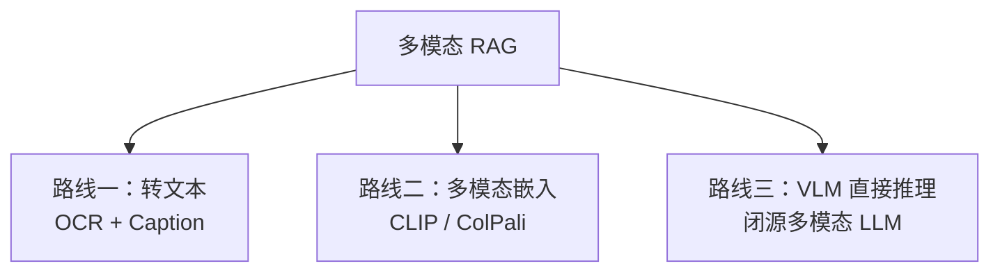
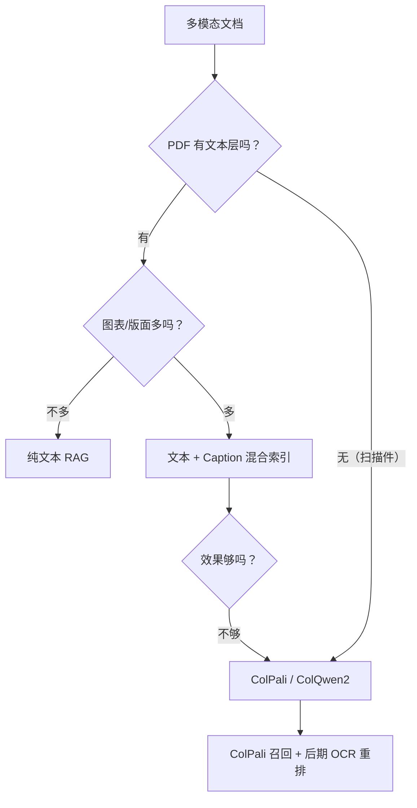

# 多模态 RAG

> **核心问题**：怎么检索 PDF 里的图表、扫描件、手写内容？多模态 RAG 和「用 VLM 直接问」的边界在哪？

---

## 1. 三条路线



| 路线 | 做法 | 成本 | 精度 | 适合 |
|---|---|---|---|---|
| **转文本** | OCR 提取文字 + VLM 生成图片描述 → 存进向量库 | 中 | 中 | 大多数场景 |
| **多模态嵌入** | 图片/页面直接向量化 | 高 | **高** | 扫描件、图表密集 |
| **VLM 直接** | 把原图/原 PDF 交给多模态大模型 | 高 | 高 | 需要推理和理解的复杂文档 |

---

## 2. 路线一：转文本（最常用）

### 2.1 流程

```
PDF 页面
   ↓
┌─────────────────────────────────────────┐
│ 解析层                                    │
│  ├─ 文本层 → 直接抽取                    │
│  ├─ 表格   → TableFormer / 表格转 MD      │
│  ├─ 图片   → OCR（识别图中文字）           │
│  └─ 图表   → VLM 生成描述（caption）      │
└─────────────────────────────────────────┘
   ↓
统一的文本表示（Markdown）
   ↓
文本切分 → 文本嵌入 → 文本向量库
```

### 2.2 图片 caption 的生成

```python
CAPTION_PROMPT = """请详细描述这张图片中的内容，用于文档检索。

包括：
1. 图表类型（柱状图/折线图/表格/示意图/照片）
2. 标题和图例
3. 主要数据和趋势（给出具体数值）
4. 图片中出现的文字

图片："""

def caption_image(vlm, image_path):
    img = Image.open(image_path)
    msgs = [{"role": "user", "content": [
        {"type": "image", "image": img},
        {"type": "text", "text": CAPTION_PROMPT},
    ]}]
    resp = vlm.invoke(msgs)
    return resp.content
```

**关键**：caption 必须包含**具体数值**和**标题**，否则检索不到。

```
❌ "这是一张柱状图，展示了一些数据"
✅ "柱状图《2024年各产品线营收（单位：亿元）》：产品A 45.2，产品B 32.8，产品C 28.1，
    产品A 同比增长 15%，为最高；产品C 同比下降 3%"
```

### 2.3 优缺点

| 优点 | 缺点 |
|---|---|
| 复用现有文本 RAG 全链路 | **caption 丢失了视觉细节**（布局、颜色、空间关系） |
| 成本可控 | 需要 VLM 调用（每张图一次） |
| 可解释性好 | OCR 对复杂图表效果有限 |

---

## 3. 路线二：多模态嵌入

### 3.1 CLIP 双塔

**CLIP**（2021）本身就支持图文联合嵌入空间：

```python
from PIL import Image
from transformers import CLIPModel, CLIPProcessor

model = CLIPModel.from_pretrained("openai/clip-vit-large-patch14")
processor = CLIPProcessor.from_pretrained("openai/clip-vit-large-patch14")

inputs = processor(text=["一张财报柱状图"], images=Image.open("chart.jpg"),
                   return_tensors="pt", padding=True)
out = model(**inputs)
img_emb = out.image_embeds      # 图像嵌入
txt_emb = out.text_embeds      # 文本嵌入
```

**问题**：
- CLIP 在**自然图像**上训练，对**文档页面**（密集文字、表格线）不敏感
- 全页嵌入丢失了细节

### 3.2 ColPali（2024）— 当前最优

**论文**：*ColPali: Efficient Document Retrieval with Vision Language Models*, Faysse et al., arXiv:2407.01449
**仓库**：`illuin-tech/colpali`
**模型**：`vidore/colpali-v1.3`

### 3.3 ColPali 的核心思想

**用「视觉 token」代替 OCR 文本做检索。**

```
传统（文本嵌入）：
  页面 → OCR → 文本 → 文本嵌入（768维，1个向量）
        ↑ 丢失了版面信息、丢失了图表视觉、OCR 有误差

ColPali（视觉嵌入）：
  页面 → 视觉编码器（SigLIP/ColQwen）→ 1030 个 patch 嵌入（每页 128×4=512 维/向量）
        ↓
  用 MaxSim 晚交互打分
```

**关键**：
1. **每个 patch 一个向量**（不是整页一个）
2. **保留版面信息** —— 视觉 token 自带位置编码
3. **不需要 OCR** —— 直接读图，绕开了 OCR 的误差
4. **用 MaxSim 晚交互**（和 ColBERT 一样）

**检索打分**：
$$
\text{Score}(Q, D) = \sum_{i \in Q} \max_{j \in D} \langle q_i, d_j \rangle
$$

其中 $Q$ 是查询的 token 集合，$D$ 是页面的 patch 集合。

### 3.4 存储代价

```
1000 页文档：
  每页 1030 个向量 × 128 维 × 4 字节（FP16 是 2 字节）= ~530 KB/页
  → 1000 页 = 530 MB（FP16）
```

**这是 ColPali 的主要代价**。缓解手段：
- **PQ 量化**（ColPali 的官方 ColLate 分块索引）
- 只索引需要的页面
- 二值化（1 bit/维度）

### 3.5 ColPali 的实际收益

论文报告的检索效果提升（ViDoRe 基准）：

| 方案 | 效果 |
|---|---|
| BM25 | 基线 |
| 文本嵌入（OCR + caption） | 中等 |
| **ColPali（视觉）** | **显著更好** |
| ColPali + 后期 OCR 重排 | 更好 |

**ColPali + 后期 OCR 重排**是当前最佳实践：
```
1. ColPali 检索出 top-50 页面
2. 对这 50 页做 OCR + 文本重排
3. 取 top-5 进入 LLM
```

### 3.6 ColQwen2

**模型**：`vidore/colqwen2-v1.0`

用 **Qwen2-VL** 做视觉编码器，**能生成文本的视觉模型**。收益：
- 更好的中文支持
- 可以「读」出页面上的文字（不需要额外 OCR）
- 检索时仍然用视觉 token

### 3.7 什么时候用 ColPali

| 场景 | 建议 |
|---|---|
| **纯扫描件 PDF**（无文本层） | ✅ 强烈推荐（比 OCR 更好） |
| **图表/示意图密集的报告** | ✅ 推荐 |
| **版面复杂（多栏、图表混排）** | ✅ 推荐 |
| **纯文本 PDF** | ❌ 用文本嵌入更快更省 |
| **成本敏感** | ❌ 存储和计算成本高 |

---

## 4. 路线三：VLM 直接推理

### 4.1 三种用法

#### 用法 A：直接问 VLM（不建索引）

```
用户问题 + 原文档（多模态输入） → VLM → 答案
```

**适合**：单文档、文档不大、问题需要看图。

**限制**：文档大时放不下；有大量文档时不可行。

#### 用法 B：VLM 做检索器

```
用 VLM 的视觉能力做「页面级」打分，选出最相关的页面
然后用文本流程处理选中的页面
```

#### 用法 C：VLM 做重排器

```
1. 文本 RAG 召回 50 个候选
2. 把候选的原始页面（图）给 VLM
3. VLM 排序
```

### 4.2 直接问 VLM vs 建 RAG 的边界

| 维度 | 直接问 VLM | RAG |
|---|---|---|
| **文档数量** | 少（1~10 篇） | 多（成百上千） |
| **延迟** | 高（要传整份文档） | 低（只传相关片段） |
| **成本** | 高 | 低 |
| **精确引用** | 难（说不清来自哪页） | 容易 |
| **跨文档综合** | 受限于能塞进去的内容 | 容易 |
| **可溯源** | 弱 | 强 |

**决策**：
```
文档 ≤ 10 篇且不大 → 直接问 VLM（简单得多）
文档多 / 需要引用 / 需要精确 → 建 RAG
```

**混合方案（推荐）**：
```
1. RAG 检索（文本 + 视觉）出候选
2. 把候选页面的**图**给 VLM，让它基于图文一起回答
```

这样既控制了上下文大小，又保留了视觉理解能力。

---

## 5. 具体实现

### 5.1 文本 + 图片混合索引

```python
class MultiModalIndex:
    def __init__(self, embedder, vlm):
        self.embedder = embedder
        self.vlm = vlm
        self.text_chunks = []      # 文本片段
        self.image_chunks = []     # 图片描述

    def add_page(self, page, text, images):
        # 1. 文本部分
        for chunk in chunk_text(text):
            self.text_chunks.append({
                "type": "text", "text": chunk, "page": page})

        # 2. 图片部分 → 生成描述
        for img in images:
            caption = self.vlm_caption(img)
            self.image_chunks.append({
                "type": "image_caption", "text": caption, "page": page})

    def search(self, query, top_k=5):
        q_emb = self.embedder.encode([query], normalize_embeddings=True)
        # 统一检索（文本和 caption 在同一个空间）
        all_chunks = self.text_chunks + self.image_chunks
        embs = self.embedder.encode([c["text"] for c in all_chunks],
                                     normalize_embeddings=True)
        scores = embs @ q_emb[0]
        idx = np.argsort(-scores)[:top_k]
        return [all_chunks[i] for i in idx]
```

**关键**：caption 和文本用**同一个嵌入模型**，这样能在统一空间里检索。

### 5.2 ColPali 的最小实现

```python
import torch
from PIL import Image
from transformers import AutoProcessor, AutoModel

class ColPaliRetriever:
    def __init__(self, model_name="vidore/colpali-v1.3", device="cuda"):
        self.model = AutoModel.from_pretrained(model_name,
                                               torch_dtype=torch.bfloat16,
                                               device_map=device).eval()
        self.processor = AutoProcessor.from_pretrained(model_name)
        self.device = device

    def encode_pages(self, page_images, batch_size=8):
        """页面 → patch 嵌入矩阵"""
        all_embs = []
        for i in range(0, len(page_images), batch_size):
            batch = page_images[i:i+batch_size]
            with torch.no_grad():
                inputs = self.processor(images=batch, return_tensors="pt")
                inputs = {k: v.to(self.device) for k, v in inputs.items()}
                out = self.model(**inputs)          # (B, N, D)
            all_embs.append(out.to(torch.float32).cpu())
        return torch.cat(all_embs)                    # (num_pages, N, D)

    def encode_query(self, query):
        with torch.no_grad():
            inputs = self.processor(
                text=[query], images=[Image.new("RGB", (1, 1))],
                return_tensors="pt", padding="longest")
            inputs = {k: v.to(self.device) for k, v in inputs.items()}
            out = self.model(**inputs)
        return out[0].to(torch.float32).cpu()          # (M, D)

    def search(self, query_emb, page_embs, top_k=5):
        """
        MaxSim 晚交互打分
        """
        scores = []
        for page in page_embs:
            # page: (N, D), query: (M, D)
            sim = query_emb @ page.T                    # (M, N)
            scores.append(sim.max(dim=1).values.sum().item())
        scores = torch.tensor(scores)
        return torch.argsort(scores, descending=True)[:top_k]
```

### 5.3 多模态重排

```python
MULTIMODAL_RERANK_PROMPT = """根据查询，从以下文档页面中选出最能回答查询的页面。
只返回页面编号，按相关度从高到低。

查询：{query}

页面：
{pages}

最相关的页面编号（逗号分隔）："""

def multimodal_rerank(vlm, query, page_images):
    pages = "\n".join(f"[{i+1}] 第{i+1}页" for i in range(len(page_images)))
    msgs = [{"role": "user", "content":
        [{"type": "text", "text": MULTIMODAL_RERANK_PROMPT.format(query=query, pages=pages)}]
        + [{"type": "image", "image": img} for img in page_images]}]
    resp = vlm.invoke(msgs)
    return [int(x) - 1 for x in resp.content.strip().split(",")]
```

---

## 6. 成本与效果对比

### 6.1 成本构成

| 方案 | 索引成本 | 查询成本 | 存储 |
|---|---|---|---|
| **文本 + OCR + caption** | 每页 1 次 VLM 调用 | 低（纯文本检索） | 低 |
| **ColPali** | 1 次视觉编码/页 | 中（MaxSim 计算） | **高（530 KB/页）** |
| **VLM 直接问** | 0 | **高**（传整份文档） | 0 |

### 6.2 效果对比（ViDoRe 类基准的定性排序）

```
视觉理解能力：  ColPali  >  VLM直接问  >  文本+OCR
检索速度：      文本  >  ColPali  >  VLM直接问
成本：          文本  <  ColPali  <  VLM直接问
存储：          文本  <  VLM直接问  <  ColPali
```

---

## 7. 特殊场景

### 7.1 视频 RAG

**流程**：
```
视频 → 抽帧 → 每帧 OCR/Caption + 音频转写（ASR）
                  ↓
        按时间戳对齐成「场景片段」
                  ↓
            文本嵌入 + 时间戳元数据
```

**元数据要含时间戳**，这样答案可以定位到视频的具体位置。

**工具**：
- 抽帧：ffmpeg、decord
- ASR：Whisper、Faster-Whisper、FunASR（中文好）
- 场景切分：PySceneDetect

### 7.2 表格 RAG

**三条路线**：

| 路线 | 做法 | 适合 |
|---|---|---|
| **表格转文本** | 每行转成陈述句 | 行级检索 |
| **表格摘要 + 原文** | LLM 生成摘要 + 原始 MD | 概览型问题 |
| **表格问答（TableQA）** | 用专门的模型（ChartQA/TabFact 训练） | 需要计算的问题 |

**注意**：表格问题常常需要**计算**（"前三季度合计多少"），纯检索不够，需要让 LLM 基于表格内容做算术。

### 7.3 图表 RAG

图表的关键信息是**数值 + 趋势 + 关系**，caption 必须包含这些。

**推荐流程**：
```
1. 用专用模型（DePlot / ChartLlama / ChartInstruct）把图表转成结构化表格
   "标题 | 系列 | 数值" 的形式
2. 转成 Markdown 表格 + 一段自然语言摘要
3. 一起嵌入
```

**DePlot**（Google, 2023）就是专门做「图表 → 表格」的模型，效果比通用 VLM 好。

### 7.4 公式和手写

| 类型 | 工具 |
|---|---|
| **公式** | MinerU、Nougat（→ LaTeX）、Mathpix |
| **手写** | TrOCR、Mathpix（付费）、PaddleOCR 手写模型 |

---

## 8. 选型



| 需求 | 推荐 |
|---|---|
| **扫描件 PDF** | ColPali / ColQwen2 |
| **图表密集的报告** | 文本 + caption 混合；不够再上 ColPali |
| **表格问答** | 表格转 MD + LLM 计算；或 TableQA 模型 |
| **视频** | 抽帧 + ASR + 文本 RAG + 时间戳元数据 |
| **文档少且需要看图推理** | 直接问 VLM |
| **中文文档** | MinerU 解析 + Qwen2.5-VL caption |

---

## 9. 工程结论

1. **先判断 PDF 有没有文本层**。有文本层的话，纯文本 RAG 就能解决 80% 的问题。
2. **扫描件是 ColPali 的最佳场景**。它绕开了 OCR 的全部误差。
3. **caption 必须包含具体数值和标题**，否则检索不到。
4. **ColPali 的存储成本很高**（~500KB/页），用 PQ 量化或只索引需要的页面。
5. **文档少就直接问 VLM**，别建索引。复杂度是成本。
6. **表格问题需要计算能力**，纯检索不够 —— 要让 LLM 基于表格内容做算术。

---

## 🔗 相关

- 解析 → [`02-文档解析与预处理.md`](./02-文档解析与预处理.md)
- 嵌入 → [`04-嵌入模型选型.md`](./04-嵌入模型选型.md)
- 高级架构 → [`09-高级RAG架构.md`](./09-高级RAG架构.md)
- 开放词汇（VLM 方向）→ [`../02-视觉检测模型/10-开放词汇与基础模型.md`](../02-视觉检测模型/10-开放词汇与基础模型.md)
