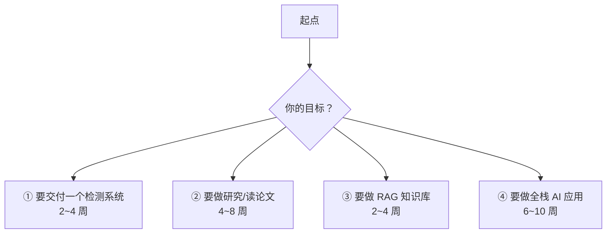

# 学习路线图

> **核心问题：按什么顺序学？多久能上手？**

---

## 1. 四条路径



---

## 2. 路径一：交付一个检测系统（2~4 周）

**目标**：用 YOLO 在自己的数据上训出一个能用的检测器，并部署上线。

### 第 1 周：跑通 + 理解

| 天 | 任务 | 产出 |
|---|---|---|
| 1 | 装环境，跑通 ultralytics 的官方权重 | 能对图片做检测 |
| 2 | 读 [`01-YOLO/02-YOLOv1-v3奠基期.md`](../01-YOLO/02-YOLOv1-v3奠基期.md) 和 [`03-YOLOv4-v5工程化期.md`](../01-YOLO/03-YOLOv4-v5工程化期.md) | 理解范式演进 |
| 3 | 整理数据，转 YOLO 格式，写数据检查脚本 | 数据集 + 检查报告 |
| 4 | 划分数据集（**按序列分组**） | train/val/test |
| 5 | 冒烟训练（3 epoch），看 `train_batch0_labels.jpg` | 确认标签正确 |
| 6 | 完整训练（100 epoch） | best.pt |
| 7 | 分析结果：混淆矩阵、PR 曲线、per-class AP | 诊断报告 |

### 第 2 周：调优

| 天 | 任务 |
|---|---|
| 8 | 建立评测基线，记录完整口径（imgsz / 后处理 / 数据集） |
| 9-10 | 增强消融：逐一开关 Mosaic / MixUp / Copy-Paste / scale |
| 11 | 调 `close_mosaic`、学习率、epochs |
| 12 | 小目标优化：提分辨率、调 TAL topk |
| 13-14 | 闭集自训练（如果有未标注数据） |

### 第 3 周：部署

| 天 | 任务 |
|---|---|
| 15 | 导出 ONNX，验证精度对齐 |
| 16 | 量化（INT8/FP16），验证 mAP |
| 17 | 目标平台部署（TensorRT / RKNN / ONNX Runtime） |
| 18 | 延迟基准测试（预热 + p50/p95/p99） |
| 19 | 预处理契约文件（训练端和部署端共用） |
| 20-21 | 端到端联调，bad case 分析 |

### 第 4 周：打磨（可选）

- 模型裁剪 / 蒸馏
- 视频流优化（多线程读帧）
- 自动化评测 CI
- 文档与交接

**关键里程碑**：
- ✅ 能解释「我的模型为什么在这里错了」（看混淆矩阵 + PR 曲线）
- ✅ 能说清「我的 mAP 是多少，什么口径」
- ✅ 部署后精度损失 < 1 mAP，延迟达标

---

## 3. 路径二：研究 / 读论文（4~8 周）

**目标**：搞懂检测领域的流派脉络，能判断一篇新论文的价值。

### 第 1-2 周：单阶段理论

| 顺序 | 论文 | 读完要能回答 |
|---|---|---|
| 1 | RetinaNet | Focal Loss 的 $\gamma$ 解决什么？ |
| 2 | FCOS | centerness 怎么抑制重复框？ |
| 3 | ATSS | Step 3 为什么要按 anchor 类型统计？ |
| 4 | GFL | 为什么用分布而不是点估计？ |
| 5 | VarifocalNet | 第二项在什么情况下主导？ |
| 6 | TOOD | 「任务对齐」对齐了什么？ |

**配套**：在 MMDetection 里跑通这 6 个模型（配置文件即代码）。

### 第 3-4 周：Transformer 系

| 顺序 | 论文 | 读完要能回答 |
|---|---|---|
| 7 | DETR | 匈牙利匹配为什么导致收敛慢？ |
| 8 | Deformable DETR | 稀疏注意力的动机？ |
| 9 | DN-DETR | 去噪 query 为什么提供密集梯度？ |
| 10 | DINO | 对比去噪的 negative query 干什么？ |
| 11 | RT-DETR | encoder 减到 1 层，decoder 为什么不减？ |
| 12 | DEIM | 稠密 O2O 的思路？ |

### 第 5 周：端到端与 YOLO

- YOLOv4（BoF/BoS 分类法）
- YOLOX（解耦头 + SimOTA）
- YOLOv6（TAL）
- YOLOv10（一致双分支）
- YOLO26（去 DFL、STAL）

### 第 6 周：扩展方向（选一个深入）

| 方向 | 关键论文 |
|---|---|
| **开放词汇** | GLIP → Grounding DINO → Florence-2 → YOLO-World |
| **分割/基础模型** | Mask2Former → SAM → SAM 2 |
| **3D/BEV** | PointPillars → CenterPoint → BEVFormer → BEVFusion |
| **姿态/跟踪** | OpenPose → HRNet → RTMPose；SORT → ByteTrack |
| **量化/部署** | RepVGG → 重参数化；QAT 相关工作 |

### 第 7-8 周：动手研究

- 复现一篇 SOTA（在自己的数据上）
- 做一组消融实验
- 尝试改一个模块，看效果
- 写技术报告

**关键里程碑**：
- ✅ 能画出检测领域的流派图谱，说清每个流派的继承关系
- ✅ 能判断一篇新论文是真改进还是换皮
- ✅ 做过至少 3 组自己的消融实验

---

## 4. 路径三：做 RAG 知识库（2~4 周）

**目标**：搭一个可评测、可迭代、有引用的企业知识库问答系统。

### 第 1 周：最小闭环

| 天 | 任务 | 产出 |
|---|---|---|
| 1 | 装环境，跑通一个 30 行的 Naive RAG | 能问答 |
| 2 | 读 [`01-RAG总览与架构.md`](../03-RAG/01-RAG总览与架构.md) | 理解模块划分 |
| 3 | 解析文档（Docling/MinerU），**人工检查 10 篇** | 解析质量报告 |
| 4 | 切分（Markdown 结构切 + 父子分块），带元数据 | chunk 库 |
| 5 | 嵌入 + 建索引（Qdrant/ES） | 可检索的索引 |
| 6 | 混合检索（BM25 + 向量 + RRF） | 混合检索器 |
| 7 | 加 Cross-Encoder 重排 | 完整检索链 |

### 第 2 周：评测 + 优化

| 天 | 任务 |
|---|---|
| 8 | **建 50 条评测集**（人工标注相关 chunk） |
| 9 | 跑检索评测（Recall@5、NDCG@10），记录基线 |
| 10 | 加查询处理（意图路由 → 必要时改写/多查询） |
| 11 | 上下文组装优化（去重、压缩、排序） |
| 12 | 提示模板 + 引用强制 + 引用校验 |
| 13 | 拒答机制（基于检索质量判定） |
| 14 | 跑生成评测（RAGAS），对比检索优化前后的变化 |

### 第 3 周：生产化

| 天 | 任务 |
|---|---|
| 15 | 延迟预算 + 超时 + 降级链路 |
| 16 | 缓存（L1 精确 + L2 语义，注意权限隔离） |
| 17 | 流式输出 |
| 18 | 全链路 trace + 监控面板 |
| 19 | 权限过滤（检索层）+ 越权测试 |
| 20 | 注入防护测试集 |
| 21 | 成本优化（模型分级 + 上下文压缩） |

### 第 4 周：进阶（按需）

- GraphRAG（如果查询真的是全局型）
- Self-RAG / CRAG 的思想
- 多模态（扫描件 / 图表密集）
- CI 集成评测

**关键里程碑**：
- ✅ 有 50 条评测集和基线分数
- ✅ 能用数字说明「这个改动带来了 +X% 召回」
- ✅ 越权测试全部通过
- ✅ 有可观测性和成本追踪

---

## 5. 路径四：全栈 AI 应用（6~10 周）

**目标**：检测 + RAG + LLM 应用的整体设计能力。

### 阶段 1（2 周）：检测基础
→ 走路径一

### 阶段 2（2 周）：RAG 基础
→ 走路径三

### 阶段 3（2 周）：系统整合

```
业务场景分析
  ↓
┌─────────────────────────────────────────────┐
│ 感知层：检测 / 跟踪 / OCR                    │
│   → 产出结构化事件流                         │
├─────────────────────────────────────────────┤
│ 知识层：RAG 检索                             │
│   → 事件 + 知识库 → 上下文                   │
├─────────────────────────────────────────────┤
│ 推理层：VLM / LLM                            │
│   → 多模态理解 + 决策                        │
├─────────────────────────────────────────────┤
│ 行动层：工具调用 / 工单 / API                 │
└─────────────────────────────────────────────┘
```

**关键设计问题**：
1. **感知和推理怎么分工？** 检测器给结构化事实，LLM 做判断和表达（比让 VLM 从零看图更可靠）
2. **上下文怎么组装？** 检测事件 + 检索文档 + 业务状态
3. **失败怎么降级？** 感知失败 → 不做判断；检索失败 → 明确标注；LLM 失败 → 兜底话术

### 阶段 4（2-4 周）：生产化与迭代

- 灰度发布
- A/B 实验
- 用户反馈闭环
- 成本优化
- 监控告警

---

## 6. 按时间的阅读量估算

| 目标 | 论文阅读量 | 代码阅读量 | 实操项目 |
|---|---|---|---|
| **能用** | 3~5 篇 | 读 1 个仓库的核心文件 | 1 个完整项目 |
| **能优化** | 8~12 篇 | 读 2~3 个仓库 | 2 个项目 + 消融实验 |
| **能做研究** | 25~40 篇 | 读 5+ 个仓库 + 复现 2~3 篇 | 3 个项目 + 1 个研究课题 |
| **能做体系** | 50+ 篇 | 全面涉猎 | 多个项目 + 公开写作 |

**注意**：**实操的价值 > 读论文的价值。** 读 5 篇论文但没动手，效果不如跑通 1 个项目再回头读。

---

## 7. 三个「必须动手做」的项目

### 项目 A：自己的检测器（必做）
- 数据：自己的业务数据（或公开数据集）
- 目标：完整走通 训练 → 评测 → 导出 → 部署
- **产出**：一份实验报告（消融 + 曲线 + 踩坑记录）

### 项目 B：企业知识库问答（必做）
- 数据：100+ 篇文档（PDF/Word/Markdown 混合）
- 目标：带引用、带拒答、可评测
- **产出**：50 条评测集 + 基线分数 + 优化记录

### 项目 C：一个前沿方向的复现（选做）
- 从 [`../02-视觉检测模型/14-论文全景索引.md`](../02-视觉检测模型/14-论文全景索引.md) 或 [`../03-RAG/13-论文与框架清单.md`](../03-RAG/13-论文与框架清单.md) 选一篇
- 目标：跑通 + 在自己数据上验证 + 写分析

---

## 8. 常见的学习误区

| 误区 | 纠正 |
|---|---|
| **先读完所有论文再动手** | 反过来：先做项目，遇到问题再读对应论文 |
| **追最新模型** | 先把一个版本吃透（YOLO11 或 v8） |
| **只看 SOTA 数字** | 在自己的数据上测才知道适不适合 |
| **不做消融** | 不知道哪个改动有效，就无法迭代 |
| **不做评测** | 无法判断改进还是退步 |
| **忽视数据质量** | 90% 的效果问题在数据 |
| **一次改多个变量** | 不知道是谁的功劳 |
| **不记录** | 三个月后全部忘光 |
| **忽略部署** | 训练好 ≠ 能上线 |

---

## 9. 每周时间分配建议

| 阶段 | 读 | 写代码 | 读代码 | 写文档 |
|---|---|---|---|---|
| **入门期** | 30% | 50% | 20% | 0% |
| **进阶期** | 40% | 30% | 20% | 10% |
| **研究期** | 40% | 20% | 20% | 20% |
| **工程期** | 10% | 40% | 20% | 30% |

---

## 10. 资源清单

### 必读（免费）

| 资源 | 用途 |
|---|---|
| Ultralytics 文档 | YOLO 的事实标准文档 |
| MMDetection 文档 | 检测器的「配置即代码」最佳实践 |
| Hugging Face Transformers 文档 | 嵌入/重排/VLM |
| MTEB Leaderboard | 嵌入模型选型 |
| RAGAS 文档 | RAG 评测 |
| ColPali / LlamaIndex 文档 | 多模态 RAG |

### 论文（免费）

- arXiv（cs.CV / cs.CL）
- Papers with Code（带榜单）
- ar5iv（arXiv 的 HTML 版，读公式方便）

### 数据集（注意许可）

- COCO / LVIS / Open Images（标注 CC BY 4.0）
- Objects365（研究免费）
- MTEB / BEIR（评测基准）

---

## 11. 检查清单：判断你是否真的学会了

### 检测
- [ ] 能画出一张检测模型的结构图
- [ ] 能解释「为什么 RetinaNet 解决了单阶段的精度问题」
- [ ] 能说出 ATSS 和 TAL 的区别
- [ ] 能解释 DFL 为什么要用 16 个 bin
- [ ] 能在自己的数据上跑完训练并诊断 bad case
- [ ] 能把模型部署到目标平台并验证精度

### RAG
- [ ] 能画出 RAG 的完整数据流和每个环节的决策点
- [ ] 能解释「Lost in the Middle」对 RAG 的启示
- [ ] 能说清「为什么检索质量是 RAG 的瓶颈」
- [ ] 能建一个 50 条的评测集并跑出基线
- [ ] 能做混合检索 + 重排，并解释每个参数的作用
- [ ] 能说清「权限过滤为什么必须在检索层做」
- [ ] 能算出一个 RAG 系统的成本并优化

### 通用
- [ ] 有自己的项目代码在 GitHub
- [ ] 有实验记录（改了什么、结果如何）
- [ ] 能对不熟悉的方案做技术评估

---

## 🔗 相关

- 全库索引 → [`../README.md`](../README.md)
- 术语表 → [`术语表.md`](./术语表.md)
- YOLO 专题 → [`../01-YOLO/`](../01-YOLO)
- 检测全景 → [`../02-视觉检测模型/`](../02-视觉检测模型)
- RAG 专题 → [`../03-RAG/`](../03-RAG)
