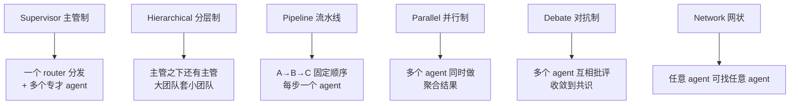
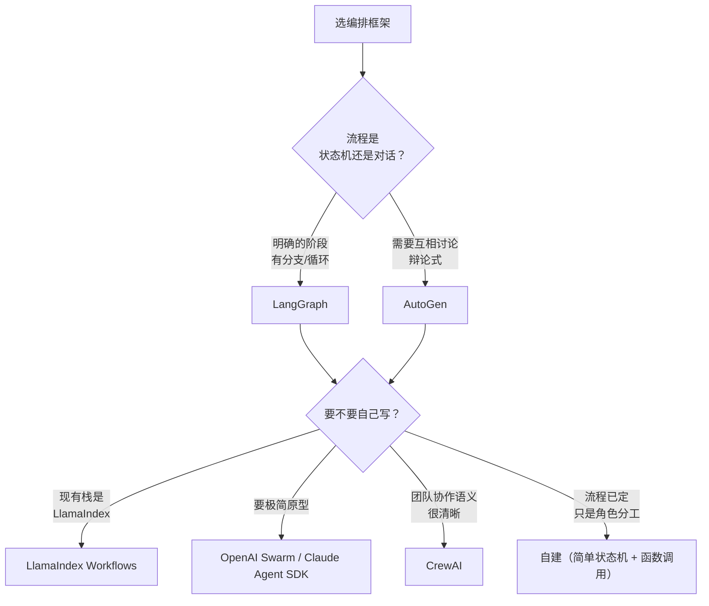

# 2026-10-31 学习笔记：多 Agent 编排与协作模式

> 今日范围：协作拓扑 / 通信契约 / 角色设计 / 错误传播与隔离 / 框架选型
> 体例：第一段给定义和骨架，第二段谈工程取舍，最后一段做对比与选择

---

## 0. 一些共识

先说最重要的一句：**多 agent 是「用成本换可靠性」的交易，不是「更先进的架构」。**

大多数团队上多 agent 的理由是「单个 agent 搞不定」。这句话要先拆开：

- 「搞不定」是指**能力不够**（一个 prompt 装不下所有领域知识）？→ 用更好的**提示 + 工具 + 上下文**，通常就够了
- 「搞不定」是指**可靠性不够**（一步错就全错，隔离不住）？→ 这才是多 agent 的正当场景
- 「搞不定」是指**并行不够快**？→ 多 agent 并行确实能省时间，但要算清楚 fan-out 成本

三个必须先接受的现实：

1. **多 agent 的错误会传染。** 单 agent 错一步 = 任务失败；多 agent 错一步 = 可能污染 3 个下游 agent 的输入。**扇出越大，错误放大越厉害。**
2. **多 agent 的调试成本是超线性的。** n 个 agent 的状态空间不是 n 倍，是组合级别。你没法只看一条 trace 就定位问题。
3. **多 agent 的 token 成本通常是 3~10 倍。** 每个 agent 都要重复读一遍系统提示、重复看一遍上下文。

所以本文的第一件事不是介绍拓扑，而是**帮你判断该不该上**。

---

## 1. 什么时候不该上多 Agent

### 1.1 判据表

| 症状 | 单 agent 够吗 | 建议 |
|---|---|---|
| 任务类型单一（如只做客服问答） | ✅ 够 | 别上，多 agent 只增加延迟 |
| 步骤 < 5 步 | ✅ 够 | Plan & Execute 就够 |
| 领域知识多但**不并发** | ✅ 用**上下文工程**（按需检索领域知识） | 别上 |
| 需要**领域隔离**（法务 vs 财务，不能互相看对方的数据） | ⚠️ 视隔离强度 | 视情况 |
| 需要**不同工具权限**（有的 agent 能扣款，有的不行） | ⚠️ 单 agent 也能做（按工具粒度授权） | 倾向不上 |
| 需要**并行处理多个独立子任务** | ❌ 不够 | **上（这是多 agent 最硬的收益）** |
| 需要**多轮对抗式审查**（生成→批评→修订） | ❌ 不够 | **上（隔离推理回路）** |
| 单 agent 经常**在一个环节系统性犯错** | ❌ 不够 | **上（专才 agent + 校验 agent）** |
| 任务经常**触发人工审批** | ⚠️ | 编排层拆分更清晰 |

### 1.2 先试便宜的替代方案

**在考虑多 agent 之前，先按这个顺序试**：

```
1. 更好的系统提示（角色、约束、示例）
2. 更好的工具描述（工具选择准确率）
3. 上下文工程（该给什么、不该给什么）
4. 单 agent + 校验步骤（生成后自查）
5. 单 agent + 结构化状态（长任务）
6. ────────────── 以上都不行 ──────────────
7. 多 agent
```

**第 4 步（单 agent + 自检）是最容易被跳过、性价比最高的一步。** 一个 agent 「先产出，再自查，不合格就改」，能解决单 agent 的大部分质量问题，成本是多 agent 的 1/5。

### 1.3 成本账要先算

```python
# 多 agent 的成本估算
def estimate_cost(n_agents: int, avg_steps: int, avg_tokens_per_step: int,
                  tokens_per_token: float = 0.00002) -> dict:
    """
    粗略估算：每个 agent 都要重复读系统提示和上下文
    """
    system_prompt_tokens = 800
    context_tokens = 2500        # 每个 agent 都要看一遍
    per_step = context_tokens + avg_tokens_per_step

    # n 个 agent，每个跑 avg_steps 步
    total_tokens = n_agents * avg_steps * per_step + n_agents * system_prompt_tokens

    return {
        "total_tokens": total_tokens,
        "cost_usd": total_tokens * tokens_per_token,
        "vs_single_agent": n_agents,   # 相对单 agent 的倍数
    }

estimate_cost(n_agents=3, avg_steps=4, avg_tokens_per_step=300)
# {'total_tokens': 36480, 'cost_usd': 0.73, 'vs_single_agent': 3}
```

**决策**：如果多 agent 方案的成本是单 agent 的 5 倍，而质量提升只有 3 个百分点，**那这个交易不划算**——除非任务价值足够高（比如一次错误损失上百万）。

---

## 2. 协作拓扑

### 2.1 六种基本拓扑



### 2.2 Supervisor（主管制）—— 最常用

```
              ┌──────────────────────────┐
   用户 ────→ │      Supervisor          │
              │  理解意图 → 选 agent →   │
              │  汇总结果 → 判断是否够    │
              └────┬────────┬────────┬───┘
                   ↓        ↓        ↓
              [research] [coding] [review]
```

**特点**：
- 主管是**唯一的调度者**，其他 agent 互不通信
- 主管负责：任务分解、路由、结果聚合、终止判断
- 其他 agent 是**无状态的专家**（除了自己的上下文）

**优点**：
- **控制流清晰**，调试容易（所有决策集中在主管）
- 天然支持「结果不够就再调一个 agent」
- 权限可以按 agent 粒度划分

**缺点**：
- **主管是瓶颈**：所有请求都过它，延迟叠加
- **主管的上下文压力**：要装下所有 agent 的输出
- **主管可能路由错误**，且错误会传递

**关键实现细节**：主管的输出不应该是自然语言，应该是一个**结构化的调度决策**：

```python
@dataclass
class SupervisorDecision:
    action: Literal["route", "respond", "ask_human"]
    target: str | None = None       # 路由到哪个 agent
    args: dict = field(default_factory=dict)
    reason: str = ""                # 路由理由（用于审计和 judge）
```

**「reason」字段很重要**：它让「路由准确率」变成一个可评测的指标（见上一份笔记的评测维度）。

### 2.3 Hierarchical（分层制）

```
              ┌──────────────┐
   用户 ────→ │  顶层主管     │
              └───┬──────┬───┘
                  ↓      ↓
          ┌───────────┐  ┌───────────┐
          │ 子主管 A   │  │ 子主管 B   │
          │ (研究线)   │  │ (执行线)   │
          └──┬─────┬──┘  └──┬─────┬──┘
             ↓     ↓        ↓     ↓
           r1    r2       c1    c2
```

**什么时候需要分层**：
- agent 数量 > 8（一个主管管不过来）
- 有明确的**领域分组**（研究线 / 执行线 / 审核线）

**代价**：层级每加一层，延迟至少 +1 次 LLM 调用；出错时定位要逐层下钻。

**经验**：**先上 Supervisor，用它管 3~5 个 agent。超过 8 个再考虑分层。**

### 2.4 Pipeline（流水线）

```
   [输入] → [Agent A: 抽取] → [Agent B: 分析] → [Agent C: 润色] → [输出]
                ↓                   ↓                   ↓
             结构化中间结果        结构化中间结果        最终文本
```

**特点**：每个 agent 的输入是上一个的输出，**顺序固定**。

**优点**：
- **完全确定性**，没有路由决策
- **每个环节可以独立优化和独立评测**
- 延迟 = 各环节之和（串行），但可预测

**缺点**：
- 僵化。中间结果不符合预期时会一路错下去
- 串行延迟高

**适用**：
- **文档处理流水线**：抽取 → 校验 → 格式化
- **内容生产**：检索 → 生成 → 编辑 → 审校
- **ETL 类任务**：每步职责清晰

**Pipeline 和「单 agent + 多步工具调用」的区别**：Pipeline 是**不同的模型/不同的提示**，单 agent 是**同一个模型的多轮工具调用**。前者隔离更强（可以换模型、可以给不同 agent 不同权限），后者更省。

### 2.5 Parallel（并行制）

```
                    ┌→ [Agent A: 查政策] ─┐
   输入 ─→ 分发 ──┼→ [Agent B: 查案例] ─┼→ 聚合 → [裁决/合并]
                    └→ [Agent C: 查数据] ─┘
```

**三种聚合方式**：

| 方式 | 做法 | 适用 |
|---|---|---|
| **拼接** | 所有结果拼一起给下游 | 各结果互补 |
| **投票** | 多数决 / 加权表决 | 同一问题多个独立答案 |
| **择一（择信任）** | 由一个 judge 选最好的 | 只需要一个答案 |

**这是多 agent 最硬的收益场景**：子任务**真正独立**，且**耗时显著**。

**并行必须注意**：

```python
import asyncio

async def run_parallel(agents, payload, timeout=30):
    """并行执行，单个失败不拖垮整体"""
    async def one(agent):
        try:
            return {"ok": True, "result": await asyncio.wait_for(
                agent.run(payload), timeout=timeout)}
        except asyncio.TimeoutError:
            return {"ok": False, "error": "timeout"}
        except Exception as e:
            return {"ok": False, "error": f"{type(e).__name__}: {e}"}

    results = await asyncio.gather(*(one(a) for a in agents))
    ok = [r for r in results if r["ok"]]
    failed = [r for r in results if not r["ok"]]
    # 部分失败时降级：至少要有一个成功
    return {"ok": ok, "failed": failed, "partial": bool(ok)}
```

**并行不等于更快**：
- 墙钟时间 ≈ max(各分支耗时)，不是 sum
- 但 **总 token 消耗是 sum**（甚至更多，因为每个分支都要重复读上下文）
- **限流**：N 个 agent 同时调同一个下游 API，可能把下游打挂。要给并发设上限。

### 2.6 Debate（对抗制）

```
   [生成 Agent] → 草案 A ─┐
   [生成 Agent] → 草案 B ─┼→ [评审 Agent] → 指出问题 → 双方修订 → 收敛
   [生成 Agent] → 草案 C ─┘
```

**为什么有效**：**独立生成 + 相互批评，比一个 agent 自审更容易发现问题。** 因为自审有「自己说自己对」的倾向，独立视角能打破。

**代价**：
- **token 成本 3~5 倍**
- **可能不收敛**（无限互相改）→ 必须设最大轮数
- **可能产生虚假共识**（几个 agent 一起跑偏）

**收敛控制**：

```python
def should_stop_debate(round_no: int, drafts: list[str], threshold: float) -> bool:
    if round_no >= MAX_ROUNDS:
        return True
    # 草案相似度超过阈值视为收敛
    return max_pair_similarity(drafts) > threshold
```

**适用**：**高风险决策**（合规审查、安全评估、方案评审）。低风险场景用不起这个成本。

### 2.7 Network（网状）

任意 agent 可以直接调用任意其他 agent。

**实际上很少用**：控制流不可预测、容易形成环、调试极难。

**例外**：**「专家网络」场景**——一群同级别的专家（法务、财务、技术）共享一个共享状态池（黑板模式），各自往里写结论。

---

## 3. 通信与契约

### 3.1 三种通信范式

| 范式 | 机制 | 优点 | 缺点 |
|---|---|---|---|
| **消息传递** | agent 之间直接收发消息 | 灵活 | 耦合高，易成环 |
| **共享状态（黑板）** | 大家都读写一个共享 store | **解耦、易审计** | 状态一致性难 |
| **编排者驱动** | 只有编排者能调度别人 | 控制流清晰 | 编排者是瓶颈 |

**生产建议**：**用编排者驱动 + 共享状态**的混合：
- 调度关系由编排者决定（明确）
- 数据通过共享状态传递（解耦）

### 3.2 消息契约要类型化

```python
from typing import Literal, TypedDict, Annotated
from pydantic import BaseModel, Field

class TaskAssignment(BaseModel):
    """编排者 → 执行者的指令"""
    task_id: str
    agent: Literal["research", "coding", "review"]
    instruction: str                       # 明确的任务说明
    context_refs: list[str] = Field(default_factory=list)  # 引用共享状态里的 key
    expected_output_schema: str = ""       # 期望的输出结构
    deadline_steps: int = 10               # 本任务的步数上限

class AgentResult(BaseModel):
    """执行者 → 编排者的回执"""
    task_id: str
    status: Literal["ok", "failed", "partial", "needs_human"]
    output: dict = Field(default_factory=dict)   # 结构化输出
    artifacts: list[str] = Field(default_factory=list)  # 产生的中间产物引用
    notes: str = ""                        # 给编排者的补充说明
    error: dict | None = None
```

**关键设计**：
- **输出用结构化 schema，不是自然语言**。自然语言输出需要额外一层解析，且格式不稳定。
- **`context_refs` 传引用而不是全文**。避免每个 agent 都收到完整上下文（既省 token 又减少干扰）。
- **`status` 里必须有 `partial` 和 `needs_human`**。只有 ok/failed 两态会让编排者无法处理「部分完成」。

### 3.3 共享状态（黑板模式）

```python
@dataclass
class Blackboard:
    """
    多个 agent 共享的状态池。
    关键：写入要带来源和版本，读写都要留痕。
    """
    entries: dict[str, BlackboardEntry] = field(default_factory=dict)
    lock: asyncio.Lock = field(default_factory=asyncio.Lock)

    async def write(self, key: str, value: Any, agent: str,
                   supersedes: str = None):
        async with self.lock:
            self.entries[key] = BlackboardEntry(
                key=key, value=value, agent=agent,
                written_at=time.time(), supersedes=supersedes)

    async def read(self, keys: list[str]) -> dict[str, Any]:
        async with self.lock:
            return {k: self.entries[k].value for k in keys if k in self.entries}

    async def history(self, key: str) -> list[BlackboardEntry]:
        """某个 key 的所有历史版本（冲突消解和审计用）"""
        return [e for e in self.entries.values()
                if e.key == key or e.supersedes == key]
```

**黑板模式的关键纪律**：

| 纪律 | 原因 |
|---|---|
| **写入必须带 agent 身份** | 否则无法追责和审计 |
| **修改用 supersedes 而不是覆盖** | 冲突可见、可回溯 |
| **读要按需读，不要读全量** | 上下文成本 |
| **写入前检查冲突** | 两个 agent 同时写同一个 key |

### 3.4 交接协议（Handoff）

**Agent 之间转移任务时的标准动作**：

```python
@dataclass
class Handoff:
    from_agent: str
    to_agent: str
    reason: str                      # 为什么转
    payload: dict                    # 传递的数据
    context_refs: list[str]          # 引用共享状态
    open_questions: list[str] = field(default_factory=list)  # 还没解决的问题
```

**「open_questions」这个字段是交接质量的关键**：

> 交接时如果不显式传递「还没搞清楚的」，下一个 agent 会**假设一切都清楚了**，从而做出错误决策。

```python
# ❌ 差
handoff = Handoff(from_agent="research", to_agent="coding",
                  payload={"requirements": "..."})

# ✅ 好
handoff = Handoff(from_agent="research", to_agent="coding",
                  payload={"requirements": "..."},
                  open_questions=[
                      "客户没说要不要支持分期，需要确认",
                      "退款时限在不同渠道可能不同，未核实",
                  ])
```

### 3.5 并发写冲突

```python
async def safe_write(blackboard, key, value, agent):
    """冲突检测：同一 key 被不同 agent 写了不同内容"""
    async with blackboard.lock:
        existing = blackboard.entries.get(key)
        if existing and existing.agent != agent:
            if existing.value != value:
                # 冲突：不静默覆盖，记录下来
                conflict_key = f"{key}__conflict_{int(time.time())}"
                await blackboard.write(
                    conflict_key,
                    {"base": existing.value, "challenger": value,
                     "challenger_agent": agent},
                    agent=agent, supersedes=key)
                return False, "conflict_recorded"
    await blackboard.write(key, value, agent)
    return True, "ok"
```

**原则**：**冲突要暴露，不要静默覆盖**。静默覆盖意味着后写的 agent 不知道它推翻了别人的结论。

---

## 4. 角色设计

### 4.1 角色 = 提示 + 工具 + 权限 + 目标

**很多人把「角色」当成一句人设（"你是一个资深的法律顾问"）。这不够。**

```python
@dataclass
class AgentRole:
    name: str
    goal: str                    # 这个 agent 存在的唯一目的
    system_prompt: str           # 行为约束和输出规范
    tools: list[str]             # 能用哪些工具（白名单）
    permissions: dict            # 额外权限（数据范围、可执行的动作）
    output_schema: type          # 输出契约
    max_steps: int = 8
    can_delegate_to: list[str] = field(default_factory=list)
    escalate_to: str | None = None   # 什么时候该找人
```

### 4.2 拆分的四个维度

| 维度 | 拆什么 | 例子 | 隔离强度 |
|---|---|---|---|
| **按能力** | 专家领域 | 研究 / 编码 / 审校 | 中 |
| **按阶段** | 流程环节 | 抽取 / 校验 / 格式化 | 中 |
| **按数据源** | 权限边界 | 只能读 A 系统 / 只能读 B 系统 | **高** |
| **按风险等级** | 危险动作 | 建议 agent / 执行 agent | **高** |

**最重要的问题：为什么要拆？** 拆分的理由必须是下面之一，否则别拆：

```
□ 隔离推理回路（生成和批评要独立）
□ 隔离权限（有的 agent 不该看到某些数据）
□ 隔离工具集（有的 agent 不该有某些工具）
□ 并行加速（子任务独立）
□ 独立评测（每个环节有自己的断言）
```

### 4.3 工具与权限的粒度

**权限应该授到「工具 + 数据范围」两层**：

```python
ROLE_TOOL_PERMISSIONS = {
    "research": {
        "tools": ["web_search", "search_internal_docs", "read_kb"],
        "data_scope": ["public_docs", "team_kb"],
        "forbidden_actions": ["write_*", "send_*", "delete_*"],
    },
    "coding": {
        "tools": ["read_repo", "write_repo", "run_tests"],
        "data_scope": ["assigned_repo"],
        "forbidden_actions": ["deploy", "delete_repo"],
    },
    "review": {
        "tools": ["read_diff", "read_spec"],
        "data_scope": ["assigned_repo"],
        "forbidden_actions": ["write_*"],
    },
}
```

**关键**：**执行危险动作的 agent 应该是独立的一个**，且它**只被允许调用那一个危险工具**。这样危险动作的边界是清晰的、可审计的、可加人工闸门的。

```python
# 危险动作的独立 agent
class ApprovalAgent:
    """唯一的执行 agent。前面所有 agent 都只能"建议"，由它决定是否执行。"""
    tools = ["approve_and_execute"]      # 只有这一个工具
    def __init__(self, human_gate: HumanGate):
        self.human_gate = human_gate

    async def run(self, payload):
        # 所有危险动作都必须过一次闸门
        approved = await self.human_gate.ask(payload)
        if not approved:
            return {"status": "blocked", "reason": "human_rejected"}
        return await self.execute(payload)
```

### 4.4 角色的提示要写什么

```python
REVIEWER_PROMPT = """你是独立的审查者。**你没有参与过前面的工作，不要因为"看起来不错"就放行。**

你的任务：检查【产出】是否满足【验收标准】，指出具体问题。

【验收标准】
{criteria}

【产出】
{output}

审查方法：
1. 逐条对照验收标准，列出每条是否满足
2. 对不满足的，指出**具体在哪**、**应该是什么**
3. 如果全部满足，也明确说"全部满足"，不要无中生有挑毛病

【不要做的事】
- 不要重写产出（那是执行者的活）
- 不要给改进建议之外的东西（不要"顺便优化一下"）
- 不要因为产出是上游生成的就不敢挑刺

输出 JSON：{"passed": bool, "checks": [{"criterion": "...", "satisfied": bool, "issue": "..."}], "summary": "..."}"""
```

**三个要点**：
1. **明确「你没有参与过前面的工作」** —— 建立独立性
2. **明确「如果全满足就直说」** —— 防止无中生有挑刺（这会让审查 agent 变成噪声源）
3. **明确职责边界**（不重写、只审查）—— 防止审查 agent 越权修改

---

## 5. 错误传播与隔离

### 5.1 扇出的错误放大

```
单 agent：  1 次调用失败 → 任务失败
                  错误传播: 1x

3 个 agent 并行：1 次调用失败 → 可能是 1/3 的结果受影响
                  但如果失败的那个是"研究 agent"，
                  下游 3 个 agent 全部拿到残缺输入 → 错误传播: 3x

Supervisor → 5 个专才：
                  主管一次误路由 → 错误的 agent 产出 → 主管基于它继续
                  错误传播: 整个任务
```

**关键认识**：**并行 fan-out 本身不放大错误（各分支独立），但共享上游会让错误扩散。**

### 5.2 隔离手段

| 手段 | 做什么 | 效果 |
|---|---|---|
| **独立上下文** | 每个 agent 有自己的消息历史 | 防止污染 |
| **结构化契约** | 传结构化数据而非自由文本 | 防止「幻觉被当成事实」 |
| **只读上游产物** | 下游不能改上游的产出 | 防止篡改 |
| **校验节点** | 关键数据流经一个校验 agent | 拦截错误 |
| **仲裁 agent** | 多个 agent 结论冲突时由第三方裁决 | 解决冲突 |
| **状态隔离** | 每个 agent 只写自己的 key | 防止互相覆盖 |

### 5.3 校验节点（Verifier）

```
[生成] → [校验] → [通过] → 下游
              ↓
           [不通过]
              ↓
         [带错误信息回退生成]   ← 关键：要带上错误原因
```

**关键**：回退时**必须带上校验的具体错误**，否则生成 agent 只会换个姿势犯同样的错：

```python
async def generate_with_verification(generator, verifier, payload, max_rounds=2):
    last_error = ""
    for rnd in range(max_rounds):
        out = await generator.run(payload)
        verdict = await verifier.run({"output": out.output,
                                      "last_error": last_error})   # ← 带上
        if verdict["passed"]:
            return out
        last_error = verdict["summary"]
        payload = {**payload, "_prev_output": out.output}
    return {"status": "failed", "output": None, "reason": last_error}
```

### 5.4 冲突仲裁

```python
async def arbitrate(disputes: list[dict], arbiter) -> dict:
    """
    disputes: [{"claim": "...", "by_agent": "a", "evidence": "..."}, ...]
    """
    if len(disputes) == 1:
        return disputes[0]

    prompt = f"""以下 agent 对同一问题给出了不同结论。请裁决。

{json.dumps(disputes, ensure_ascii=False, indent=2)}

裁决原则：
1. 以**证据**为准，不以 agent 的角色权威为准
2. 如果都不充分，结论应该是"无法确定"，并说明需要什么信息
3. 说明你的裁决理由

输出 JSON：{{"winner": "结论", "reason": "...", "need_more_info": ["..."]}}"""

    raw = await arbiter.run({"prompt": prompt})
    return json.loads(raw.output)
```

**仲裁的三个原则**：
1. **以证据为准** —— 不因为「安全 agent 说了算」就采纳它的结论
2. **允许「无法确定」** —— 强行二选一会产生错误确定性
3. **说明还缺什么信息** —— 把不确定性转成可执行的下一步

### 5.5 死锁与活锁

```
死锁：agent A 等 B 的输出，B 等 A 的输出
活锁：agent 反复做同样的事，状态没有实质变化
```

**防护**：

```python
# 全局步数预算
class OrchestrationBudget:
    def __init__(self, max_total_steps=60, max_agent_steps=10):
        self.max_total_steps = max_total_steps
        self.max_agent_steps = max_agent_steps
        self.total = 0
        self.per_agent = defaultdict(int)

    def consume(self, agent: str) -> bool:
        """返回 False 表示预算耗尽，必须终止"""
        if self.total >= self.max_total_steps:
            return False
        if self.per_agent[agent] >= self.max_agent_steps:
            return False
        self.total += 1
        self.per_agent[agent] += 1
        return True

    def detect_livelock(self, recent_actions: list[str], window=6) -> bool:
        """最近 window 步里同一动作出现超过 3 次 → 活锁"""
        if len(recent_actions) < window:
            return False
        recent = recent_actions[-window:]
        return max(recent.count(a) for a in set(recent)) >= 3
```

**跨 agent 的死锁**：A 等 B、B 等 A 时，需要**编排者设超时**，而不是让 agent 无限等。

---

## 6. 框架选型

### 6.1 主流编排框架

| 框架 | 定位 | 核心抽象 | 适合 |
|---|---|---|---|
| **LangGraph** | **图式状态机** | 节点 + 边 + 状态 + 持久化 | **生产首选**，流程可控 |
| **CrewAI** | 角色扮演 | Agent + Task + Crew + Process | 快速搭「团队协作」 |
| **AutoGen** | 对话式多 agent | 可对话的 Agent | 辩论、研究类 |
| **OpenAI Swarm** | 轻量 | Agent + Handoff | 极简编排，原型 |
| **MetaGPT** | SOP 驱动 | 角色 + 标准流程 | 软件开发流程 |
| **LlamaIndex Workflows** | 事件驱动 | 事件 + 处理器 | 和 RAG 生态整合 |
| **Claude Agent SDK** | Anthropic 官方 | 工具 + 子 agent | Claude 生态 |
| **自建** | — | — | 需求特殊、已有架构 |

### 6.2 LangGraph（推荐）

**核心抽象**：
```
State（共享状态） → Node（读状态、返回状态更新） → Edge（决定下一步）
```

```python
from typing import Annotated, TypedDict
import operator
from langgraph.graph import StateGraph, END

class TeamState(TypedDict):
    task: str
    findings: Annotated[list, operator.add]   # 累积
    draft: str
    review: dict | None
    needs_human: bool

def research_node(state: TeamState) -> dict:
    out = research_agent.run(state["task"])
    return {"findings": out.output["findings"]}

def draft_node(state: TeamState) -> dict:
    out = draft_agent.run({"task": state["task"], "findings": state["findings"]})
    return {"draft": out.output["draft"]}

def review_node(state: TeamState) -> dict:
    verdict = review_agent.run({"draft": state["draft"]})
    return {"review": verdict.output}

def route(state: TeamState) -> str:
    if state["review"] and state["review"]["passed"]:
        return "done"
    if state["review"] and state["review"].get("need_human"):
        return "human"
    return "done"      # 重试次数由 review 内部控制

graph = StateGraph(TeamState)
graph.add_node("research", research_node)
graph.add_node("draft", draft_node)
graph.add_node("review", review_node)
graph.set_entry_point("research")
graph.add_edge("research", "draft")
graph.add_edge("draft", "review")
graph.add_conditional_edges("review", route,
                             {"done": END, "human": "research"})
app = graph.compile(checkpointer=...)   # 支持中断恢复
```

**LangGraph 的关键价值**：
- **状态是显式的**，不是藏在 prompt 里
- **可持久化**（checkpointer），支持中断、人工介入、恢复
- **条件边**让流程分支清晰
- **图结构可视化**，调试友好

### 6.3 CrewAI

```python
from crewai import Agent, Task, Crew, Process

researcher = Agent(
    role="数据研究员",
    goal="找出与 {topic} 相关的所有关键事实",
    backstory="你擅长从多来源交叉验证事实，宁可说不确定也不猜。",
    tools=[web_search, kb_search],
    verbose=False,
)

analyst = Agent(role="分析师", goal="基于研究结果给出结论", backstory="...")

crew = Crew(
    agents=[researcher, analyst],
    tasks=[Task(description="研究 {topic}", expected_output="事实清单", agent=researcher),
           Task(description="分析研究结果", expected_output="结论报告", agent=analyst)],
    process=Process.sequential,      # 或 Process.hierarchical
)
result = crew.kickoff(inputs={"topic": "2026 年新能源政策"})
```

**CrewAI 的特点**：
- **角色描述式配置**，上手快，适合原型和「团队协作」语义清晰的场景
- 内置 memory、planning、process 抽象
- **流程类型**：sequential（串行）、hierarchical（有个 manager 统筹）

**不足**：
- 控制流不如 LangGraph 灵活
- 内部抽象多，调试时不好定位是哪里出问题
- 版本演进快，API 变动频繁

### 6.4 AutoGen

```python
import autogen

researcher = autogen.AssistantAgent(name="Researcher", llm_config=cfg,
                                    system_message="你是研究员。用 terminate 标签结束对话。")
critic = autogen.AssistantAgent(name="Critic", llm_config=cfg,
                                system_message="你是严格的批评者，指出问题。用 terminate 结束。")

user_proxy = autogen.UserProxyAgent(name="User", human_input_mode="NEVER",
                                     max_consecutive_auto_reply=0)

group_chat = autogen.GroupChat(
    agents=[user_proxy, researcher, critic],
    messages=[],
    max_round=12,                    # ← 必设，否则会烧钱
    speaker_selection_method="auto",
)
chat = autogen.GroupChatManager(group_chat=group_chat, llm_config=cfg)
user_proxy.initiate_chat(chat, message="分析一下这份合同的条款风险")
```

**AutoGen 的特点**：
- **对话即编排**，agent 之间互相说话
- `max_round` 是必需的护栏
- 适合**辩论式、研究式**任务

**不足**：
- 对话 token 消耗大（每个 agent 都要看到全部对话）
- 控制流不如状态机清晰
- 终止条件容易失控

### 6.5 选型决策



**我的实际建议**：

| 情况 | 选 |
|---|---|
| **生产环境，需要可控可调试** | **LangGraph** |
| 流程就是「A→B→C」固定三步 | **别用框架**，直接写函数 |
| 需要 agent 之间辩论 | AutoGen，或自己写 debate 循环 |
| 已经在用 LlamaIndex | LlamaIndex Workflows |
| 一次性原型 | CrewAI 或 Swarm |
| 团队协作语义强（研究员/分析师/writer） | CrewAI |

> **一条反直觉的建议**：**很多「多 agent 系统」用 200 行 Python 直接写，比引框架更好。** 框架的抽象成本在流程不复杂时是纯负担。

---

## 7. 落地清单与常见失败模式

### 7.1 上线前的检查清单

```
□ 每个 agent 都有明确的 goal（能一句话说清）
□ 每个 agent 的工具白名单是显式配置的
□ 每个 agent 的输出是结构化 schema，不是自由文本
□ 危险动作集中在单独的 agent，且有人工闸门
□ 有全局步数预算 + 单 agent 步数上限
□ 有活锁检测（同一动作重复检测）
□ 跨 agent 交接传递了未解决的问题（open_questions）
□ 共享状态的写入带 agent 身份，冲突不静默覆盖
□ 并行分支有超时，且单分支失败不拖垮整体
□ 并行有全局并发上限
□ 每个 agent 的失败模式被单独测过
□ 有「所有 agent 都失败」的兜底路径
□ token 成本有上限监控
```

### 7.2 常见失败模式

| # | 失败模式 | 症状 | 解法 |
|---|---|---|---|
| 1 | **为了拆而拆** | 延迟翻倍、调试变难、成本 3~5 倍 | 先确认拆分理由属于那五条 |
| 2 | **角色只有人设没有权限** | agent 越权访问数据 | 工具白名单 + 数据范围显式配置 |
| 3 | **输出用自由文本** | 下游解析失败 | 结构化 schema |
| 4 | **主管误路由** | 走错分支，错误扩散 | 记录路由理由 + 评测路由准确率 |
| 5 | **没有全局步数预算** | 死循环，烧钱 | 预算 + 活锁检测 |
| 6 | **并行不设并发上限** | 打爆下游 API | 全局 semaphore |
| 7 | **部分失败被当成功** | 结果残缺但流程继续 | status 里有 `partial` |
| 8 | **交接不带未解决问题** | 下游 agent 误以为都清楚了 | `open_questions` 字段 |
| 9 | **共享状态静默覆盖** | 结论被推翻且无人知道 | supersedes + 冲突记录 |
| 10 | **审查 agent 和生成 agent 同源** | 自审自夸 | 审查用独立 prompt + 独立上下文 |
| 11 | **审查 agent 无中生有挑刺** | 变成噪声源 | 明确「全满足就直说」 |
| 12 | **危险动作分散在多个 agent** | 审计困难 | 集中到一个审批 agent |
| 13 | **并行当成「更快」** | token 消耗翻倍但延迟没降多少 | 明确收益是隔离还是并行 |
| 14 | **没有降级路径** | 全员失败 → 整个任务挂 | 设计「全失败」兜底 |
| 15 | **没有评测多 agent** | 改了 prompt 不知道好坏 | 见上一份笔记 |

---

## 8. 一句话总结

**多 agent 的唯一正当理由是「需要隔离或需要并行」——而不是「单个 agent 看起来不够聪明」。** 拓扑上 Supervisor 是最安全的默认选择，通信上「编排者驱动 + 结构化共享状态」最可调试，而真正决定成败的往往不是拓扑，而是**三个不起眼的纪律：输出必须结构化、危险动作必须集中、失败必须显式。** 这三条做到了，多 agent 就是放大器；做不到，多 agent 就是故障放大器。

---

## 9. 参考

- *Multi-Agent Collaboration Mechanisms: A Survey of LLMs* (2024) — https://arxiv.org/abs/2501.06322
- *AutoGen: Enabling Next-Gen LLM Applications via Multi-Agent Conversation* (Wu et al., 2023) — https://arxiv.org/abs/2308.08155
- *MetaGPT: Meta Programming for Multi-Agent Collaborative Framework* (Hong et al., ICLR 2024) — https://arxiv.org/abs/2308.00352
- *CrewAI* — https://docs.crewai.com
- *LangGraph* — https://langchain-ai.github.io/langgraph/
- *LlamaIndex Workflows* — https://docs.llamaindex.ai/en/stable/module_guides/workflow/
- *Building Effective Agents* (Anthropic, 2024) — 编排模式的原始讨论 — https://www.anthropic.com/research/building-effective-agents
- *AgentOrchestra: A Hierarchical Multi-Agent Framework* (2024) — https://arxiv.org/abs/2406.18769
- *Mixture-of-Agents Enhances Large Language Model Capabilities* (Wang et al., ICLR 2025) — https://arxiv.org/abs/2406.04692
- *LLM Multi-Agent Systems: Challenges and Open Problems* (2024) — https://arxiv.org/abs/2402.17153
- 工具与权限设计 → 见 `notes/2026-10-31-tool-calling-and-mcp.md`
- 轨迹埋点与评测 → 见 `notes/2026-10-31-agent-eval-and-observability.md`
